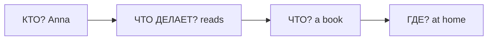

# Структура английского предложения

> [!abstract] Коротко
> - Порядок слов в английском почти всегда фиксирован: **кто → что делает → кого/что → где → когда**.
> - В полном предложении обязательно есть подлежащее и глагол. Нет действия — ставим `be`: `She is kind`.
> - Время и место обычно идут в конце: `We meet friends in the park on Sundays`.

<!-- beginner-intro:start -->
## Простыми словами

Представь предложение как маленькую сцену. Сначала назови героя: **кто?** Затем скажи, что он делает или какой он. Потом добавь детали. В `My sister reads a book` герой — `my sister`, действие — `reads`, предмет действия — `a book`. Грамматические названия просто помогают различать эти роли.

Собирай мысль по вопросам: **кто → что делает → что/кого → где → когда**. Не обязательно заполнять все места. Но в обычном полном предложении должны быть герой и глагол. Если действия нет, часто нужен `be`: «Она добрая» → `She is kind`.

### Наглядная схема

Читай слева направо: каждый блок отвечает на свой вопрос.

## Правило и схема
<!-- beginner-intro:end -->

В обычном утверждении сначала называем **подлежащее** — о ком говорим, затем **сказуемое** — действие или состояние. После них идут дополнение и обстоятельства. В отличие от русского, порядок слов обычно нельзя свободно менять.

## Схема

`S + глагол + (O) + (где) + (когда)`

| Часть речи | Роль | Пример |
| --- | --- | --- |
| Существительное | называет предмет или человека | book, Anna |
| Местоимение | заменяет имя или предмет | she, it |
| Глагол | действие или состояние | read, be |
| Прилагательное | признак предмета | interesting |
| Наречие | характеристика действия | slowly |

Дополнение нужно не каждому глаголу: `The baby sleeps`. Для состояния часто нужен `be`: `The baby is happy`.

<!-- beginner-examples:start -->
## Примеры с разбором

1. **Tom drinks tea.** — Том пьёт чай.  
   **Разбор:** `Tom` — кто; `drinks` — действие; `tea` — что он пьёт. Это три основных блока.
2. **The children sleep.** — Дети спят.  
   **Разбор:** после «спят» не нужно отвечать «что?». Поэтому предложение закончено без дополнения.
3. **My bag is heavy.** — Моя сумка тяжёлая.  
   **Разбор:** действия нет. `Is` связывает сумку с её признаком; по-русски отдельное «есть» не переводим.
4. **We meet our friends in the park on Sundays.** — По воскресеньям мы встречаемся с друзьями в парке.  
   **Разбор:** после героя и действия добавлены друзья, место и время. В английском начинаем с `we`, хотя русский перевод начинается со времени.
<!-- beginner-examples:end -->

## Дополнительные примеры

- **We read books at home.** — Мы читаем книги дома.
- **Anna works in London.** — Анна работает в Лондоне.
- **The room is quiet.** — В комнате тихо.

> [!warning] Частая ошибка
> В обычном полном предложении нельзя пропускать подлежащее и нужный глагол: **She is tired**, а не *Is tired* или *She tired*. Исключение: команды вроде **Stop!**

## Проверь себя

Сначала ответь сам, потом открой ответы: нажми на заголовок блока.

1. Собери предложение: *coffee / drinks / every morning / my dad*
2. Собери предложение: *at home / the children / are*
3. Исправь ошибку: *Is very cold today.*
4. Исправь ошибку: *In the evening I TV watch.*
5. Переведи: «Анна работает в Лондоне».
6. Найди подлежащее и сказуемое: *My new neighbour plays the piano at night.*

> [!success]- Ответы и пояснения
> 1. **My dad drinks coffee every morning.** — кто (`my dad`) → действие (`drinks`) → что (`coffee`) → когда (`every morning`).
> 2. **The children are at home.** — действия нет, поэтому связка `are` соединяет детей с местом.
> 3. **It is very cold today.** — у английского предложения должно быть подлежащее; здесь его роль выполняет `it`.
> 4. **In the evening I watch TV. / I watch TV in the evening.** — дополнение `TV` идёт после глагола, а не перед ним.
> 5. **Anna works in London.** — кто → действие → где; `works` с `-s`, потому что Анна = `she`.
> 6. **подлежащее — my new neighbour; сказуемое — plays** — всё, что стоит до глагола, описывает героя; `the piano` — дополнение, `at night` — время.

## Источники

- [Cambridge Dictionary — Word order and focus](https://dictionary.cambridge.org/us/grammar/british-grammar/word-order-and-focus_2)
- [Cambridge Dictionary — Subjects](https://dictionary.cambridge.org/grammar/british-grammar/subjects)
- [British Council — Clause structure and verb patterns](https://learnenglish.britishcouncil.org/free-resources/grammar/english-grammar-reference/clause-structure-verb-patterns)

---

[[000 - Оглавление|Оглавление]] · [[002 - Личные местоимения — I и me|Следующая тема →]]
