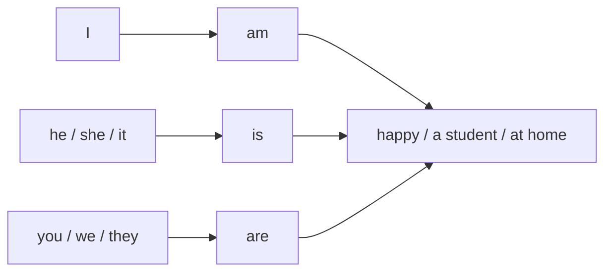

# To be в настоящем — am, is, are

> [!abstract] Коротко
> - По-русски «Я дома», а по-английски нужна связка: `I am at home`.
> - `I` → **am**, `he/she/it` и один предмет → **is**, `you/we/they` и несколько предметов → **are**.
> - Отрицание: `am/is/are + not`. Вопрос: переставь `be` вперёд — `Are you ready?`. Слово `do` не нужно.

<!-- beginner-intro:start -->
## Простыми словами

В русском мы говорим «Я дома», «Он врач», «Они устали» без глагола. В английском в таких предложениях ставят форму **be** — «быть». Она работает как связка между человеком и информацией о нём. `Am`, `is`, `are` — разные формы одного глагола.

Выбери героя: с `I` ставь `am`, с одним человеком или предметом — обычно `is`, с `you`, `we`, `they` — `are`. Для отрицания добавь `not`. Для вопроса поменяй местами героя и форму `be`. Отдельное `do` здесь не требуется.

### Наглядная схема

`Be` соединяет героя с информацией о нём. В настоящем выбираем форму по герою.

## Правило и схема
<!-- beginner-intro:end -->

`Be` соединяет человека или предмет с его характеристикой, профессией или местонахождением. В русском «есть» часто опускается, в английском форма `be` нужна.

| Подлежащее | Утверждение | Отрицание | Вопрос |
| --- | --- | --- | --- |
| I | am | am not | Am I…? |
| he, she, it | is | is not / isn't | Is she…? |
| you, we, they | are | are not / aren't | Are they…? |

Сокращения: `I'm`, `you're`, `he's`, `she's`, `it's`, `we're`, `they're`. В вопросе переставляем `be` перед подлежащим; `do` не добавляем.

<!-- beginner-examples:start -->
## Примеры с разбором

1. **I am tired.** — Я устал.  
   **Разбор:** это состояние, а не действие. После `I` нужна связка `am`.
2. **The keys are on the table.** — Ключи на столе.  
   **Разбор:** ключей несколько, поэтому `are`. Связка нужна и при указании места.
3. **He isn't a doctor.** — Он не врач.  
   **Разбор:** `isn't` = `is not`. Отрицаем профессию; `doesn't` не добавляем.
4. **Are you cold? — Yes, I am.** — Тебе холодно? — Да.  
   **Разбор:** в вопросе `are` стоит перед `you`. В ответе говорящий меняет `you` на `I`, поэтому выбирает `am`.
<!-- beginner-examples:end -->

## Дополнительные примеры

- **I'm a designer.** — Я дизайнер.
- **They aren't at home.** — Их нет дома.
- **Is your sister busy? — Yes, she is.** — Твоя сестра занята? — Да.

> [!warning] Частая ошибка
> **Are you ready?**, а не *Do you are ready?* В положительном коротком ответе не сокращаем: **Yes, I am**, а не *Yes, I'm*.

> [!tip] Дальше по теме
> [[021 - Сокращения — I'm, don't, 's и 'd|Сокращения — I'm, don't, 's и 'd]]

## Проверь себя

Сначала ответь сам, потом открой ответы: нажми на заголовок блока.

1. Вставь форму be: My parents ___ at work.
2. Вставь форму be: The weather ___ nice today.
3. Сделай отрицание: *I am hungry.*
4. Сделай вопрос: *She is a student.*
5. Исправь ошибку: *Do you are tired?*
6. Ответь кратко «да»: *Are you from Russia?*

> [!success]- Ответы и пояснения
> 1. **are** — родители — несколько людей (`they`) → `are`.
> 2. **is** — погода — одно явление (`it`) → `is`.
> 3. **I'm not hungry. / I am not hungry.** — `not` после `am`; форму `amn't` не используют.
> 4. **Is she a student?** — переставляем `is` перед `she`; `do` не нужен.
> 5. **Are you tired?** — с глаголом `be` вопрос строится перестановкой, без `do`.
> 6. **Yes, I am.** — в положительном кратком ответе `I am` не сокращаем до `I'm`.

## Источники

- [British Council — Present simple: 'to be'](https://learnenglish.britishcouncil.org/free-resources/grammar/a1-a2/present-simple-be)

---

[[002 - Личные местоимения — I и me|← Предыдущая тема]] · [[000 - Оглавление|Оглавление]] · [[004 - Have и have got — обладание|Следующая тема →]]
