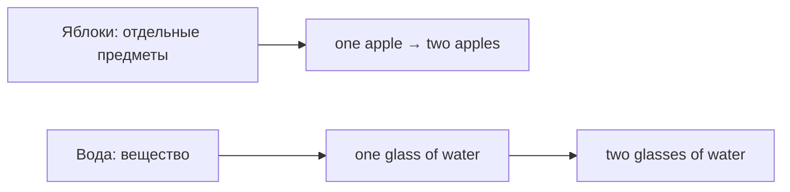

# Исчисляемые и неисчисляемые существительные

> [!abstract] Коротко
> - **Исчисляемые** считаем штуками: `a chair, two chairs`. **Неисчисляемые** — вещества и понятия: `water, advice, information`.
> - У неисчисляемых нет `a/an` и нет `-s`; количество выражаем порциями: `a glass of water`, `a piece of advice`.
> - Сомневаешься — смотри в словаре пометки `[C]` (countable) и `[U]` (uncountable).

<!-- beginner-intro:start -->
## Простыми словами

Английский различает предметы, которые принято считать **по отдельности**, и вещества или понятия, которые обычно считают **порциями**. Яблоко — отдельная штука: `an apple`, `two apples`. Вода — вещество: не «две воды», а `two glasses of water`.

Это свойство английского слова, а не физический запрет что-то посчитать. Например, русские «советы» передаются неисчисляемым `advice`. Чтобы назвать количество, добавь единицу: `a piece of advice`. Проверяй сомнительные слова в словаре: пометки `[C]` и `[U]` означают исчисляемое и неисчисляемое.

### Наглядная схема

Сравни, **что именно считаем**: предмет или ёмкость с веществом.

## Правило и схема
<!-- beginner-intro:end -->

**Исчисляемое** можно считать отдельными единицами: `one chair, two chairs`. **Неисчисляемое** обозначает вещество, массу или понятие без подсчёта отдельных единиц: `water, advice`.

| | Исчисляемое | Неисчисляемое |
| --- | --- | --- |
| Единственное число | a chair | water, не a water в общем значении |
| Количество | many chairs, a few chairs | much water, a little water |
| Глагол | The chair is / The chairs are | The water is |

Обычно неисчисляемы `information`, `advice`, `furniture`, `luggage`, `homework`, `news`. Считай порции: `a piece of advice`, `two bottles of water`.

Значение может менять исчисляемость: `chicken` — мясо, `a chicken` — птица; `two coffees` — две порции кофе.

<!-- beginner-examples:start -->
## Примеры с разбором

1. **I'd like an apple.** — Я бы хотел яблоко.  
   **Разбор:** яблоко можно назвать одной штукой, поэтому допустим артикль `an`.
2. **I'd like some water.** — Я бы хотел воды.  
   **Разбор:** `water` обозначает вещество. `Some` передаёт неопределённое количество, без `a`.
3. **We bought two bottles of water.** — Мы купили две бутылки воды.  
   **Разбор:** считаем бутылки: `bottles` во множественном числе. `Water` остаётся без `-s`.
4. **This furniture is expensive.** — Эта мебель дорогая.  
   **Разбор:** `furniture` неисчисляемое: не `furnitures`. Согласуем его с `is`, как единственное число.
<!-- beginner-examples:end -->

## Дополнительные примеры

- **We need three chairs.** — Нам нужны три стула.
- **This information is useful.** — Эта информация полезна.
- **She gave me two pieces of advice.** — Она дала мне два совета.

> [!warning] Частая ошибка
> **Some advice**, а не *an advice* или *advices*.

## Проверь себя

Сначала ответь сам, потом открой ответы: нажми на заголовок блока.

1. Выбери: Can you give me (an advice / some advice)?
2. Вставь a/an или ничего: I'd like ___ orange and ___ juice.
3. Вставь is или are: The news ___ good.
4. Исправь ошибку: *We bought new furnitures.*
5. Как сказать «три кусочка хлеба»?
6. Переведи: «Мне нужна информация».

> [!success]- Ответы и пояснения
> 1. **some advice** — `advice` неисчисляемое: без `an` и без `-s`.
> 2. **an orange, juice (без артикля)** — апельсин — штука; сок — жидкость.
> 3. **is** — `news` неисчисляемое, хотя оканчивается на `-s`.
> 4. **We bought new furniture.** — `furniture` не имеет множественного числа.
> 5. **three pieces of bread / three slices of bread** — считаем порции, `bread` остаётся без `-s`.
> 6. **I need some information. / I need information.** — `information` неисчисляемое, `an information` не бывает.

## Источники

- [British Council — Nouns: countable and uncountable](https://learnenglish.britishcouncil.org/free-resources/grammar/a1-a2/nouns-countable-uncountable)

---

[[006 - Множественное число существительных|← Предыдущая тема]] · [[000 - Оглавление|Оглавление]] · [[008 - Притяжательный падеж — 's и s'|Следующая тема →]]
