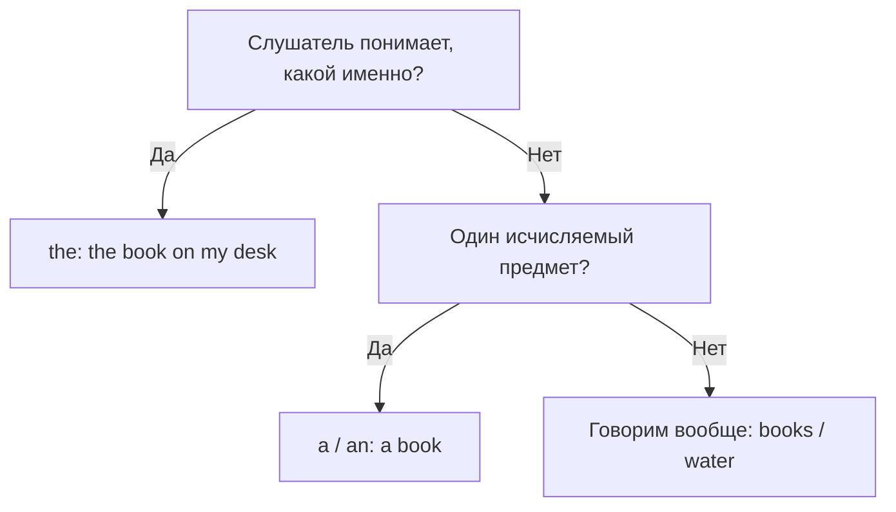

# Артикль the и отсутствие артикля

> [!abstract] Коротко
> - `the` = «тот самый, понятно какой»: уже упоминали, видно из ситуации или он единственный.
> - О вещах **вообще** во множественном числе и с неисчисляемыми — без артикля: `Cats are clever`, `Music helps`.
> - Перед `my, this, Anna's` артикль не нужен.

<!-- beginner-intro:start -->
## Простыми словами

`The` помогает собеседнику узнать: «ты понимаешь, о каком именно предмете я говорю». Он может быть уже упомянут, виден обоим или определяться описанием. Когда говорим о вещах **вообще**, с множественным числом и неисчисляемыми словами часто обходятся без артикля.

Задай себе вопрос: «Слушатель может определить, какие именно?» Да → обычно `the`. «Я говорю обо всех таких вещах в целом?» → часто нулевой артикль: `Dogs need exercise`. Нулевой артикль — это просто отсутствие слова перед существительным, а не знак, который нужно написать.

### Наглядная схема

Это начальная подсказка для обычных нарицательных существительных. У имён, географических названий и устойчивых выражений есть отдельные правила.

## Правило и схема
<!-- beginner-intro:end -->

`The` показывает: собеседник может понять, **какой именно** предмет или набор предметов имеется в виду. Подходит для единственного, множественного и неисчисляемого.

| Ситуация | Выбор |
| --- | --- |
| Предмет уже назван | I saw a dog. The dog was wet. |
| Предмет понятен из ситуации | Please close the door. |
| Уникальный в данном контексте | the sun, the manager of this shop |
| Предметы / понятие вообще | Ø Dogs need exercise. Ø Music helps me. |
| Конкретная группа / часть | the dogs next door, the music in this film |

Нулевой артикль обозначается `Ø`; писать этот знак не нужно. Перед `my`, `this`, `Anna's` дополнительный артикль не ставится.

<!-- beginner-examples:start -->
## Примеры с разбором

1. **I saw a dog. The dog followed me.** — Я увидел собаку. Эта собака пошла за мной.  
   **Разбор:** сначала вводим одну собаку через `a`; во второй фразе слушатель уже знает её → `the`.
2. **Please close the window.** — Пожалуйста, закрой окно.  
   **Разбор:** из ситуации понятно, какое окно имеется в виду. Раньше упоминать его необязательно.
3. **Music helps me relax.** — Музыка помогает мне расслабиться.  
   **Разбор:** музыка вообще, без указания конкретной записи. Неисчисляемое `music` употреблено без артикля.
4. **The music in this café is too loud.** — Музыка в этом кафе слишком громкая.  
   **Разбор:** теперь речь о конкретной музыке в конкретном месте. Поэтому нужно `the`.
<!-- beginner-examples:end -->

## Дополнительные примеры

- **The water in this bottle is cold.** — Вода в этой бутылке холодная.
- **Water is essential for life.** — Вода необходима для жизни.
- **Where is the key I gave you?** — Где ключ, который я тебе дал?

> [!tip] Проверка
> Спроси себя: «Может ли собеседник определить, какой именно?» Первое упоминание тоже может требовать **the**, если предмет уже понятен из ситуации.

> [!tip] Дальше по теме
> [[138 - Продвинутые артикли — the rich, a good knowledge of|Продвинутые артикли — the rich, a good knowledge of]]

## Проверь себя

Сначала ответь сам, потом открой ответы: нажми на заголовок блока.

1. Вставь a/the: I bought ___ dress and ___ hat. ___ dress is red.
2. Вставь the или ничего: ___ life is beautiful.
3. Вставь the или ничего: ___ milk in this bottle is sour.
4. Вставь the или ничего: I love ___ dogs.
5. Вставь the: Can you open ___ door, please?
6. Исправь ошибку: *A moon goes round the Earth.*

> [!success]- Ответы и пояснения
> 1. **a, a, The** — сначала вводим предметы через `a`, затем говорим об уже известном платье через `the`.
> 2. **— (без артикля)** — жизнь вообще, неисчисляемое в общем смысле.
> 3. **The** — конкретное молоко в этой бутылке.
> 4. **— (без артикля)** — собаки вообще.
> 5. **the** — из ситуации понятно, какую дверь.
> 6. **The moon goes round the Earth.** — Луна у Земли одна, она уникальна → `the`.

## Источники

- [British Council — Articles: 'a', 'an', 'the'](https://learnenglish.britishcouncil.org/free-resources/grammar/a1-a2-grammar/articles-a-an-the)
- [British Council — Articles: 'the' or no article](https://learnenglish.britishcouncil.org/free-resources/grammar/a1-a2-grammar/articles-the-or-no-article)

---

[[012 - Артикли a и an|← Предыдущая тема]] · [[000 - Оглавление|Оглавление]] · [[014 - Артикли с местами и устойчивыми выражениями|Следующая тема →]]
