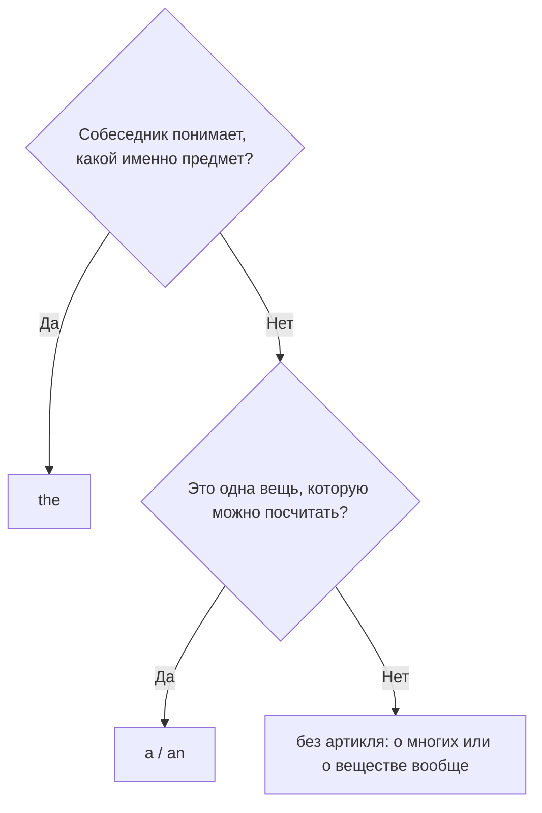

# Артикль the и отсутствие артикля

> [!abstract] Коротко
> **The** значит «тот самый — ты понимаешь, о каком я». **A** — «какой-то, один из». Без артикля говорим о вещах **вообще**: **I like coffee.**

## Суть

**The** произошло от слова **that** — «тот». Ставь его, когда собеседник точно знает, о каком предмете речь:

- **уже говорили о нём:** I bought **a** book. **The** book is about birds. — Купил (какую-то) книгу. Эта книга — о птицах.
- **понятно из ситуации:** Close **the** door. — Закрой дверь (ту, что в этой комнате).
- **он один такой:** **the** sun, **the** moon, **the** Earth.
- **есть уточнение:** **the** book **on my desk** — книга на моём столе.

А если говорим о вещах **вообще** — во множественном числе или о «веществах» — артикль не нужен: **Dogs are friendly. Music helps me relax.**

## Как выбрать

## Примеры

- **I like coffee.** — Я люблю кофе. *Кофе вообще.*
- **==The== coffee in this cup is cold.** — Кофе в этой чашке холодный. *Конкретный кофе.*
- **I love dogs.** — Я люблю собак. *Всех собак вообще.*
- **==The== dogs next door are noisy.** — Соседские собаки шумные. *Конкретные собаки.*

> [!tip] Как проверить
> Попробуй мысленно сказать «**тот самый**». Звучит естественно — скорее всего, нужен **the**.

> [!warning] Частые ошибки
> - ~~the my car~~ → **my car** — с my, your, this артикль не ставим.
> - ~~The life is beautiful.~~ → **Life is beautiful.** — жизнь вообще.
> - ~~A moon~~ → **The moon** — Луна одна.

## Проверь себя

Сначала ответь сам, потом открой ответы: нажми на заголовок блока.

1. Вставь a/the: I bought ___ dress and ___ hat. ___ dress is red.
2. Вставь the или ничего: ___ life is beautiful.
3. Вставь the или ничего: ___ milk in this bottle is sour.
4. Вставь the или ничего: I love ___ dogs.
5. Вставь the: Can you open ___ door, please?
6. Исправь ошибку: *A moon goes round the Earth.*

> [!success]- Ответы и пояснения
> 1. **a, a, The** — сначала знакомим с вещами через `a`, потом говорим о «том самом» платье через `the`.
> 2. **— (без артикля)** — жизнь вообще.
> 3. **The** — конкретное молоко, в этой бутылке.
> 4. **— (без артикля)** — собаки вообще, все.
> 5. **the** — из ситуации понятно, о какой двери речь.
> 6. **The moon goes round the Earth.** — Луна одна, значит `the`.

> [!info]- Источники
> - [British Council — Articles: 'a', 'an', 'the'](https://learnenglish.britishcouncil.org/free-resources/grammar/a1-a2-grammar/articles-a-an-the)
> - [British Council — Articles: 'the' or no article](https://learnenglish.britishcouncil.org/free-resources/grammar/a1-a2-grammar/articles-the-or-no-article)

---
[[012 - Артикли a и an|← Предыдущая тема]] · [[000 - Оглавление|Оглавление]] · [[014 - Артикли с местами и устойчивыми выражениями|Следующая тема →]]
