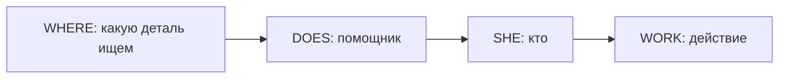

# Общие и специальные вопросы

> [!abstract] Коротко
> - **Общий вопрос** (да/нет): помощник + подлежащее + глагол — `Do you work?`, `Is she here?`, `Can you swim?`.
> - **Специальный вопрос**: вопросительное слово + тот же порядок — `Where do you work?`.
> - Нет своего помощника (Present/Past Simple)? Добавь `do/does/did`, а глагол верни в начальную форму.

<!-- beginner-intro:start -->
## Простыми словами

Общий вопрос проверяет всю мысль: «Ты работаешь?» — можно ответить «да/нет». Специальный вопрос просит конкретную деталь: «Где ты работаешь?» Для него добавляем слово `where`, `when`, `why` и сохраняем вопросительный порядок дальше.

Найди помощника: `be`, модальный глагол или `have` в Perfect. Перенеси его перед человеком. Если обычный глагол в Present/Past Simple стоит без помощника, добавь `do/does/did`; основной глагол после них возвращается к начальной форме. Вопросы к самому действующему лицу разбираются отдельно.

### Наглядная схема

Схема показывает обычные вопросы к детали, кроме вопросов к самому подлежащему.

## Правило и схема
<!-- beginner-intro:end -->

**Общий вопрос** допускает ответ «да/нет». **Специальный** начинается с вопросительного слова: `where`, `when`, `why`, `what`, `which`, `who`, `how`.

## Схемы

| Тип глагола | Вопрос |
| --- | --- |
| Be | (Where) + am/is/are/was/were + S…? |
| Модальный / вспомогательный | (Why) + can/have/will… + S + остальная часть? |
| Обычный глагол, Present/Past Simple | (Where) + do/does/did + S + V…? |

Если вспомогательных несколько, перед подлежащим идёт **первый**: `What have you been doing?`. `What` часто означает открытый выбор, `which` — выбор из ограниченного набора.

<!-- beginner-examples:start -->
## Примеры с разбором

1. **Are you hungry?** — Ты голоден?  
   **Разбор:** в утверждении было `you are`. Переставляем `are`, без добавления `do`.
2. **Do they live here?** — Они здесь живут?  
   **Разбор:** у `live` нет своего помощника, поэтому добавляем `do`.
3. **Where does Max work?** — Где работает Макс?  
   **Разбор:** `where` просит место; `does` задаёт вопрос о Максе, а `work` остаётся без `-s`.
4. **When did you arrive?** — Когда ты приехал?  
   **Разбор:** прошлое уже показано словом `did`; дальше `arrive`, не `arrived`.
<!-- beginner-examples:end -->

## Дополнительные примеры

- **Do you speak Spanish?** — Ты говоришь по-испански?
- **Why is he laughing?** — Почему он смеётся?
- **Which train should we take?** — На какой поезд нам сесть?

> [!warning] Частая ошибка
> **Where did she go?**, а не *Where did she went?* О вопросах «кто сделал?» см. [[018 - Вопрос к подлежащему — who called|Вопрос к подлежащему — who called]].

## Проверь себя

Сначала ответь сам, потом открой ответы: нажми на заголовок блока.

1. Сделай вопрос: *They live in Moscow.*
2. Сделай вопрос: *He can drive.*
3. Задай вопрос к выделенному: *She works **in a bank**.*
4. Задай вопрос к выделенному: *They arrived **yesterday**.*
5. Исправь ошибку: *Where you are going?*
6. Выбери: (What / Which) colour do you prefer — red or blue?

> [!success]- Ответы и пояснения
> 1. **Do they live in Moscow?** — обычный глагол в Present Simple → помощник `do`.
> 2. **Can he drive?** — у `can` свой помощник, просто переставляем.
> 3. **Where does she work?** — `does` берёт на себя `-s`, глагол становится `work`.
> 4. **When did they arrive?** — прошлое показывает `did`, поэтому `arrive`.
> 5. **Where are you going?** — помощник `are` должен стоять перед подлежащим.
> 6. **Which** — выбор из ограниченного набора вариантов.

## Источники

- [British Council — Question forms](https://learnenglish.britishcouncil.org/free-resources/grammar/a1-a2/question-forms)

---

[[016 - Формы глагола и окончания -s, -ed, -ing|← Предыдущая тема]] · [[000 - Оглавление|Оглавление]] · [[018 - Вопрос к подлежащему — who called|Следующая тема →]]
