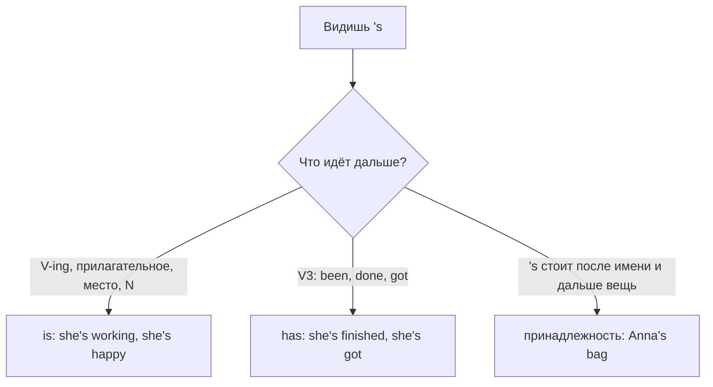

# Сокращения — I'm, don't, 's и 'd

> [!abstract] Коротко
> - Сокращение = слово + апостроф вместо пропущенных букв: `I am → I'm`, `do not → don't`.
> - `'s` бывает тремя разными словами: `is`, `has` или принадлежностью (`Anna's`). Различай по следующему слову.
> - `'d` = `would` (перед V) или `had` (перед V3). В кратком положительном ответе не сокращаем: `Yes, I am`.

<!-- beginner-intro:start -->
## Простыми словами

В живой речи англичане почти всегда сливают короткие служебные слова с соседними: вместо `I am` говорят `I'm`, вместо `do not` — `don't`. На письме пропущенные буквы заменяет апостроф `'`. Это не «неправильный» или «детский» английский: сокращения нормальны в разговоре, письмах друзьям, сообщениях и большинстве текстов. В официальных документах часто пишут полные формы.

Главная трудность — не написать, а **узнать** сокращение. `'s` и `'d` выглядят одинаково, но могут скрывать разные слова. Секрет простой: посмотри, что стоит **после** сокращения. Вот подсказка, которой можно пользоваться всегда: раскрой сокращение полностью и проверь, получилось ли правильное предложение.

### Наглядная схема

Как понять, что прячется за `'s`:

## Правило и схема
<!-- beginner-intro:end -->

Сокращения образуются от `be`, `have`, `will`, `would/had` и от отрицания `not`.

| Полная форма | Сокращение | Пример |
| --- | --- | --- |
| I am | I'm | I'm tired. |
| he/she/it is | he's / she's / it's | It's late. |
| you/we/they are | you're / we're / they're | They're here. |
| I/you/we/they have | I've / you've … | I've finished. |
| he/she/it has | he's / she's / it's | She's gone. |
| will | 'll | I'll call you. |
| would / had | 'd | I'd like… / I'd seen… |
| is not / are not | isn't / aren't | It isn't cold. |
| do not / does not / did not | don't / doesn't / didn't | I don't know. |
| have not / has not / had not | haven't / hasn't / hadn't | We haven't met. |
| cannot / could not | can't / couldn't | I can't swim. |
| will not / would not | won't / wouldn't | It won't work. |
| should not / must not | shouldn't / mustn't | You mustn't smoke. |

Особые формы: `will not → won't`, `cannot → can't`, `I am not → I'm not` (формы *amn't* нет; в вопросе-хвостике — `aren't I?`).

**Как раскрыть `'d`:** если дальше начальная форма глагола или `like/rather/better` → `would`; если дальше V3 → `had`: `I'd go` = I would go; `I'd gone` = I had gone. Исключение: `you'd better` = you **had** better.

**Где не сокращаем:** в кратком положительном ответе (`Yes, I am`, а не *Yes, I'm*), когда слово стоит в конце фразы (`I know where she is`, а не *where she's*), и обычно в официальных текстах.

<!-- beginner-examples:start -->
## Примеры с разбором

1. **She's a doctor, and she's got two kids.** — Она врач, и у неё двое детей.  
   **Разбор:** первое `she's` = `she is` (дальше существительное `a doctor`); второе = `she has` (дальше `got`).
2. **It's raining, and the dog is in its bed.** — Идёт дождь, а собака лежит на своей лежанке.  
   **Разбор:** `it's` = `it is`. `Its` без апострофа — не сокращение, а слово «его/её» о предмете или животном.
3. **I'd like a coffee. I'd never tried it before.** — Я бы хотел кофе. Я никогда раньше его не пробовал.  
   **Разбор:** `I'd like` = `I would like` (дальше начальная форма); `I'd tried` = `I had tried` (дальше V3).
4. **Are you ready? — Yes, I am.** — Ты готов? — Да.  
   **Разбор:** в коротком ответе форма стоит в конце и несёт ударение, поэтому сокращать `I am` нельзя.
<!-- beginner-examples:end -->

## Дополнительные примеры

- **We're late, aren't we?** — Мы опаздываем, да?
- **He's been to Paris twice.** — Он дважды бывал в Париже. (`he's` = `he has`)
- **They won't come.** — Они не придут.

> [!warning] Частая ошибка
> **It's** (= it is / it has) и **its** (принадлежность) — разные слова. Апостроф никогда не образует множественное число: **cars**, а не *car's*.

## Проверь себя

Сначала ответь сам, потом открой ответы: нажми на заголовок блока.

1. Раскрой сокращение: *She's working.*
2. Раскрой сокращение: *She's worked here for years.*
3. Раскрой сокращение: *I'd help you if I could.*
4. Раскрой сокращение: *When I arrived, they'd left.*
5. Сократи: *I will not tell anyone.*
6. Исправь ошибку: *Are you hungry? — Yes, I'm.*

> [!success]- Ответы и пояснения
> 1. **She is working.** — дальше `V-ing`, значит `is` (Present Continuous).
> 2. **She has worked here for years.** — дальше V3 `worked`, значит `has` (Present Perfect).
> 3. **I would help you…** — дальше начальная форма `help`, значит `would`.
> 4. **…they had left.** — дальше V3 `left`, значит `had` (Past Perfect).
> 5. **I won't tell anyone.** — `will not` сокращается в особую форму `won't`.
> 6. **Yes, I am.** — в коротком положительном ответе не сокращаем.

## Источники

- [Cambridge Dictionary — Contractions](https://dictionary.cambridge.org/grammar/british-grammar/contractions)
- [Cambridge Dictionary — It's or its](https://dictionary.cambridge.org/grammar/british-grammar/it-s-or-its)

---

[[020 - Повелительное наклонение и let's|← Предыдущая тема]] · [[000 - Оглавление|Оглавление]] · [[022 - Present Simple — привычки и факты|Следующая тема →]]
