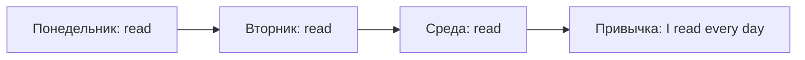

# Present Simple — привычки и факты

> [!abstract] Коротко
> - Present Simple — **как обычно бывает**: привычки, факты, расписания, постоянные ситуации.
> - `I/you/we/they work` · `he/she/it works`. Вопрос и отрицание — через `do/does`: `Does she work?`, `She doesn't work`.
> - После `does/doesn't` окончание `-s` у глагола исчезает.
> - Слова-подсказки: `usually, often, every day, on Mondays, once a week`.

<!-- beginner-intro:start -->
## Простыми словами

Present Simple показывает, **как обычно устроена жизнь**, а не кадр происходящего прямо сейчас. Подумай о привычке, расписании, профессии или факте: «работаю учителем», «пью чай по утрам». Название «настоящее простое» не означает «только в эту секунду».

Назови человека и действие. С `he/she/it` в утверждении добавь `-s`; с остальными оставь начальную форму. Для вопроса или отрицания возьми `do/does`. У `does` окончание уже есть, поэтому второе `-s` у действия не ставится.

### Наглядная схема

Здесь важна повторяемость. Чтение в эту секунду не утверждается.

## Правило и схема
<!-- beginner-intro:end -->

Present Simple описывает регулярные действия, факты, устойчивые ситуации и состояния. Действие не обязано происходить прямо сейчас.

| | I / you / we / they | He / she / it |
| --- | --- | --- |
| Утверждение | S + V | S + V-s |
| Отрицание | S + don't + V | S + doesn't + V |
| Вопрос | Do + S + V? | Does + S + V? |

Частые выражения: `every day`, `usually`, `sometimes`, `once a week`. Они помогают понять контекст, но время выбирается по смыслу. Глагол `be` использует собственные формы: [[003 - To be в настоящем — am, is, are|To be в настоящем — am, is, are]].

<!-- beginner-examples:start -->
## Примеры с разбором

1. **I read before bed.** — Я читаю перед сном.  
   **Разбор:** это привычка; необязательно, что сейчас у меня в руках книга.
2. **Mia reads before bed.** — Миа читает перед сном.  
   **Разбор:** Миа = `she`. В утверждении `read` получает окончание `-s`.
3. **Mia doesn't read newspapers.** — Миа не читает газеты.  
   **Разбор:** отрицание с `doesn't`; после него начальная форма `read`.
4. **Does water freeze at zero degrees Celsius?** — Вода замерзает при нуле градусов Цельсия?  
   **Разбор:** спрашиваем об общем факте. Неисчисляемое `water` согласуется как `it`, поэтому `does`.
<!-- beginner-examples:end -->

## Дополнительные примеры

- **I walk to work every day.** — Я каждый день хожу на работу пешком.
- **She teaches French.** — Она преподаёт французский.
- **Does this bus stop here?** — Этот автобус здесь останавливается?

> [!warning] Частая ошибка
> Окончание `-s` только в утверждении: **He works**, но **He doesn't work**.

> [!tip] Дальше по теме
> [[024 - Like, love, want и would like|Like, love, want и would like]] · [[027 - Present Simple или Present Continuous|Present Simple или Present Continuous]]

## Проверь себя

Сначала ответь сам, потом открой ответы: нажми на заголовок блока.

1. Вставь глагол в нужной форме: My brother ___ (live) in Kazan.
2. Вставь глагол в нужной форме: We ___ (not / eat) meat.
3. Сделай вопрос: *She speaks French.*
4. Вставь глагол: The shop ___ (open) at nine.
5. Исправь ошибку: *He don't like coffee.*
6. Исправь ошибку: *Does your dad works here?*

> [!success]- Ответы и пояснения
> 1. **lives** — `my brother` = `he` → `-s`.
> 2. **don't eat** — отрицание с `we` → `don't`.
> 3. **Does she speak French?** — `does` забирает `-s`, глагол — `speak`.
> 4. **opens** — расписание; `the shop` = `it`.
> 5. **He doesn't like coffee.** — с `he` помощник `does`.
> 6. **Does your dad work here?** — после `does` начальная форма.

## Источники

- [British Council — Present simple](https://learnenglish.britishcouncil.org/free-resources/grammar/a1-a2/present-simple)

---

[[021 - Сокращения — I'm, don't, 's и 'd|← Предыдущая тема]] · [[000 - Оглавление|Оглавление]] · [[023 - Наречия частотности — always и usually|Следующая тема →]]
