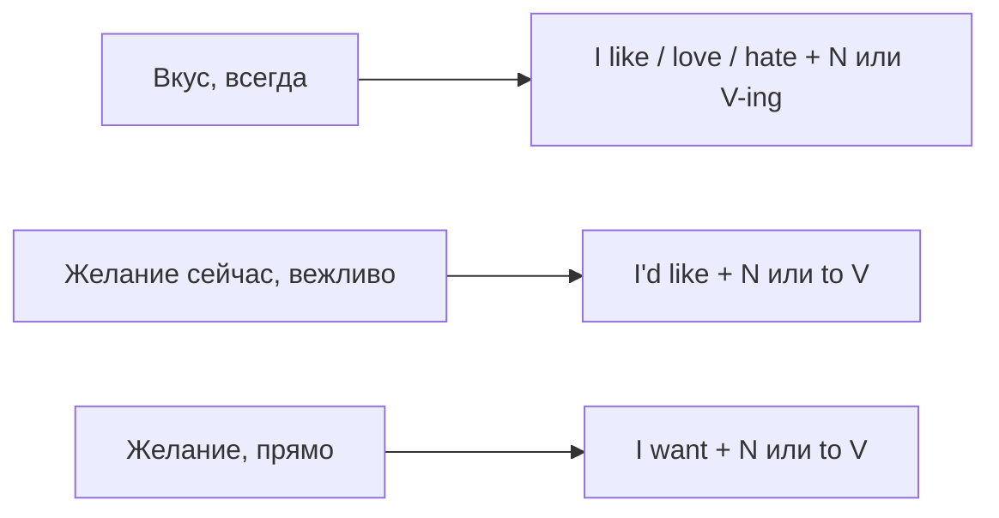

# Like, love, want и would like

> [!abstract] Коротко
> - `I like tea` — мне нравится чай **вообще** (всегда). `I'd like a tea` — я **хотел бы** чай сейчас (вежливая просьба).
> - После `like/love/hate` занятия — обычно `-ing`: `I like swimming`. После `would like` и `want` — `to + V`: `I'd like to swim`.
> - `Would you like…?` — вежливое предложение: `Would you like some tea?` Ответ: `Yes, please` / `No, thank you`.

<!-- beginner-intro:start -->
## Простыми словами

По-русски «Я люблю кофе» и «Я бы хотел кофе» звучат по-разному, и в английском тоже. `Like` и `love` говорят о вкусах — о том, что тебе нравится всегда. `Would like` — о желании прямо сейчас, причём очень вежливо. Официанту говорят `I'd like a coffee, please`, а не *I like a coffee*: вторая фраза означала бы «я вообще люблю кофе».

`Want` — тоже «хочу», но прямее и проще. В магазине или ресторане `I want…` может звучать резковато, поэтому вежливее `I'd like…`. Обрати внимание на подлежащее: «мне нравится» по-английски строится как «я нравлю»: `I like`, а не *me like*. То, что нравится, ставим после глагола.

### Наглядная схема

## Правило и схема
<!-- beginner-intro:end -->

| Смысл | Модель | Пример |
| --- | --- | --- |
| Нравится вообще | like / love / hate / enjoy + N | I like jazz. |
| Нравится занятие | like / love / hate + V-ing | She loves dancing. |
| Хочу (прямо) | want + N / to V | I want a new phone. I want to sleep. |
| Хотел бы (вежливо) | would like + N / to V | I'd like a ticket. I'd like to book a room. |
| Предложение | Would you like + N / to V? | Would you like to come? |
| Хочу, чтобы ты… | want / would like + кого + to V | I'd like you to stay. |

`Like` и `want` — обычные глаголы: вопрос и отрицание через `do/does`: `Do you like it?`, `She doesn't want to go`. У `would like` вопрос строится перестановкой `would`: `Would you like…?`

После `like/love/hate` возможно и `to V` (`I like to get up early`), особенно о привычках и выборе, но для начала надёжнее `-ing`. После `enjoy` — только `-ing`.

<!-- beginner-examples:start -->
## Примеры с разбором

1. **I like coffee, but I don't like tea.** — Я люблю кофе, но не люблю чай.  
   **Разбор:** вкусы вообще → `like`. Отрицание обычного глагола через `don't`.
2. **I'd like a coffee, please.** — Мне, пожалуйста, кофе.  
   **Разбор:** просьба сейчас → `would like`. `I'd` = `I would`. Здесь `a coffee` — «одна чашка кофе».
3. **She loves swimming in the sea.** — Она обожает плавать в море.  
   **Разбор:** занятие после `love` → форма `-ing`.
4. **Would you like to join us? — Yes, I'd love to.** — Хочешь присоединиться к нам? — С удовольствием.  
   **Разбор:** вежливое приглашение `Would you like to…?`; в ответе `to` сохраняем, а глагол не повторяем.
<!-- beginner-examples:end -->

## Дополнительные примеры

- **Do you want something to eat?** — Хочешь чего-нибудь поесть?
- **My son hates getting up early.** — Мой сын терпеть не может рано вставать.
- **I'd like you to meet my sister.** — Я хочу познакомить тебя с моей сестрой.

> [!warning] Частая ошибка
> **I'd like to go**, а не *I'd like go*. «Мне нравится» = **I like**, а не *Me like* и не *It likes me*. В кафе: **I'd like…**, а не *I like…*.

## Проверь себя

Сначала ответь сам, потом открой ответы: нажми на заголовок блока.

1. Выбери: (I like / I'd like) a glass of water, please.
2. Выбери: (I like / I'd like) reading detective stories. Это моё хобби.
3. Вставь форму: My dad loves ___ (cook).
4. Вставь форму: I'd like ___ (book) a table for two.
5. Сделай вопрос: *She likes football.*
6. Исправь ошибку: *Would you like a tea? — Yes, I would like.*

> [!success]- Ответы и пояснения
> 1. **I'd like** — вежливая просьба сейчас.
> 2. **I like** — постоянный вкус.
> 3. **cooking** — после `love` занятие обычно в форме `-ing`.
> 4. **to book** — после `would like` нужно `to + V`.
> 5. **Does she like football?** — `like` — обычный глагол, вопрос через `does`.
> 6. **Yes, please.** — на предложение отвечают `Yes, please`; фраза *I would like* без продолжения неполная.

## Источники

- [Cambridge Dictionary — Like](https://dictionary.cambridge.org/grammar/british-grammar/like)
- [Cambridge Dictionary — Would like](https://dictionary.cambridge.org/grammar/british-grammar/would-like)
- [Cambridge Dictionary — Hate, like, love and prefer](https://dictionary.cambridge.org/grammar/british-grammar/hate-like-love-and-prefer)

---

[[023 - Наречия частотности — always и usually|← Предыдущая тема]] · [[000 - Оглавление|Оглавление]] · [[025 - Present Continuous — процесс сейчас|Следующая тема →]]
