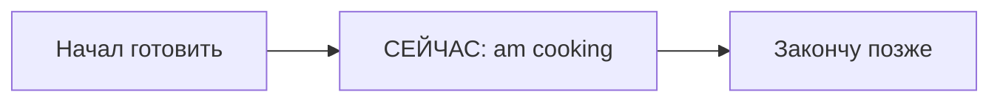

# Present Continuous — процесс сейчас

> [!abstract] Коротко
> - Present Continuous — действие **в процессе сейчас** или временная ситуация «в эти дни».
> - Формула: `am/is/are + V-ing`. Без `am/is/are` не работает: `She is reading`.
> - Вопрос: `Are you working?` Отрицание: `I'm not working`. Помощник `do` не нужен.

<!-- beginner-intro:start -->
## Простыми словами

Представь видеозапись: действие уже идёт, а мы смотрим на него изнутри. Для такого «сейчас в процессе» нужен Present Continuous. Это может быть буквально эта минута или временный период: например, сейчас ты несколько недель работаешь над проектом.

Собери **две обязательные части**: подходящее `am/is/are` и действие с `-ing`. Одного `-ing` недостаточно. Сравни «обычно работаю дома» (`I work`) и «на этой неделе работаю дома» (`I'm working`). Выбор зависит от взгляда на ситуацию, а не только от слова `now`.

### Наглядная схема

Точка «сейчас» находится внутри процесса; конец действия ещё не показан.

## Правило и схема
<!-- beginner-intro:end -->

Present Continuous показывает действие в процессе сейчас или вокруг настоящего момента, временную ситуацию и происходящее изменение. «Сейчас» может быть периодом: этой неделей или текущим проектом.

## Схема

- Утверждение: `S + am/is/are + V-ing`.
- Отрицание: `S + am/is/are + not + V-ing`.
- Вопрос: `Am/Is/Are + S + V-ing?`

Сравни: `I work at a bank` — моя постоянная работа; `I'm working from home this week` — временный режим. Глаголы состояния обычно требуют Simple: [[026 - Глаголы состояния — know, want, have|Глаголы состояния — know, want, have]]. Для будущей договорённости эта же форма используется в [[043 - Present Continuous и Present Simple для будущего|Present Continuous и Present Simple для будущего]].

<!-- beginner-examples:start -->
## Примеры с разбором

1. **I'm making dinner.** — Я готовлю ужин.  
   **Разбор:** готовка сейчас в процессе. `I'm` = `I am`, затем `making`.
2. **She's staying with us this week.** — На этой неделе она живёт у нас.  
   **Разбор:** временная ситуация вокруг настоящего; необязательно, что она прямо сейчас дома.
3. **It isn't raining now.** — Сейчас дождь не идёт.  
   **Разбор:** `not` добавлено к `is`; форма `raining` сохраняется.
4. **What are you reading?** — Что ты читаешь?  
   **Разбор:** сначала вопросительное слово, затем `are`, человек и `reading`. Помощник `do` не нужен.
<!-- beginner-examples:end -->

## Дополнительные примеры

- **I'm listening to a podcast.** — Я слушаю подкаст.
- **Prices are rising.** — Цены растут.
- **Are you using this chair?** — Ты пользуешься этим стулом?

> [!warning] Частая ошибка
> Не пропускай `be`: **She is reading**, а не *She reading*. **Now** само по себе не требует Continuous: **I understand now**.

> [!tip] Дальше по теме
> [[027 - Present Simple или Present Continuous|Present Simple или Present Continuous]]

## Проверь себя

Сначала ответь сам, потом открой ответы: нажми на заголовок блока.

1. Вставь глагол: Listen! Somebody ___ (sing).
2. Вставь глагол: I ___ (not / work) this week; I'm on holiday.
3. Сделай вопрос: *They are watching a film.*
4. Исправь ошибку: *She reading a book now.*
5. Исправь ошибку: *What do you doing?*
6. Выбери: Look! It (snows / is snowing).

> [!success]- Ответы и пояснения
> 1. **is singing** — действие идёт прямо сейчас.
> 2. **am not working / I'm not working** — временная ситуация этой недели.
> 3. **Are they watching a film?** — `are` переставляем вперёд.
> 4. **She is reading a book now.** — без `is` формы Continuous нет.
> 5. **What are you doing?** — в Continuous помощник — `be`, а не `do`.
> 6. **is snowing** — видим процесс сейчас.

## Источники

- [Cambridge Dictionary — Be](https://dictionary.cambridge.org/it/grammatica/grammatica-britannico/be-expressions-with-be)
- [British Council — Stative verbs](https://learnenglish.britishcouncil.org/free-resources/grammar/b1-b2/stative-verbs)
- [British Council — Present continuous](https://learnenglish.britishcouncil.org/comment/146642)

---

[[024 - Like, love, want и would like|← Предыдущая тема]] · [[000 - Оглавление|Оглавление]] · [[026 - Глаголы состояния — know, want, have|Следующая тема →]]
