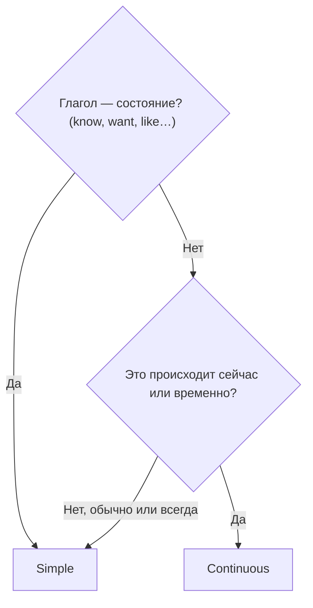

# Present Simple или Present Continuous

> [!abstract] Коротко
> **Simple** — «обычно, всегда, вообще»: **I work at a school.** **Continuous** — «сейчас, временно, в процессе»: **I'm working at home today.**

## Суть

Представь два способа показать жизнь человека:

- **Simple — это его анкета.** Где живёт, где работает, что любит, что делает каждый день. Постоянное.
- **Continuous — это фото прямо сейчас.** Что он делает в этот момент или в этот период. Временное.

| Simple — анкета | Continuous — фото |
| --- | --- |
| I **work** at a school. — работаю (постоянно) | I'm **working** at home today. — сегодня (временно) |
| He **reads** every evening. — привычка | He's **reading** now. — сейчас |
| Water **freezes** at 0°C. — факт | The lake **is freezing**. — замерзает (меняется) |

## Как выбрать

## Примеры

- **How often do you go to the gym?** — Как часто ты ходишь в зал? *Привычка.*
- **I'm staying at a hotel until my flat is ready.** — Живу в отеле, пока квартира не готова. *Временно.*
- **My grandparents live in a village.** — Бабушка с дедушкой живут в деревне. *Постоянно.*
- **I think you're right.** — Думаю, ты прав. *Мнение — состояние.*

> [!tip] Слова-подсказки
> **always, usually, every day, often** → чаще Simple. **now, at the moment, today, this week, Look!** → чаще Continuous. Но слово — только подсказка, решает смысл.

> [!warning] Частые ошибки
> - ~~Look! It rains.~~ → **Look! It's raining.** — процесс прямо сейчас.
> - ~~I'm going to the gym every day.~~ → **I go to the gym every day.** — привычка.
> - ~~I'm thinking you're right.~~ → **I think you're right.** — мнение.

## Проверь себя

Сначала ответь сам, потом открой ответы: нажми на заголовок блока.

1. Выбери: Shh! The baby (sleeps / is sleeping).
2. Выбери: My grandparents (live / are living) in a village. Это их постоянный дом.
3. Выбери: I (stay / am staying) at a hotel until my flat is ready.
4. Выбери: How often (do you go / are you going) to the gym?
5. Выбери: I (think / am thinking) you're right.
6. Исправь ошибку: *Look! It rains.*

> [!success]- Ответы и пояснения
> 1. **is sleeping** — «Тише!» — ребёнок спит прямо сейчас.
> 2. **live** — постоянный дом, «анкета».
> 3. **am staying** — временно, пока квартира не готова.
> 4. **do you go** — вопрос о привычке.
> 5. **think** — «считаю», это мнение, состояние.
> 6. **Look! It's raining.** — «Смотри!» — дождь идёт сейчас.

> [!info]- Источники
> - [Cambridge Dictionary — Present simple or present continuous?](https://dictionary.cambridge.org/grammar/british-grammar/present-simple-or-present-continuous)
> - [British Council — Stative verbs](https://learnenglish.britishcouncil.org/free-resources/grammar/b1-b2/stative-verbs)

---
[[026 - Глаголы состояния — know, want, have|← Предыдущая тема]] · [[000 - Оглавление|Оглавление]] · [[028 - Past Simple — завершённое прошлое|Следующая тема →]]
