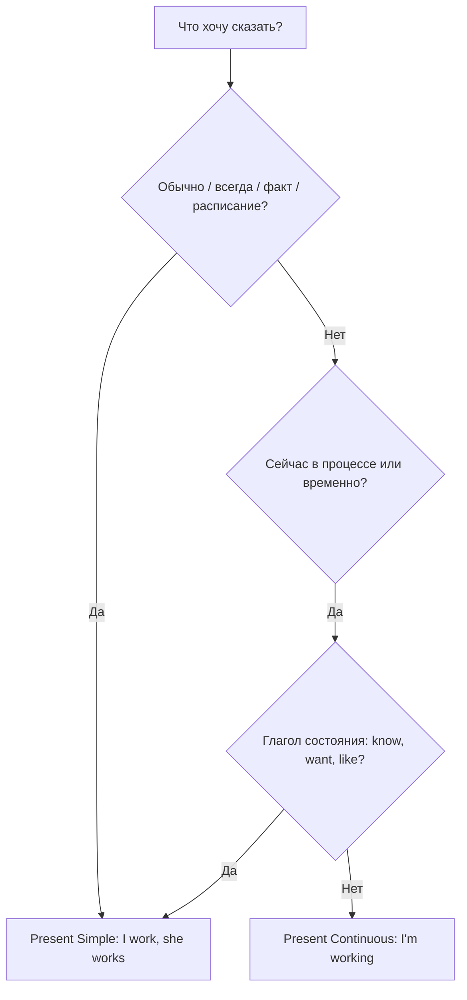

# Present Simple или Present Continuous

> [!abstract] Коротко
> - **Simple** — как обычно, всегда, постоянно: `I work in a bank`.
> - **Continuous** — сейчас, в процессе, временно: `I'm working from home this week`.
> - Глаголы состояния (`know, want, like, need`) обычно остаются в Simple даже «сейчас»: `I know`, не *I'm knowing*.

<!-- beginner-intro:start -->
## Простыми словами

Русское «Я работаю» может означать и «у меня есть работа», и «сейчас я занят делом». Английский требует выбрать. Представь две картинки. Первая — **фотография с подписью «как обычно»**: «Он водит автобус» (это его профессия). Вторая — **кадр видео прямо сейчас**: «Он ведёт автобус» (в эту минуту он за рулём).

Задай себе два вопроса. «Это обычно, постоянно, по расписанию?» → Simple. «Это происходит сейчас или только в этот период, временно?» → Continuous. Слова-подсказки помогают, но не решают за тебя: даже со словом `now` бывает Simple — `I understand now`.

### Наглядная схема

## Правило и схема
<!-- beginner-intro:end -->

| | Present Simple | Present Continuous |
| --- | --- | --- |
| Смысл | привычка, факт, постоянное, расписание | процесс сейчас, временное, меняющееся |
| Формула | S + V(-s); do/does | S + am/is/are + V-ing |
| Подсказки | usually, always, every day, often, never | now, at the moment, today, this week, Look!, Listen! |
| Пример | She **teaches** maths. | She**'s teaching** a class now. |
| Постоянное ↔ временное | I **live** in Kazan. | I**'m living** with friends until I find a flat. |
| Факт ↔ изменение | The population **grows** every year. | The city **is growing** fast. |

**Раздражающая привычка**: `always` + Continuous — `You're always losing your keys!` (с оттенком недовольства).

**Глаголы состояния** (`know, understand, believe, like, love, hate, want, need, prefer, own, belong, seem`) обычно не ставят в Continuous. Подробнее: [[026 - Глаголы состояния — know, want, have|Глаголы состояния — know, want, have]].

<!-- beginner-examples:start -->
## Примеры с разбором

1. **Tom drives a bus. Right now he's driving to the depot.** — Том водит автобус. Прямо сейчас он едет в депо.  
   **Разбор:** профессия — постоянный факт → Simple; поездка в эту минуту → Continuous.
2. **I usually walk to work, but this week I'm taking the bus.** — Обычно я хожу на работу пешком, но на этой неделе езжу на автобусе.  
   **Разбор:** привычка с `usually` → Simple; временное изменение «на этой неделе» → Continuous.
3. **What do you do? — I'm a nurse. What are you doing? — I'm reading.** — Кем ты работаешь? — Медсестрой. Что ты делаешь? — Читаю.  
   **Разбор:** `What do you do?` спрашивает о профессии, `What are you doing?` — о занятии сейчас.
4. **I don't understand this word.** — Я не понимаю это слово.  
   **Разбор:** понимание — состояние, поэтому Simple, хотя речь о текущем моменте.
<!-- beginner-examples:end -->

## Дополнительные примеры

- **Water boils at 100°C. Look — the water's boiling!** — Вода кипит при 100°C. Смотри, вода кипит!
- **She's always interrupting me!** — Она вечно меня перебивает!
- **Prices are going up.** — Цены растут.

> [!warning] Частая ошибка
> **What do you do?** — «Кем ты работаешь?», а не «Что ты делаешь?». И не ставь Continuous с `know/want/like`: **I want a coffee**, а не *I'm wanting*.

## Проверь себя

Сначала ответь сам, потом открой ответы: нажми на заголовок блока.

1. Выбери: Shh! The baby (sleeps / is sleeping).
2. Выбери: My grandparents (live / are living) in a village.
3. Выбери: I (stay / am staying) at a hotel until my flat is ready.
4. Выбери: How often (do you go / are you going) to the gym?
5. Выбери: I (think / am thinking) you're right.
6. Исправь ошибку: *Look! It rains.*

> [!success]- Ответы и пояснения
> 1. **is sleeping** — процесс прямо сейчас.
> 2. **live** — постоянная ситуация.
> 3. **am staying** — временная ситуация.
> 4. **do you go** — вопрос о привычке, частоте.
> 5. **think** — здесь `think` = «считаю», состояние.
> 6. **Look! It's raining.** — `Look!` показывает, что процесс идёт сейчас.

## Источники

- [Cambridge Dictionary — Present simple or present continuous?](https://dictionary.cambridge.org/grammar/british-grammar/present-simple-or-present-continuous)
- [British Council — Stative verbs](https://learnenglish.britishcouncil.org/free-resources/grammar/b1-b2/stative-verbs)

---

[[026 - Глаголы состояния — know, want, have|← Предыдущая тема]] · [[000 - Оглавление|Оглавление]] · [[028 - Past Simple — завершённое прошлое|Следующая тема →]]
