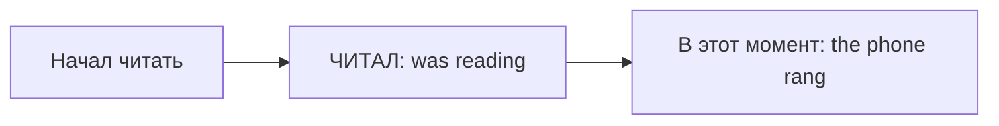

# Past Continuous и Past Simple — фон и событие

> [!abstract] Коротко
> - Past Continuous (`was/were + V-ing`) — **фон**: что происходило в тот момент.
> - Past Simple — **событие** на этом фоне: `I was cooking when the phone rang`.
> - `while` + два параллельных процесса: `While I was cooking, he was reading`.

<!-- beginner-intro:start -->
## Простыми словами

Past Continuous — словно кадр из вчерашней видеозаписи: в выбранный момент действие **уже шло**. Past Simple рассказывает о событии целиком. Дело не в том, сколько минут оно длилось: даже долгая поездка может быть представлена как один завершённый факт.

Сначала выбери точку в прошлом: «в восемь», «когда он пришёл». Что происходило в этот момент? Для фона используй `was/were + -ing`. Что случилось на этом фоне? Часто Past Simple. Слова `when/while` помогают соединить части, но сами по себе не определяют время.

### Наглядная схема

Фон уже шёл, когда произошло другое событие.

## Правило и схема
<!-- beginner-intro:end -->

Past Continuous показывает действие **в процессе в момент прошлого**. Past Simple представляет событие целиком. Часто длительный процесс создаёт фон, а короткое событие происходит на этом фоне.

## Схема

- `S + was/were + V-ing`.
- `S + wasn't/weren't + V-ing`.
- `Was/Were + S + V-ing?`

| Смысл | Пример |
| --- | --- |
| Процесс в момент прошлого | At six, I was cooking. |
| Событие на фоне | I was cooking when she called. |
| Два одновременных процесса | I was cooking while he was reading. |

`When` и `while` не выбирают время автоматически: важно, представляем ли действие как процесс или событие.

<!-- beginner-examples:start -->
## Примеры с разбором

1. **At nine, I was studying.** — В девять я занимался.  
   **Разбор:** девять часов — точка наблюдения; занятие уже находилось в процессе.
2. **I was studying when the lights went out.** — Я занимался, когда погас свет.  
   **Разбор:** учёба — фон с `was studying`; отключение — событие с `went out`.
3. **While I was cooking, Sam was washing the dishes.** — Пока я готовил, Сэм мыл посуду.  
   **Разбор:** описываем два процесса, которые шли одновременно; в обеих частях Continuous.
4. **I cooked dinner and watched a film.** — Я приготовил ужин и посмотрел фильм.  
   **Разбор:** перечисляем завершённые события по порядку, поэтому обе формы Past Simple.
<!-- beginner-examples:end -->

## Дополнительные примеры

- **It was raining when we left.** — Когда мы вышли, шёл дождь.
- **I wasn't sleeping at midnight.** — В полночь я не спал.
- **What were you doing at five?** — Что ты делал в пять?

> [!tip] Сравни
> **When I arrived, he cooked dinner** — приготовил после моего прихода. **…he was cooking dinner** — уже готовил.

> [!tip] Дальше по теме
> [[040 - Повествовательные времена — как рассказать историю|Повествовательные времена — как рассказать историю]]

## Проверь себя

Сначала ответь сам, потом открой ответы: нажми на заголовок блока.

1. Вставь глаголы: I ___ (have) a shower when the doorbell ___ (ring).
2. Вставь глагол: At 8 o'clock yesterday we ___ (watch) TV.
3. Вставь глаголы: While she ___ (drive), she ___ (listen) to music.
4. Вставь глаголы: He ___ (open) the door, ___ (come) in and ___ (sit) down.
5. Сделай вопрос: *You were sleeping at midnight.*
6. Исправь ошибку: *When I arrived, they were have dinner.*

> [!success]- Ответы и пояснения
> 1. **was having, rang** — душ — процесс-фон, звонок — событие.
> 2. **were watching** — процесс в конкретный момент прошлого.
> 3. **was driving, was listening** — два одновременных процесса.
> 4. **opened, came, sat** — последовательные события — Past Simple.
> 5. **Were you sleeping at midnight?** — `were` переходит вперёд.
> 6. **When I arrived, they were having dinner.** — после `were` нужна форма `-ing`.

## Источники

- [British Council — Past continuous and past simple](https://learnenglish.britishcouncil.org/free-resources/grammar/a1-a2/past-continuous-past-simple)

---

[[029 - To be в прошлом — was и were|← Предыдущая тема]] · [[000 - Оглавление|Оглавление]] · [[031 - Used to и would — прошлые привычки|Следующая тема →]]
