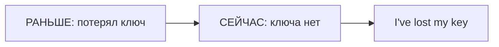

# Present Perfect — связь прошлого с настоящим

> [!abstract] Коротко
> - Present Perfect (`have/has + V3`) смотрит на прошлое **из сегодня**: опыт, результат сейчас, незаконченный период.
> - Нет точного прошлого времени: `I've been to Rome` (когда — неважно).
> - `been to` — побывал и вернулся; `gone to` — уехал и ещё там.

<!-- beginner-intro:start -->
## Простыми словами

Present Perfect смотрит на прошлое **из точки «сейчас»**. Мы спрашиваем: какой у меня опыт к этому моменту, какой результат есть сейчас, сколько уже сделано? Точная дата часто не важна. «Я потерял ключ» может означать «сейчас не могу открыть дверь».

Собери `have/has + V3`: третью форму ищи в таблице неправильных глаголов или добавляй `-ed` у правильных. Это не всегда «действие закончилось»: `I've known her for years` описывает знание, которое продолжается. При явно законченном времени вроде `yesterday` обычно нужен Past Simple.

### Наглядная схема

Стрелка показывает связь прошлого события с нынешним результатом, а не просто календарный порядок.

## Правило и схема
<!-- beginner-intro:end -->

Present Perfect показывает прошлое **с точки зрения настоящего**: опыт к текущему моменту, результат сейчас, события в ещё не завершившемся периоде или состояние, которое продолжается.

## Схема

- `S + have/has + V3`.
- `S + haven't/hasn't + V3`.
- `Have/Has + S + V3?`

| Смысл | Пример |
| --- | --- |
| Опыт без точной даты | I've visited Prague. |
| Результат сейчас | I've lost my wallet. |
| Незаконченный период | She's called twice today. |
| Состояние до настоящего | We've known him for years. |

`Been to` — побывал и вернулся; `gone to` — ушёл/уехал и ещё не вернулся.

<!-- beginner-examples:start -->
## Примеры с разбором

1. **I've lost my key.** — Я потерял ключ.  
   **Разбор:** важен нынешний результат: ключа сейчас нет. `I've` = `I have`, `lost` — V3.
2. **Have you ever ridden a horse?** — Ты когда-нибудь ездил верхом?  
   **Разбор:** спрашиваем об опыте за жизнь до настоящего момента, без конкретной даты.
3. **We've lived here for five years.** — Мы живём здесь пять лет.  
   **Разбор:** жизнь началась раньше и продолжается сейчас. Русское настоящее может соответствовать английскому Perfect.
4. **She has been to Italy, but she's at home now.** — Она бывала в Италии, но сейчас дома.  
   **Разбор:** `has been to` сообщает о поездке с возвращением; `has gone to` означало бы, что она ещё не вернулась.
<!-- beginner-examples:end -->

## Дополнительные примеры

- **Have you ever tried surfing?** — Ты когда-нибудь пробовал сёрфинг?
- **He has gone to the shop.** — Он ушёл в магазин.
- **I haven't finished the report.** — Я ещё не закончил отчёт.

> [!warning] Частая ошибка
> Для указанного завершённого прошлого обычно нужен Past Simple: **I saw her yesterday**. Подробнее: [[034 - Present Perfect или Past Simple|Present Perfect или Past Simple]].

## Проверь себя

Сначала ответь сам, потом открой ответы: нажми на заголовок блока.

1. Вставь глагол: I ___ (lose) my keys. I can't open the door.
2. Вставь глагол: ___ you ever ___ (try) sushi?
3. Вставь глагол: She ___ (not / finish) her homework.
4. Выбери: Tom isn't here. He's (been / gone) to the bank.
5. Исправь ошибку: *I have saw this film.*
6. Исправь ошибку: *Have you visited Paris last year?*

> [!success]- Ответы и пояснения
> 1. **have lost / I've lost** — важен результат сейчас.
> 2. **Have, tried** — опыт за всю жизнь до сейчас.
> 3. **hasn't finished** — `she` → `has`; отрицание `hasn't`.
> 4. **gone** — он ушёл и ещё не вернулся.
> 5. **I have seen this film.** — после `have` нужна V3: `see — saw — seen`.
> 6. **Did you visit Paris last year?** — `last year` — законченное время → Past Simple.

## Источники

- [British Council — Present perfect](https://learnenglish.britishcouncil.org/free-resources/grammar/b1-b2/present-perfect)

---

[[032 - Be used to и get used to — привыкнуть|← Предыдущая тема]] · [[000 - Оглавление|Оглавление]] · [[034 - Present Perfect или Past Simple|Следующая тема →]]
