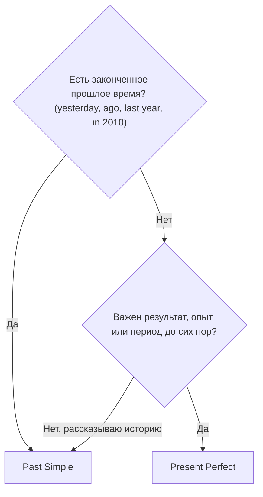

# Present Perfect или Past Simple

> [!abstract] Коротко
> **Past Simple** — рассказ о прошлом: **когда** это было. **Present Perfect** — итог **на сейчас**: что есть, что успел, какой опыт. Есть точное прошлое время (вчера, в 2010) — почти всегда Past Simple.

## Суть

Представь два вопроса:

- «**Когда** это было?» → **Past Simple**. Событие привязано к моменту в прошлом.
- «**Что в итоге сейчас?**» → **Present Perfect**. Момент не важен, важен результат.

| Past Simple — «тогда» | Present Perfect — «итог сейчас» |
| --- | --- |
| I **lost** my keys yesterday. | I'**ve lost** my keys. I can't get in. |
| She **lived** here from 2010 to 2015. (больше не живёт) | She'**s lived** here since 2010. (и сейчас живёт) |
| **Did** you **see** him last week? | **Have** you **seen** him this week? (неделя ещё идёт) |

## Как выбрать

## Как это звучит в разговоре

Часто разговор **начинается** с Present Perfect (общий вопрос), а потом переходит в Past Simple (подробности):

- **Have you met Leo?** — Ты знаком с Лео? *(опыт)*
- **Yes, I met him last year.** — Да, познакомились в прошлом году. *(когда)*

## Примеры

- **I finished the report an hour ago.** — Я закончил отчёт час назад.
- **I've finished the report. Here it is.** — Я закончил отчёт. Вот он.
- **We haven't had any rain this month.** — В этом месяце не было дождей. *(месяц ещё идёт)*

> [!tip] Слова-сигналы
> **ago, yesterday, last…, in 2010, when?** → Past Simple. **ever, never, already, yet, just, so far** → обычно Present Perfect.

> [!warning] Частые ошибки
> - ~~When have you arrived?~~ → **When did you arrive?** — вопрос «когда?» — всегда про момент в прошлом.
> - ~~I have seen him yesterday.~~ → **I saw him yesterday.**

## Проверь себя

Сначала ответь сам, потом открой ответы: нажми на заголовок блока.

1. Выбери: I (have finished / finished) the report an hour ago.
2. Выбери: I (have finished / finished) the report. Here it is.
3. Выбери: She (has lived / lived) in Paris from 2010 to 2015.
4. Выбери: — (Have you seen / Did you see) the new Bond film? — Yes, I (have seen / saw) it on Friday.
5. Выбери: We (haven't had / didn't have) any rain so far this month.
6. Исправь ошибку: *When have you arrived?*

> [!success]- Ответы и пояснения
> 1. **finished** — «час назад» — точный момент в прошлом.
> 2. **have finished** — важен результат: отчёт готов, вот он.
> 3. **lived** — период закончился в 2015 году.
> 4. **Have you seen; saw** — сначала общий вопрос об опыте, потом конкретный день — пятница.
> 5. **haven't had** — «пока что в этом месяце»: месяц ещё не закончился.
> 6. **When did you arrive?** — вопрос «когда?» требует Past Simple.

> [!info]- Источники
> - [British Council — Present perfect](https://learnenglish.britishcouncil.org/free-resources/grammar/b1-b2/present-perfect)
> - [British Council — British English and American English](https://learnenglish.britishcouncil.org/free-resources/grammar/b1-b2/british-english-american-english)

---
[[033 - Present Perfect — связь прошлого с настоящим|← Предыдущая тема]] · [[000 - Оглавление|Оглавление]] · [[035 - For, since и how long|Следующая тема →]]
