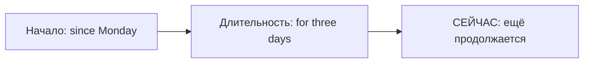

# For, since и how long

> [!abstract] Коротко
> - `for` + **длительность**: `for two hours, for ten years`.
> - `since` + **точка начала**: `since Monday, since 2020, since I moved here`.
> - Ситуация длится до сих пор → Present Perfect: `I've known her for years` (не *I know her for years*).

<!-- beginner-intro:start -->
## Простыми словами

`For` отвечает «как долго?»: два часа, десять лет. `Since` отвечает «с какого момента?»: с утра, с 2020 года. Это не два взаимозаменяемых перевода русского «в течение»: после них нужны разные типы информации.

Нарисуй отрезок. Вся его длина — `for two years`; левая граница — `since 2024`. Если ситуация тянется до настоящего, часто используем Present Perfect. Само `for` не требует Perfect: законченная поездка тоже могла длиться `for two weeks`.

### Наглядная схема

`Since` называет левую границу, `for` — длину всего промежутка до сейчас.

## Правило и схема
<!-- beginner-intro:end -->

`For` указывает **длительность**, `since` — **начальную точку**. Когда действие или состояние продолжается до настоящего, обычно нужен Present Perfect Simple или Continuous.

| Выражение | Пример |
| --- | --- |
| for + период | for ten minutes, for years |
| since + точка | since Monday, since 2022 |
| since + событие в прошлом | since I moved here |
| how long | How long have you lived here? |

`For` употребляется и в других временах: `I stayed for a week` — пребывание закончено. Состояния чаще требуют Simple (`have known`), продолжающаяся деятельность — часто Continuous (`have been studying`).

<!-- beginner-examples:start -->
## Примеры с разбором

1. **I've worked here for two years.** — Я работаю здесь два года.  
   **Разбор:** `two years` — длительность, поэтому `for`; работа продолжается.
2. **I've worked here since May.** — Я работаю здесь с мая.  
   **Разбор:** май — начальная точка, поэтому `since`, а не `for`.
3. **How long have you known her?** — Как давно ты её знаешь?  
   **Разбор:** `how long` спрашивает длительность до настоящего; `know` обычно не используют в Continuous.
4. **We stayed there for a week last summer.** — Прошлым летом мы пробыли там неделю.  
   **Разбор:** `for` обозначает длительность, но период завершён; поэтому Past Simple `stayed`.
<!-- beginner-examples:end -->

## Дополнительные примеры

- **I've known her for ten years.** — Я знаю её десять лет.
- **He's worked here since April.** — Он работает здесь с апреля.
- **It's been raining since we arrived.** — Дождь идёт с тех пор, как мы приехали.

> [!warning] Частая ошибка
> **Since 2020**, но **for six years**. Не *I know her for ten years*, если состояние началось раньше и продолжается сейчас.

## Проверь себя

Сначала ответь сам, потом открой ответы: нажми на заголовок блока.

1. Вставь for или since: I've had this car ___ 2018.
2. Вставь for или since: They've been married ___ twenty years.
3. Вставь for или since: She's been ill ___ last Friday.
4. Задай вопрос «Как давно ты здесь живёшь?»
5. Исправь ошибку: *I know him since school.*
6. Исправь ошибку: *We waited for since two hours.*

> [!success]- Ответы и пояснения
> 1. **since** — 2018 — точка начала.
> 2. **for** — двадцать лет — длительность.
> 3. **since** — прошлая пятница — точка начала.
> 4. **How long have you lived here? / How long have you been living here?** — длительность до сейчас → Present Perfect.
> 5. **I've known him since school.** — состояние длится до сих пор → Present Perfect.
> 6. **We waited for two hours.** — с длительностью только `for`.

## Источники

- [British Council — Present perfect](https://learnenglish.britishcouncil.org/free-resources/grammar/b1-b2/present-perfect)
- [Cambridge Dictionary — Present perfect continuous ( I have been working )](https://dictionary.cambridge.org/us/grammar/british-grammar/present-perfect-i-have-been)

---

[[034 - Present Perfect или Past Simple|← Предыдущая тема]] · [[000 - Оглавление|Оглавление]] · [[036 - Just, already, yet, still, ever и never|Следующая тема →]]
