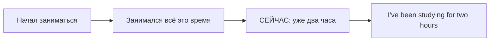

# Present Perfect Continuous — длительность и процесс

> [!abstract] Коротко
> - Present Perfect Continuous (`have/has been + V-ing`) — **сколько времени длится занятие** до сейчас.
> - Процесс может ещё идти (`I've been waiting for an hour`) или только что закончиться и оставить след (`I'm tired — I've been running`).
> - Сколько **сделано** → Present Perfect Simple: `I've written three emails`. Глаголы состояния → только Simple: `I've known`.

<!-- beginner-intro:start -->
## Простыми словами

Present Perfect Continuous подчёркивает **занятие, которое длилось до настоящего момента**. Оно может ещё идти или только что прекратиться, оставив следы: ты запыхался, потому что бегал. Обычно важны процесс и длительность, а не число готовых результатов.

Собирай форму в три шага: `have/has` → всегда `been` → действие с `-ing`. Сравни `I've read three pages` — сколько готово; `I've been reading for an hour` — сколько времени занимался. С глаголами состояния вроде `know` обычно нужен Simple Perfect.

### Наглядная схема

Этот пример показывает деятельность, которая длится до сейчас. В других ситуациях она могла только что закончиться.

## Правило и схема
<!-- beginner-intro:end -->

Форма показывает деятельность, которая началась раньше и продолжается сейчас, повторялась до настоящего или недавно закончилась с заметными последствиями. Акцент — на процессе и длительности.

## Схема

- `S + have/has been + V-ing`.
- `S + haven't/hasn't been + V-ing`.
- `Have/Has + S + been + V-ing?`

| Simple | Continuous |
| --- | --- |
| I've written three emails. Сколько, результат. | I've been writing emails. Чем занимался. |
| She's read the book. Прочитала. | She's been reading the book. Читала, возможно ещё не закончила. |

Обе формы возможны с некоторыми длительными ситуациями: `I've lived / I've been living here for years`. Глаголы состояния обычно требуют Simple: `I've known`, не *I've been knowing*.

<!-- beginner-examples:start -->
## Примеры с разбором

1. **I've been studying for two hours.** — Я занимаюсь уже два часа.  
   **Разбор:** подчёркнута длительность занятия до сейчас, не количество выполненных заданий.
2. **She's been painting, so her hands are blue.** — Она красила, поэтому у неё синие руки.  
   **Разбор:** процесс мог закончиться, но его следы видны сейчас.
3. **I've painted two doors.** — Я покрасил две двери.  
   **Разбор:** считаем законченные результаты, поэтому Present Perfect Simple, без `been painting`.
4. **How long have you been waiting?** — Как долго ты уже ждёшь?  
   **Разбор:** в вопросе `have` переносится перед человеком, а `been waiting` остаётся вместе после него.
<!-- beginner-examples:end -->

## Дополнительные примеры

- **We've been waiting for an hour.** — Мы ждём уже час.
- **Why are you wet? — I've been washing the car.** — Почему ты мокрый? — Я мыл машину.
- **Has she been working all day?** — Она весь день работает?

> [!tip] Запомни
> Continuous не гарантирует, что процесс всё ещё идёт: он мог только что закончиться.

## Проверь себя

Сначала ответь сам, потом открой ответы: нажми на заголовок блока.

1. Вставь глагол: I ___ (learn) English for three years.
2. Вставь глагол: Why are your hands dirty? — I ___ (repair) the bike.
3. Выбери: I (have read / have been reading) three books this month.
4. Выбери: She (has known / has been knowing) him for years.
5. Сделай вопрос: *You have been waiting long.*
6. Исправь ошибку: *It has raining all day.*

> [!success]- Ответы и пояснения
> 1. **have been learning / I've been learning** — длительность занятия до сейчас.
> 2. **have been repairing / I've been repairing** — видимые следы недавнего процесса.
> 3. **have read** — считаем результат — количество книг.
> 4. **has known** — `know` — глагол состояния.
> 5. **Have you been waiting long?** — вперёд выходит только `have`.
> 6. **It has been raining all day.** — не пропускай `been`.

## Источники

- [British Council — Present perfect simple and continuous](https://learnenglish.britishcouncil.org/free-resources/grammar/b1-b2/present-perfect-simple-continuous)
- [Cambridge Dictionary — Present perfect continuous ( I have been working )](https://dictionary.cambridge.org/us/grammar/british-grammar/present-perfect-i-have-been)

---

[[036 - Just, already, yet, still, ever и never|← Предыдущая тема]] · [[000 - Оглавление|Оглавление]] · [[038 - Past Perfect — раньше другого прошлого|Следующая тема →]]
