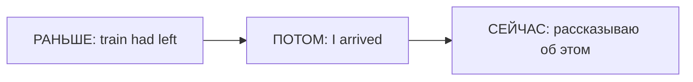

# Past Perfect — раньше другого прошлого

> [!abstract] Коротко
> - Past Perfect (`had + V3`) — событие **раньше другого прошлого** события.
> - Нужна прошлая «точка отсчёта»: `When I arrived, the train had left` (поезд ушёл ещё до моего прихода).
> - Просто цепочка событий по порядку → Past Simple: `I came, saw and left`.

<!-- beginner-intro:start -->
## Простыми словами

Past Perfect помогает вернуться **ещё дальше назад** из уже выбранного момента прошлого. Представь рассказ: ты пришёл на станцию, но поезд уехал раньше. Приход — точка рассказа; отъезд — событие до этой точки.

Используй `had + V3` для более раннего события, когда нужно показать порядок или причину. `Had` одинаково для всех лиц. Это не правило «для любого далёкого прошлого»: если просто рассказываешь о 1990 годе без второго прошлого момента, Past Simple обычно достаточно.

### Наглядная схема

Порядок на схеме — фактический порядок событий, даже если в предложении сначала назван мой приезд.

## Правило и схема
<!-- beginner-intro:end -->

Past Perfect показывает действие или состояние **до выбранного момента в прошлом**. Часто объясняет, почему в тот момент возникла определённая ситуация.

## Схема

- `S + had + V3`.
- `S + hadn't + V3`.
- `Had + S + V3?`

Временная линия: **раньше — Past Perfect → позднее — Past Simple**. Порядок частей предложения может быть любым. Не нужно ставить Past Perfect для любого давнего события: требуется точка отсчёта в прошлом. Если порядок ясен из `before/after`, часто достаточно Past Simple.

<!-- beginner-examples:start -->
## Примеры с разбором

1. **When I arrived, the train had left.** — Когда я приехал, поезд уже ушёл.  
   **Разбор:** сначала уехал поезд, потом приехал я. `Had left` отмечает более раннее событие.
2. **I was tired because I hadn't slept well.** — Я устал, потому что плохо спал.  
   **Разбор:** плохой сон произошёл до того момента, когда я чувствовал усталость.
3. **Had you met her before the party?** — Ты встречал её до вечеринки?  
   **Разбор:** опыт оценивается не до сейчас, а до прошлого события — вечеринки.
4. **I opened the door and sat down.** — Я открыл дверь и сел.  
   **Разбор:** события просто идут по порядку; возвращения назад нет, поэтому двух Past Simple достаточно.
<!-- beginner-examples:end -->

## Дополнительные примеры

- **The film had started when we arrived.** — Когда мы приехали, фильм уже начался.
- **I couldn't pay because I'd forgotten my wallet.** — Я не мог заплатить, потому что забыл кошелёк.
- **Had you met her before that trip?** — Ты встречал её до той поездки?

> [!tip] Сравни
> **When I arrived, he left** — ушёл при моём появлении или после. **When I arrived, he had left** — ушёл раньше.

> [!tip] Дальше по теме
> [[040 - Повествовательные времена — как рассказать историю|Повествовательные времена — как рассказать историю]]

## Проверь себя

Сначала ответь сам, потом открой ответы: нажми на заголовок блока.

1. Вставь глагол: When we got to the cinema, the film ___ (already / start).
2. Вставь глагол: She was sad because she ___ (lose) her ring.
3. Вставь глагол: I ___ (never / see) the sea before that trip.
4. Выбери: When I arrived, she (left / had left). Мы так и не увиделись.
5. Выбери: When the phone rang, I (answered / had answered) it.
6. Исправь ошибку: *After he has finished work, he went home.*

> [!success]- Ответы и пояснения
> 1. **had already started** — фильм начался раньше нашего прихода.
> 2. **had lost** — потеря случилась раньше, чем грусть.
> 3. **had never seen** — опыт до прошлого момента — поездки.
> 4. **had left** — она ушла ещё до моего прихода.
> 5. **answered** — я ответил после звонка — обычная последовательность.
> 6. **After he had finished work, he went home. / After he finished work, he went home.** — рассказ в прошлом → `had finished` (или Past Simple, т.к. порядок ясен из `after`).

## Источники

- [British Council — Past perfect](https://learnenglish.britishcouncil.org/free-resources/grammar/b1-b2/past-perfect)

---

[[037 - Present Perfect Continuous — длительность и процесс|← Предыдущая тема]] · [[000 - Оглавление|Оглавление]] · [[039 - Past Perfect Continuous — процесс до прошлого момента|Следующая тема →]]
