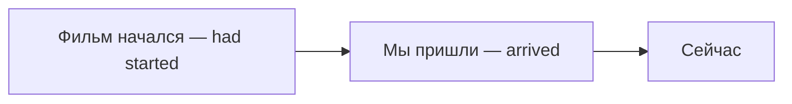

# Past Perfect — раньше другого прошлого

> [!abstract] Коротко
> Past Perfect — это «**прошлое прошлого**». Когда рассказываешь о прошлом и нужно вернуться ещё дальше назад: **When we arrived, the film ==had started==.** — Когда мы пришли, фильм **уже** начался.

## Суть

Представь, что твой рассказ — это **точка в прошлом** (например, «мы пришли в кино»). Всё, что случилось **ещё до** этой точки, идёт в Past Perfect:

**When we arrived, the film had started.** — Мы пришли, а фильм к тому времени уже шёл. Мы его начало пропустили.

Сравни:

- **When we arrived, the film ==started==.** — Мы пришли, и (тогда) фильм начался. *Успели!*
- **When we arrived, the film ==had started==.** — Мы пришли, а он уже начался. *Опоздали.*

> [!example] Формула
> **Кто** + **had** + **третья форма (V3)**
>
> I **had seen**. She **had left**. **Had** you **met** her before?

**Had** — одинаковое для всех: I had, she had, they had.

## Примеры

- **I couldn't get in because I'd lost my key.** — Я не мог войти, потому что (до этого) потерял ключ. *`I'd` = `I had`.*
- **She was sad because she had lost her ring.** — Ей было грустно, потому что она потеряла кольцо.
- **I had never seen the sea before that trip.** — До той поездки я никогда не видел моря.
- **Had you met her before the party?** — Ты встречал её до вечеринки?

> [!tip] Нужна точка отсчёта
> Past Perfect — не «очень давно», а «**раньше чего-то** в прошлом». **I saw her in 2005** — просто Past Simple, хоть это и давно. Если порядок и так ясен (**after, before**), можно обойтись Past Simple.

> [!warning] Частые ошибки
> - ~~After he has finished work, he went home.~~ → **After he had finished work, he went home.** — в рассказе о прошлом `has` не подходит.
> - ~~When the phone rang, I had answered it.~~ → **When the phone rang, I answered it.** — ответил **после** звонка, а не до.

## Проверь себя

Сначала ответь сам, потом открой ответы: нажми на заголовок блока.

1. Вставь глагол: When we got to the cinema, the film ___ (already / start).
2. Вставь глагол: She was sad because she ___ (lose) her ring.
3. Вставь глагол: I ___ (never / see) the sea before that trip.
4. Выбери: When I arrived, she (left / had left). Мы так и не увиделись.
5. Выбери: When the phone rang, I (answered / had answered) it.
6. Исправь ошибку: *After he has finished work, he went home.*

> [!success]- Ответы и пояснения
> 1. **had already started** — фильм начался раньше, чем мы пришли.
> 2. **had lost** — сначала потеряла, потом грустила.
> 3. **had never seen** — опыт до того момента — поездки.
> 4. **had left** — она ушла ещё до моего прихода, поэтому мы не увиделись.
> 5. **answered** — сначала звонок, потом ответ — обычная цепочка, Past Simple.
> 6. **After he had finished work, he went home.** — рассказ о прошлом → `had finished`. Вариант `After he finished work` тоже верен: порядок ясен из `after`.

> [!info]- Источники
> - [British Council — Past perfect](https://learnenglish.britishcouncil.org/free-resources/grammar/b1-b2/past-perfect)

---
[[037 - Present Perfect Continuous — длительность и процесс|← Предыдущая тема]] · [[000 - Оглавление|Оглавление]] · [[039 - Past Perfect Continuous — процесс до прошлого момента|Следующая тема →]]
