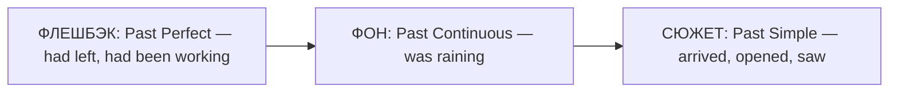

# Повествовательные времена — как рассказать историю

> [!abstract] Коротко
> - **Past Simple** — главные события по порядку: `I opened the door and saw…`
> - **Past Continuous** — фон, декорации: `It was raining, people were hurrying home…`
> - **Past Perfect (Continuous)** — «флешбэк», что было раньше: `Someone had broken the window`, `She had been crying`.

<!-- beginner-intro:start -->
## Простыми словами

Хороший рассказ похож на фильм. Есть **сюжет** — события, которые двигают историю вперёд. Есть **фон** — погода, обстановка, что люди делали в тот момент. И есть **флешбэки** — когда рассказчик возвращается к тому, что случилось ещё раньше. В английском для каждого из этих слоёв есть своё время.

Ты уже знаешь все эти времена по отдельности. Здесь мы собираем их вместе. Главное правило: Past Simple — это «двигатель» рассказа. Если всё рассказать только им, история получится плоской, как список. Если добавить фон и флешбэки, она оживает.

### Наглядная схема

Три слоя одной истории:

## Правило и схема
<!-- beginner-intro:end -->

| Слой рассказа | Время | Пример |
| --- | --- | --- |
| Главные события по порядку | Past Simple | I **got** home, **opened** the door and **switched on** the light. |
| Фон, процессы в момент события | Past Continuous | It **was getting** dark and the wind **was blowing**. |
| Событие раньше точки рассказа | Past Perfect | Someone **had left** the window open. |
| Длительный процесс до точки рассказа | Past Perfect Continuous | My neighbour **had been waiting** for me for an hour. |
| Прошлые привычки героя | used to / would | We **used to** spend every summer there. |

Подсказки связок: `when, while, as` (одновременность), `as soon as, after, before, by the time` (последовательность), `suddenly, then, eventually, in the end` (развитие сюжета).

Past Perfect не нужен для каждого события в прошлом. Используй его, только когда **возвращаешься назад** относительно уже идущего рассказа. Если порядок ясен из `after/before`, хватает Past Simple.

<!-- beginner-examples:start -->
## Примеры с разбором

1. **It was raining when I left the office.** — Когда я вышел из офиса, шёл дождь.  
   **Разбор:** дождь — фон (`was raining`), выход из офиса — событие сюжета (`left`).
2. **When I got to the station, the train had already gone.** — Когда я добрался до вокзала, поезд уже ушёл.  
   **Разбор:** уход поезда случился раньше моего прихода → Past Perfect.
3. **She was exhausted because she had been working all night.** — Она была измотана, потому что работала всю ночь.  
   **Разбор:** долгий процесс до момента рассказа объясняет её состояние → Past Perfect Continuous.
4. **I heard a noise, went downstairs and found a cat in the kitchen.** — Я услышал шум, спустился вниз и обнаружил на кухне кота.  
   **Разбор:** три события подряд в их реальном порядке → три Past Simple.
<!-- beginner-examples:end -->

## Пример связного рассказа

> It **was** a cold evening. Snow **was falling** and the streets **were** empty. I **was walking** home when I **noticed** a small dog by the door of a shop. It **was shaking**. Somebody **had tied** it to the door and **left**. It **had** clearly **been sitting** there for hours. I **took** it home, and it **has lived** with me ever since.

**Разбор:** `was / was falling / were empty` — декорации; `was walking` — фон для события `noticed`; `had tied… left` и `had been sitting` — флешбэк; цепочка `took` — сюжет; финальное `has lived` возвращает нас в настоящее.

## Дополнительные примеры

- **While we were having dinner, the lights went out.** — Пока мы ужинали, погас свет.
- **By the time the police arrived, the thieves had escaped.** — К приезду полиции воры уже скрылись.
- **Suddenly I realised I had forgotten my passport.** — Вдруг я понял, что забыл паспорт.

> [!warning] Частая ошибка
> Не ставь Past Perfect «для красоты» или для любого давнего события: **I was born in 1998**, а не *I had been born*. Нужна точка отсчёта в прошлом, от которой ты смотришь назад.

## Проверь себя

Сначала ответь сам, потом открой ответы: нажми на заголовок блока.

1. Вставь глаголы: When I ___ (wake up), the sun ___ (shine).
2. Вставь глаголы: When we ___ (arrive) at the cinema, the film ___ (already / start).
3. Вставь глаголы: He ___ (be) tired because he ___ (drive) for ten hours.
4. Вставь глаголы: I ___ (pick up) the phone, ___ (dial) the number and ___ (wait).
5. Вставь глаголы: While she ___ (cook), the doorbell ___ (ring).
6. Исправь ошибку: *When I came home, my wife cooked dinner, so the kitchen smelled great.* (она готовила в тот момент)

> [!success]- Ответы и пояснения
> 1. **woke up, was shining** — пробуждение — событие, солнце — фон.
> 2. **arrived, had already started** — фильм начался раньше нашего прихода.
> 3. **was, had been driving** — длительный процесс до момента объясняет усталость.
> 4. **picked up, dialled, waited** — цепочка событий по порядку.
> 5. **was cooking, rang** — процесс-фон и событие на этом фоне.
> 6. **…my wife was cooking dinner…** — готовка уже шла в момент моего прихода.

## Источники

- [Cambridge Dictionary — Past continuous or past simple?](https://dictionary.cambridge.org/grammar/british-grammar/past-continuous-or-past-simple)
- [Cambridge Dictionary — Past perfect simple or past simple?](https://dictionary.cambridge.org/grammar/british-grammar/past-perfect-simple-or-past-simple)
- [British Council — Past perfect](https://learnenglish.britishcouncil.org/free-resources/grammar/b1-b2/past-perfect)

---

[[039 - Past Perfect Continuous — процесс до прошлого момента|← Предыдущая тема]] · [[000 - Оглавление|Оглавление]] · [[041 - Will — решения, обещания и прогнозы|Следующая тема →]]
