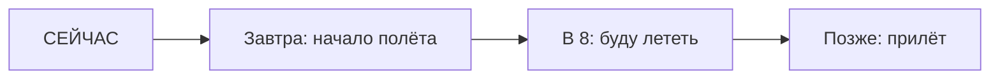

# Future Continuous — процесс в будущем

> [!abstract] Коротко
> - Future Continuous (`will be + V-ing`) — **процесс в определённый момент будущего**: `At 8 tomorrow I'll be flying`.
> - Вежливо узнать о планах: `Will you be using the car tonight?`
> - Не теряй `be`: `will be working`, не *will working*.

<!-- beginner-intro:start -->
## Простыми словами

Future Continuous — видеокадр **из будущего**. Ты выбираешь будущий момент и говоришь, что тогда будет происходить. Действие к этому моменту обычно уже начнётся, но мы не утверждаем, что оно к нему закончится.

Схема: `will` → `be` → `V-ing`. После `will` нельзя ставить `am/is/are`: нужна именно начальная форма `be`. Сравни «завтра поработаю» (`I'll work`) и «завтра в десять буду работать» (`I'll be working`) — во второй фразе выделен процесс в конкретный момент.

### Наглядная схема

Завтрашние восемь часов — точка внутри полёта.

## Правило и схема
<!-- beginner-intro:end -->

Future Continuous показывает действие, которое будет в процессе в определённый будущий момент. Также описывает ожидаемый ход событий или временную будущую деятельность.

## Схема

- `S + will be + V-ing`.
- `S + won't be + V-ing`.
- `Will + S + be + V-ing?`

Сравни: `I'll call at eight` — позвоню в восемь; `I'll be driving at eight` — в восемь буду за рулём. Вопрос `Will you be using…?` часто нейтрально уточняет планы, что удобно перед просьбой.

<!-- beginner-examples:start -->
## Примеры с разбором

1. **At eight tomorrow, I'll be flying to Rome.** — Завтра в восемь я буду лететь в Рим.  
   **Разбор:** восемь часов — будущая точка внутри полёта, а не обязательно время вылета.
2. **Don't call at six. We'll be eating.** — Не звони в шесть. Мы будем есть.  
   **Разбор:** объясняем, какой процесс будет идти в момент возможного звонка.
3. **I won't be using the car this afternoon.** — Сегодня днём я не буду пользоваться машиной.  
   **Разбор:** отрицаем процесс в будущем периоде; после `won't` остаётся `be using`.
4. **Will you be working tomorrow evening?** — Ты будешь работать завтра вечером?  
   **Разбор:** спрашиваем об ожидаемом ходе дел; `will` вынесено перед человеком.
<!-- beginner-examples:end -->

## Дополнительные примеры

- **This time tomorrow, we'll be sitting on the plane.** — Завтра в это время мы будем сидеть в самолёте.
- **I won't be working on Friday.** — В пятницу я не буду работать.
- **Will you be passing the post office?** — Ты не будешь проходить мимо почты?

> [!warning] Частая ошибка
> Сохраняй обе части: **will be waiting**, а не *will waiting*. О завершении к сроку: [[046 - Future Perfect — к будущему сроку|Future Perfect — к будущему сроку]].

## Проверь себя

Сначала ответь сам, потом открой ответы: нажми на заголовок блока.

1. Вставь глагол: This time next week, I ___ (lie) on a beach.
2. Вставь глагол: Don't phone at seven — we ___ (have) dinner.
3. Выбери: I (will call / will be calling) you at eight, I promise.
4. Сделай вопрос: *You will be working tomorrow.*
5. Сделай отрицание: *She will be using the laptop.*
6. Исправь ошибку: *At midnight I will sleeping.*

> [!success]- Ответы и пояснения
> 1. **will be lying / 'll be lying** — процесс в будущий момент; `lie → lying`.
> 2. **will be having / 'll be having** — в момент звонка будет идти ужин.
> 3. **will call** — обещание одного действия, не процесс.
> 4. **Will you be working tomorrow?** — вперёд выходит только `will`.
> 5. **She won't be using the laptop.** — `won't` + `be using`.
> 6. **At midnight I will be sleeping.** — не пропускай `be`.

## Источники

- [British Council — Future continuous and future perfect](https://learnenglish.britishcouncil.org/free-resources/grammar/b1-b2/future-continuous-future-perfect)
- [Cambridge Dictionary — Future continuous ( I will be working )](https://dictionary.cambridge.org/grammar/british-grammar/future-continuous-i-will-be-working-or-future-perfect-i-will-have-worked)

---

[[044 - Вероятность будущего — likely и probably|← Предыдущая тема]] · [[000 - Оглавление|Оглавление]] · [[046 - Future Perfect — к будущему сроку|Следующая тема →]]
