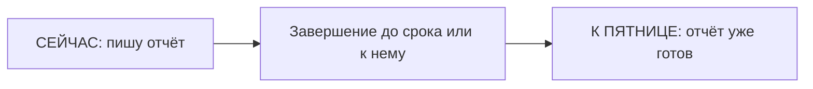

# Future Perfect — к будущему сроку

> [!abstract] Коротко
> - Future Perfect (`will have + V3`) — **будет сделано к сроку** в будущем: `I'll have finished by Friday`.
> - `by` = «не позже чем к»: `by six`, `by then`, `by the time you arrive`.
> - После `will` всегда `have` (не `has`).

<!-- beginner-intro:start -->
## Простыми словами

Future Perfect означает: «**к тому будущему моменту уже будет сделано**». Представь крайний срок: к пятнице отчёт будет готов. Мы смотрим из будущего назад на действие, которое завершится раньше выбранной точки.

Собери `will + have + V3`. `Have` не меняется на `has`, даже с `she`, потому что стоит после `will`. `By Friday` — не «в пятницу», а «к пятнице, не позже»: закончить можно и раньше. Для процесса в самой точке нужен Future Continuous.

### Наглядная схема

`By Friday` — граница: результат должен быть готов не позже неё.

## Правило и схема
<!-- beginner-intro:end -->

Future Perfect показывает завершение **к будущему моменту** или длительность состояния на тот момент. Частые ориентиры: `by Friday`, `by then`, `by the time…`.

## Схема

- `S + will have + V3`.
- `S + won't have + V3`.
- `Will + S + have + V3?`

`By` значит «не позднее чем к», `until` — «вплоть до» для продолжающегося действия. После будущего `by the time` обычно используем настоящее время: `By the time you arrive, we'll have finished`.

<!-- beginner-examples:start -->
## Примеры с разбором

1. **I'll have finished the report by Friday.** — К пятнице я закончу отчёт.  
   **Разбор:** обещаем готовый результат не позже пятницы; `finished` — V3.
2. **By next June, she'll have graduated.** — К следующему июню она окончит учёбу.  
   **Разбор:** смотрим на результат из будущего июня; после `will` используем `have`, не `has`.
3. **We won't have arrived by noon.** — К полудню мы ещё не приедем.  
   **Разбор:** отрицаем завершение к сроку; это не означает, что мы вообще не приедем.
4. **Will you have read it by our meeting?** — Ты успеешь прочитать это к нашей встрече?  
   **Разбор:** спрашиваем о готовности результата к определённой будущей точке.
<!-- beginner-examples:end -->

## Дополнительные примеры

- **I'll have sent the report by noon.** — К полудню я отправлю отчёт.
- **By the time we get there, the shop will have closed.** — Когда мы доберёмся, магазин уже закроется.
- **By June, we'll have lived here for ten years.** — К июню мы будем жить здесь уже десять лет.

> [!tip] Дополнительно
> Длительность деятельности к будущему моменту можно выразить через Future Perfect Continuous: [[047 - Future Perfect Continuous — длительность к будущему моменту|Future Perfect Continuous — длительность к будущему моменту]].

## Проверь себя

Сначала ответь сам, потом открой ответы: нажми на заголовок блока.

1. Вставь глагол: By the end of the year, I ___ (read) twenty books.
2. Вставь глагол: Call me at ten — I ___ (finish) by then.
3. Выбери: By next June, she (will graduate / will have graduated).
4. Вставь by или until: I'll be here ___ six, then I'll leave.
5. Вставь by или until: Please send the documents ___ Monday.
6. Исправь ошибку: *By the time you arrive, she will has left.*

> [!success]- Ответы и пояснения
> 1. **will have read** — результат к сроку в будущем.
> 2. **will have finished / 'll have finished** — к десяти работа будет готова.
> 3. **will have graduated** — к будущему сроку уже окончит.
> 4. **until** — оставаться вплоть до шести.
> 5. **by** — срок: не позже понедельника.
> 6. **By the time you arrive, she will have left.** — после `will` — `have`.

## Источники

- [British Council — Future continuous and future perfect](https://learnenglish.britishcouncil.org/free-resources/grammar/b1-b2/future-continuous-future-perfect)
- [Cambridge Dictionary — Future perfect simple ( I will have worked eight hours )](https://dictionary.cambridge.org/grammar/british-grammar/future-perfect-simple-i-will-have-worked-eight-hours)

---

[[045 - Future Continuous — процесс в будущем|← Предыдущая тема]] · [[000 - Оглавление|Оглавление]] · [[047 - Future Perfect Continuous — длительность к будущему моменту|Следующая тема →]]
