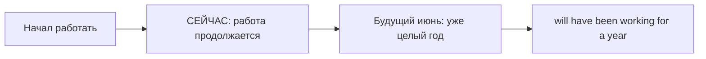

# Future Perfect Continuous — длительность к будущему моменту

> [!abstract] Коротко
> - Future Perfect Continuous (`will have been + V-ing`) — **сколько времени будет длиться** занятие к будущему моменту.
> - Нужна будущая точка и длительность: `By June, I'll have been working here for a year`.
> - Глаголы состояния — в Future Perfect Simple: `will have known`.

<!-- beginner-intro:start -->
## Простыми словами

Это форма для «**к будущему моменту буду заниматься этим уже столько-то времени**». Главная идея — длительность деятельности до будущей точки, а не готовое количество результатов. Форма длинная и сравнительно редкая: на этапе B2 сначала научись понимать её в тексте.

Собирай по блокам: `will` → `have been` → действие с `-ing`. Добавь будущую точку (`by June`) и длительность (`for a year`). С глаголами состояния обычно выбирают Future Perfect Simple: `will have known`, а не `will have been knowing`.

### Наглядная схема

Считаем длительность работы до будущего июня, а не количество законченных задач.

## Правило и схема
<!-- beginner-intro:end -->

Форма показывает, **сколько будет длиться деятельность к будущему моменту**. Это дополнительная тема: в программах её глубина может выходить за B2; сначала достаточно узнавать форму и её смысл.

## Схема

- `S + will have been + V-ing`.
- `S + won't have been + V-ing`.
- `Will + S + have been + V-ing?`

Сравни: `will be working at six` — процесс в шесть; `will have finished by six` — результат к шести; `will have been working for eight hours by six` — длительность работы к шести. С глаголами состояния обычно нужен Future Perfect Simple: `will have known`.

<!-- beginner-examples:start -->
## Примеры с разбором

1. **By June, I'll have been working here for a year.** — К июню я буду работать здесь уже год.  
   **Разбор:** год измеряется до будущего июня; важна длительность работы.
2. **At noon, we'll have been driving for six hours.** — В полдень мы будем ехать уже шесть часов.  
   **Разбор:** смотрим на накопившуюся длительность поездки из будущего полудня.
3. **Will she have been studying for long by then?** — К тому времени она уже долго будет заниматься?  
   **Разбор:** в вопросе переносим только `will`; остальные части сохраняют порядок.
4. **By then, I'll have known him for ten years.** — К тому времени я буду знать его уже десять лет.  
   **Разбор:** `know` — состояние. Поэтому Simple `will have known`, несмотря на длительность.
<!-- beginner-examples:end -->

## Дополнительные примеры

- **By noon, I'll have been travelling for twelve hours.** — К полудню я буду в дороге уже двенадцать часов.
- **In May, she'll have been teaching here for ten years.** — В мае исполнится десять лет, как она здесь преподаёт.
- **You'll be tired — you'll have been working all day.** — Ты будешь уставшим: ты ведь весь день будешь работать.

> [!warning] Частая ошибка
> Не пропускай `been`: **will have been working**. Форма **will have worked** тоже существует, но не подчёркивает процесс так же явно.

## Проверь себя

Сначала ответь сам, потом открой ответы: нажми на заголовок блока.

1. Вставь глагол: By 2030, they ___ (live) in this house for twenty years.
2. Вставь глагол: At five o'clock, I ___ (drive) for six hours.
3. Выбери: By then, I (will have been knowing / will have known) her for ten years.
4. Выбери: By Friday, I (will have written / will have been writing) the essay.
5. Сделай вопрос: *You will have been studying for long.*
6. Исправь ошибку: *Next month I will have be teaching for ten years.*

> [!success]- Ответы и пояснения
> 1. **will have been living** — длительность к будущему моменту (возможно и `will have lived`).
> 2. **will have been driving** — накопленная длительность к пяти часам.
> 3. **will have known** — `know` — состояние.
> 4. **will have written** — важен готовый результат.
> 5. **Will you have been studying for long?** — вперёд выходит `will`.
> 6. **Next month I will have been teaching for ten years.** — нужна форма `been`.

## Источники

- [Cambridge Dictionary — Future perfect continuous ( I will have been working here ten years )](https://dictionary.cambridge.org/uk/grammar/british-grammar/future-perfect-continuous-i-will-have-been-working-here-ten-years.)
- [Cambridge Dictionary — Future perfect simple ( I will have worked eight hours )](https://dictionary.cambridge.org/grammar/british-grammar/future-perfect-simple-i-will-have-worked-eight-hours)

---

[[046 - Future Perfect — к будущему сроку|← Предыдущая тема]] · [[000 - Оглавление|Оглавление]] · [[048 - Будущее с точки зрения прошлого|Следующая тема →]]
