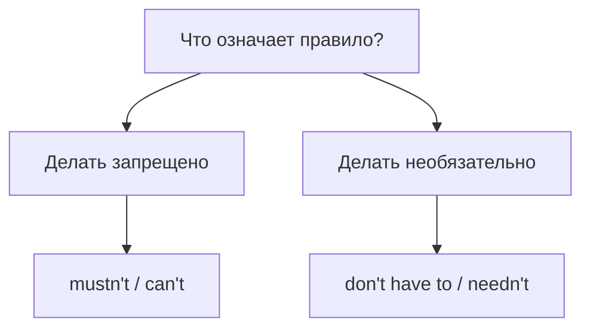

# Запрет и отсутствие необходимости

> [!abstract] Коротко
> - **Нельзя**: `mustn't`, `can't`, `not allowed to`. **Не обязательно**: `don't have to`, `don't need to`, `needn't`.
> - Главная ловушка: `You mustn't go` — тебе нельзя идти; `You don't have to go` — можешь не идти.
> - Прошлое: `wasn't allowed to` (запрет), `didn't have to` (не было нужды).

<!-- beginner-intro:start -->
## Простыми словами

«Не нужно» оставляет выбор, а «нельзя» его запрещает. Это главное различие темы. Если встреча добровольная, ты можешь прийти или не прийти. Если вход запрещён, войти нельзя. Английские отрицания здесь нельзя переводить слово за словом.

Для запрета выбирай `mustn't/can't` или `not allowed to`. Для отсутствия обязанности — `don't have to`, `don't need to`, `needn't`. Запомни пару целиком: `must` — нужно, но `mustn't` — **запрещено**, а не «не нужно».

### Наглядная схема

Задай вопрос о смысле, прежде чем выбирать английское отрицание.

## Правило и схема
<!-- beginner-intro:end -->

Отрицательные формы необходимости выражают **разные смыслы**. «Нельзя» и «не обязательно» не взаимозаменяемы.

| Значение | Формы |
| --- | --- |
| Запрещено | mustn't + V; can't + V; be not allowed to + V |
| Не нужно, но можно | don't/doesn't have to + V |
| Нет необходимости | don't/doesn't need to + V; needn't + V |

`Needn't` — модальная форма, без `to`. Обычный глагол `need` требует `do` и `to`: `You don't need to wait`. `Be allowed to` удобно для других времён: `We weren't allowed to enter`.

<!-- beginner-examples:start -->
## Примеры с разбором

1. **You mustn't feed the animals.** — Животных кормить нельзя.  
   **Разбор:** это запрет, а не сообщение о том, что животные уже сыты.
2. **You don't have to bring food.** — Еду приносить не обязательно.  
   **Разбор:** обязанности нет; запрета принести еду эта фраза не устанавливает.
3. **We needn't hurry.** — Нам не нужно спешить.  
   **Разбор:** необходимости нет. После модального `needn't` стоит `hurry` без `to`.
4. **We weren't allowed to take photos.** — Нам не разрешали фотографировать.  
   **Разбор:** прошлый запрет удобно выразить через прошлую форму `be`: `weren't allowed to`.
<!-- beginner-examples:end -->

## Дополнительные примеры

- **You mustn't park here.** — Здесь нельзя парковаться.
- **Children under 12 aren't allowed to use the pool alone.** — Детям до 12 лет нельзя пользоваться бассейном одним.
- **We needn't book a table.** — Нам не нужно бронировать столик.

> [!warning] Главная ловушка
> **You mustn't leave** — тебе нельзя уходить. **You don't have to leave** — тебе не обязательно уходить.

## Проверь себя

Сначала ответь сам, потом открой ответы: нажми на заголовок блока.

1. Выбери: You (mustn't / don't have to) smoke in the hospital.
2. Выбери: Tomorrow is Sunday, so I (mustn't / don't have to) get up early.
3. Выбери: You (needn't / mustn't) bring anything — we have everything.
4. Переведи: «Нам не разрешали пользоваться телефонами».
5. Исправь ошибку: *You needn't to worry.*
6. Переведи: «Тебе не обязательно отвечать прямо сейчас».

> [!success]- Ответы и пояснения
> 1. **mustn't** — это запрет.
> 2. **don't have to** — необходимости нет, но можно.
> 3. **needn't** — нет необходимости.
> 4. **We weren't allowed to use our phones.** — прошлый запрет → `weren't allowed to`.
> 5. **You needn't worry. / You don't need to worry.** — модальное `needn't` без `to`.
> 6. **You don't have to answer right now.** — отсутствие обязанности.

## Источники

- [Cambridge Dictionary — Need](https://dictionary.cambridge.org/grammar/british-grammar/need)
- [British Council — Modals: permission and obligation](https://learnenglish.britishcouncil.org/free-resources/grammar/b1-b2/modals-permission-obligation)

---

[[052 - Обязанность — must, have to, need to|← Предыдущая тема]] · [[000 - Оглавление|Оглавление]] · [[054 - Совет — should, ought to, had better|Следующая тема →]]
