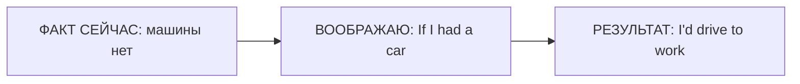

# Second Conditional — воображаемое настоящее и будущее

> [!abstract] Коротко
> - Second Conditional — **воображаемое** настоящее/будущее: `If I had a car, I'd drive`.
> - Формула: `If + Past Simple, would + V`. Прошедшая форма тут = «нереально», а не «в прошлом».
> - `If I were you, I'd…` — совет. `would` только в одной части!

<!-- beginner-intro:start -->
## Простыми словами

Второй тип позволяет представить другую жизнь: «Если бы у меня было больше свободного времени…». Ситуация может противоречить фактам или казаться маловероятной. Форма Past Simple здесь означает **воображаемую дистанцию**, хотя речь идёт о сейчас или будущем.

В условии ставь прошлую форму, в результате — `would + V`. Не добавляй `would` в обе части. У «Если бы я был тобой» закрепилась форма `If I were you`. Для реально возможного плана используй первый тип, а не этот только из-за русского слова «если».

### Наглядная схема

Здесь меняем нынешнюю ситуацию в воображении. Форма `had` не переносит условие во вчерашний день.

## Правило и схема
<!-- beginner-intro:end -->

Второе условное представляет ситуацию как воображаемую, маловероятную или противоречащую действительности сейчас. Прошедшая форма здесь выражает **дистанцию от реальности**, а не прошлое время.

## Схема

`If + S + Past Simple, S + would + V`

В результате возможны `could` — мог бы, `might` — возможно бы. Для `be` в нереальных условиях употребляется `were` со всеми лицами; `was` тоже распространено, особенно в разговоре. Для совета удобно `If I were you…`.

<!-- beginner-examples:start -->
## Примеры с разбором

1. **If I had a car, I'd drive to work.** — Если бы у меня была машина, я бы ездил на работу.  
   **Разбор:** представляем ситуацию, которой сейчас нет; `had` не означает прошлое обладание.
2. **If she lived here, we'd see her more often.** — Если бы она жила здесь, мы бы чаще её видели.  
   **Разбор:** воображаем другое настоящее; `we'd` = `we would`.
3. **If I were you, I'd check it again.** — На твоём месте я бы проверил это ещё раз.  
   **Разбор:** устойчивый способ дать совет через воображаемую ситуацию.
4. **What would you do if you won a million pounds?** — Что бы ты сделал, если бы выиграл миллион фунтов?  
   **Разбор:** гипотеза о будущем; `won` в условии, `would do` в результате.
<!-- beginner-examples:end -->

## Дополнительные примеры

- **If I had more time, I'd learn Italian.** — Если бы у меня было больше времени, я бы учил итальянский.
- **If she lived closer, we could meet more often.** — Если бы она жила ближе, мы могли бы встречаться чаще.
- **If I were you, I'd ask for help.** — На твоём месте я бы попросил помощи.

> [!warning] Частая ошибка
> В основной модели **if I knew**, а не *if I would know*. Сравни: **If I have time, I'll…** — реальная возможность; **If I had time, I'd…** — воображаемая.

> [!tip] Дальше по теме
> [[129 - Условия без if — Had I known, but for, supposing|Условия без if — Had I known, but for, supposing]]

## Проверь себя

Сначала ответь сам, потом открой ответы: нажми на заголовок блока.

1. Вставь глаголы: If I ___ (know) the answer, I ___ (tell) you.
2. Вставь глаголы: What ___ you ___ (do) if you ___ (win) the lottery?
3. Вставь глагол: If I ___ (be) you, I would apologise.
4. Выбери: If I (have / had) more money, I'd buy a house.
5. Выбери: If it (rains / rained) tomorrow, we'll stay home. (это вполне возможно)
6. Исправь ошибку: *If I would have time, I would help you.*

> [!success]- Ответы и пояснения
> 1. **knew, would tell** — сейчас я не знаю — ситуация воображаемая.
> 2. **would, do, won** — гипотетическое будущее.
> 3. **were** — устойчивое `If I were you` для совета.
> 4. **had** — нереальное условие → Past Simple.
> 5. **rains** — реальная возможность → First Conditional.
> 6. **If I had time, I would help you.** — после `if` не ставим `would`.

## Источники

- [British Council — Conditionals: zero, first and second](https://learnenglish.britishcouncil.org/free-resources/grammar/b1-b2/conditionals-zero-first-second)

---

[[060 - First Conditional — реальное будущее условие|← Предыдущая тема]] · [[000 - Оглавление|Оглавление]] · [[062 - Third Conditional — другое прошлое|Следующая тема →]]
