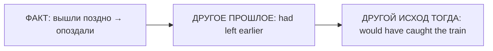

# Third Conditional — другое прошлое

> [!abstract] Коротко
> - Third Conditional — **другое прошлое**, которого уже не изменить: `If I had left earlier, I would have caught the train`.
> - Формула: `If + had + V3, would have + V3`.
> - `'d` = `had` перед V3 и `would` перед `have`: `If I'd known, I'd have helped`.

<!-- beginner-intro:start -->
## Простыми словами

Третий тип — мысленный «повтор» уже завершённого прошлого. Мы не можем изменить вчерашнее событие, но можем представить: «Если бы вышли раньше, успели бы». И условие, и результат относятся к **тогда**, а не к сейчас.

В условии нужны `had + V3`, в результате `would have + V3`. Два сокращения `'d` могут означать разное: `If I'd known` = `had known`; `I'd have helped` = `would have helped`. Проверяй следующее слово, чтобы раскрыть сокращение.

### Наглядная схема

Обе воображаемые части относятся к прошлому.

## Правило и схема
<!-- beginner-intro:end -->

Третье условное воображает **изменение уже завершённого прошлого** и другой результат в прошлом. События изменить нельзя; конструкция позволяет обсудить сожаление, ошибку или альтернативный исход.

## Схема

`If + S + had + V3, S + would have + V3`

`Could have` вместо `would have` выражает возможность, `might have` — менее уверенный результат. Порядок частей не меняет смысл.

<!-- beginner-examples:start -->
## Примеры с разбором

1. **If I'd seen you, I'd have said hello.** — Если бы я тебя увидел, я бы поздоровался.  
   **Разбор:** в обычном контексте не увидел и не поздоровался; представляем другой исход прошлого.
2. **We'd have arrived on time if we'd left earlier.** — Мы бы приехали вовремя, если бы выехали раньше.  
   **Разбор:** результат стоит первым; формы и смысл от перестановки не меняются.
3. **If she hadn't helped, I couldn't have finished.** — Если бы она не помогла, я не смог бы закончить.  
   **Разбор:** фактически помощь была; `couldn't have` описывает отсутствие возможности в альтернативном прошлом.
4. **If we'd booked sooner, we might have paid less.** — Если бы мы забронировали раньше, возможно, заплатили бы меньше.  
   **Разбор:** `might have` делает воображаемый результат менее уверенным, чем `would have`.
<!-- beginner-examples:end -->

## Дополнительные примеры

- **If we'd left earlier, we'd have caught the train.** — Если бы мы вышли раньше, мы бы успели на поезд.
- **She might have passed if she'd revised more.** — Возможно, она сдала бы экзамен, если бы больше повторяла.
- **If I hadn't lost the key, I could have opened the door.** — Если бы я не потерял ключ, я смог бы открыть дверь.

> [!warning] Частая ошибка
> В условии **had known**, в результате **would have helped**. Не *if I would have known*. Сокращение `'d` означает `had` перед `V3`, но `would` перед `V`.

> [!tip] Дальше по теме
> [[129 - Условия без if — Had I known, but for, supposing|Условия без if — Had I known, but for, supposing]]

## Проверь себя

Сначала ответь сам, потом открой ответы: нажми на заголовок блока.

1. Вставь глаголы: If you ___ (tell) me, I ___ (help) you.
2. Вставь глаголы: She ___ (not / be) late if she ___ (catch) the bus.
3. Раскрой сокращения: *If I'd known, I'd have come.*
4. Перефразируй: *I didn't have an umbrella, so I got wet.*
5. Перефразируй: *We didn't book, so we didn't get a table.*
6. Исправь ошибку: *If I would have seen him, I would have said hello.*

> [!success]- Ответы и пояснения
> 1. **had told, would have helped** — обе части о прошлом.
> 2. **wouldn't have been, had caught** — результат и условие в прошлом.
> 3. **If I had known, I would have come.** — перед V3 `'d` = `had`, перед `have` — `would`.
> 4. **If I had had an umbrella, I wouldn't have got wet.** — меняем реальное прошлое на воображаемое.
> 5. **If we had booked, we would have got a table.** — оба факта в прошлом → Third Conditional.
> 6. **If I had seen him, I would have said hello.** — в условии `had + V3`, не `would have`.

## Источники

- [British Council — Conditionals: third and mixed](https://learnenglish.britishcouncil.org/free-resources/grammar/b1-b2/conditionals-third-mixed)

---

[[061 - Second Conditional — воображаемое настоящее и будущее|← Предыдущая тема]] · [[000 - Оглавление|Оглавление]] · [[063 - Mixed Conditionals — разные времена условия и результата|Следующая тема →]]
