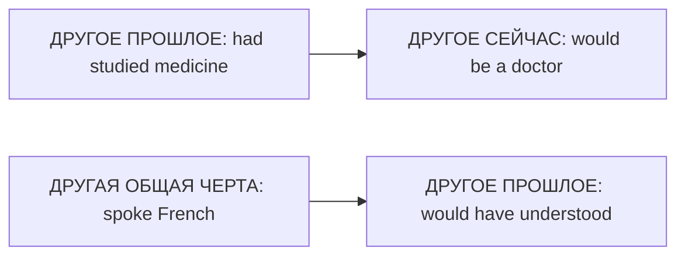

# Mixed Conditionals — разные времена условия и результата

> [!abstract] Коротко
> - Части относятся к **разным временам**.
> - Прошлое → настоящее: `If + had V3, would + V` — `If I'd slept more, I wouldn't be tired now`.
> - Постоянная черта → прошлое: `If + Past Simple, would have V3` — `If I spoke French, I'd have understood him yesterday`.

<!-- beginner-intro:start -->
## Простыми словами

Смешанный тип связывает разные времена: **другое прошлое → другое сейчас** или **другая общая характеристика → другое прошлое**. Например, не изучал медицину тогда, поэтому не врач сейчас. Название «смешанный» просто означает, что две части смотрят на разные моменты.

Подпиши каждой части «тогда» или «сейчас». Для нереального прошлого бери `had + V3`; для нереальной нынешней ситуации — Past Simple. Результат сейчас → `would + V`, результат тогда → `would have + V3`.

### Наглядная схема

У каждой части своя временная точка. Это отличает смешанный тип от третьего.

## Правило и схема
<!-- beginner-intro:end -->

Смешанные условные нужны, когда воображаемая причина и её следствие относятся к **разным временам**. Выбирай формы по смыслу каждой части.

| Связь | Схема |
| --- | --- |
| Другое прошлое → другой результат сейчас | if + had V3 → would V |
| Другая устойчивая ситуация сейчас → другой результат в прошлом | if + Past Simple → would have V3 |

Второй вариант описывает характеристику, которая актуальна сейчас и была важна тогда: например, общее знание языка, а не новое знание, появившееся только сегодня.

<!-- beginner-examples:start -->
## Примеры с разбором

1. **If I'd gone to bed earlier, I wouldn't be so tired now.** — Если бы я лёг раньше, сейчас я бы так не устал.  
   **Разбор:** сон — прошлое условие, усталость — нынешний результат.
2. **If she hadn't missed the flight, she'd be here now.** — Если бы она не пропустила рейс, сейчас была бы здесь.  
   **Разбор:** меняем прошлое событие и показываем его последствие в настоящем.
3. **If I were more careful, I wouldn't have lost my keys yesterday.** — Если бы я был внимательнее, вчера не потерял бы ключи.  
   **Разбор:** невнимательность — общая черта, а потеря ключей — конкретный прошлый результат.
4. **If I spoke French, I'd have understood the film last night.** — Если бы я знал французский, вчера вечером понял бы фильм.  
   **Разбор:** предполагаем устойчивое знание языка, которое было бы доступно и вчера.
<!-- beginner-examples:end -->

## Дополнительные примеры

- **If I'd studied medicine, I'd be a doctor now.** — Если бы я учился медицине, сейчас я был бы врачом.
- **If we hadn't missed the bus, we wouldn't be late now.** — Если бы мы не пропустили автобус, сейчас мы бы не опаздывали.
- **If I weren't so shy, I'd have spoken to her at the party.** — Если бы я не был таким застенчивым, я бы заговорил с ней на вечеринке.

> [!tip] Проверка
> Подпиши у каждой части «тогда» или «сейчас». Если обе части про прошлое, обычно нужен [[062 - Third Conditional — другое прошлое|Third Conditional — другое прошлое]].

## Проверь себя

Сначала ответь сам, потом открой ответы: нажми на заголовок блока.

1. Вставь глаголы: If I ___ (take) that job last year, I ___ (be) rich now.
2. Вставь глаголы: If she ___ (be) more careful, she ___ (not / lose) her phone yesterday.
3. Перефразируй: *I didn't eat breakfast, so I'm hungry now.*
4. Перефразируй: *He isn't brave, so he didn't jump.*
5. Выбери: If we hadn't missed the flight, we (would be / would have been) in Rome now.
6. Исправь ошибку: *If I had studied medicine, I would have been a doctor now.*

> [!success]- Ответы и пояснения
> 1. **had taken, would be** — прошлое условие → результат сейчас.
> 2. **were/was, wouldn't have lost** — постоянная черта → прошлое событие.
> 3. **If I had eaten breakfast, I wouldn't be hungry now.** — прошлое → сейчас.
> 4. **If he were braver, he would have jumped.** — черта характера сейчас → прошлое действие.
> 5. **would be** — `now` — результат в настоящем.
> 6. **If I had studied medicine, I would be a doctor now.** — `now` требует результата в настоящем: `would be`.

## Источники

- [British Council — Conditionals: third and mixed](https://learnenglish.britishcouncil.org/free-resources/grammar/b1-b2/conditionals-third-mixed)

---

[[062 - Third Conditional — другое прошлое|← Предыдущая тема]] · [[000 - Оглавление|Оглавление]] · [[064 - Unless, provided, as long as и in case|Следующая тема →]]
