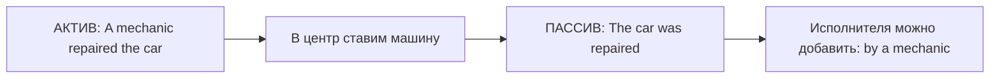

# Passive Voice — основа пассивного залога

> [!abstract] Коротко
> - Пассив = **предмет в центре внимания**: `The window was broken` (кто разбил — неважно или неизвестно).
> - Формула: `be` в нужном времени + `V3`. Исполнителя можно добавить через `by`.
> - Глаголы без дополнения (`happen, arrive, die, sleep`) пассива не образуют.

<!-- beginner-intro:start -->
## Простыми словами

Сравни два ракурса: «Мастер починил дверь» и «Дверь починили». Событие одно, но во второй фразе нас интересует дверь. Английский **пассивный залог** как раз позволяет начать с предмета, который получает действие.

Поставь этот предмет первым, затем нужную форму `be`, затем V3 действия. Исполнителя можно добавить через `by`, но если он неизвестен или неважен, его опускают. Не каждый глагол так работает: у «спать» нет предмета, который кто-то «спит».

### Наглядная схема

При смене залога меняется главный ракурс, а не само событие.

## Правило и схема
<!-- beginner-intro:end -->

Пассивный залог позволяет начать с того, **над чем совершают действие**. Исполнитель неизвестен, неважен или упоминается позже. Сравни: `Someone repaired the roof` → `The roof was repaired`.

## Схема

`S, получающее действие + be в нужном времени + V3 + (by + исполнитель)`

Время и число выражает `be`; смысловой глагол остаётся в `V3`. `By` называет исполнителя; `with` — инструмент. Пассив обычно возможен у глаголов с дополнением: `build a house → a house is built`. Непереходные `arrive`, `happen`, `sleep` обычного пассива не образуют.

<!-- beginner-examples:start -->
## Примеры с разбором

1. **Someone broke the window. → The window was broken.** — Кто-то разбил окно. → Окно разбили.  
   **Разбор:** окно из получателя действия стало подлежащим; прошлое выражено через `was`.
2. **English is spoken here.** — Здесь говорят по-английски.  
   **Разбор:** говорящие не названы; `is spoken` описывает обычную ситуацию.
3. **The email was sent by Lena.** — Письмо отправила Лена.  
   **Разбор:** `by Lena` называет исполнителя. Без этой части предложение осталось бы законченным.
4. **The door was opened with a key.** — Дверь открыли ключом.  
   **Разбор:** ключ — инструмент, поэтому `with`, а не `by`.
<!-- beginner-examples:end -->

## Дополнительные примеры

- **These bicycles are made in Italy.** — Эти велосипеды производят в Италии.
- **My wallet was stolen yesterday.** — Вчера у меня украли кошелёк.
- **The cake was cut with a knife.** — Торт разрезали ножом.

> [!warning] Частая ошибка
> **The accident happened**, а не *was happened*. Формы других времён: [[068 - Passive Voice во временах и с модальными глаголами|Passive Voice во временах и с модальными глаголами]].

> [!tip] Дальше по теме
> [[071 - Пассив — get, два дополнения и глаголы с предлогами|Пассив — get, два дополнения и глаголы с предлогами]]

## Проверь себя

Сначала ответь сам, потом открой ответы: нажми на заголовок блока.

1. Перестрой в пассив: *They make cars in this factory.*
2. Перестрой в пассив: *Someone stole my bike.*
3. Перестрой в пассив: *Shakespeare wrote "Hamlet".*
4. Вставь by или with: The letter was written ___ a pencil.
5. Исправь ошибку: *The accident was happened at night.*
6. Исправь ошибку: *English is speak all over the world.*

> [!success]- Ответы и пояснения
> 1. **Cars are made in this factory.** — Present Simple → `are + V3`; исполнитель неважен.
> 2. **My bike was stolen.** — Past Simple → `was + V3`.
> 3. **"Hamlet" was written by Shakespeare.** — исполнитель важен → `by`.
> 4. **with** — карандаш — инструмент.
> 5. **The accident happened at night.** — `happen` не образует пассив.
> 6. **English is spoken all over the world.** — в пассиве нужна V3: `spoken`.

## Источники

- [British Council — Passives](https://learnenglish.britishcouncil.org/free-resources/grammar/b1-b2/passives)
- [British Council — Active and passive voice](https://learnenglish.britishcouncil.org/free-resources/grammar/english-grammar-reference/active-passive-voice)

---

[[066 - It's time — пора сделать|← Предыдущая тема]] · [[000 - Оглавление|Оглавление]] · [[068 - Passive Voice во временах и с модальными глаголами|Следующая тема →]]
