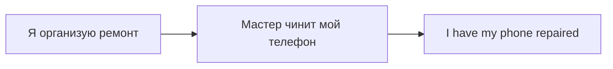

# Have и get something done — услуга или воздействие

> [!abstract] Коротко
> - `have/get + предмет + V3` — **кто-то сделал для меня** (услуга): `I had my hair cut`.
> - Порядок важен: `I had repaired the car` (сам починил) ≠ `I had the car repaired` (мне починили).
> - Та же модель — о неприятностях: `She had her bag stolen`. `Get` — разговорнее.

<!-- beginner-intro:start -->
## Простыми словами

Когда тебе стригут волосы или чинят телефон, ты обычно организуешь работу, но выполняет её другой человек. Конструкция `have/get something done` ставит в центр **тебя и полученную услугу**, даже если мастер не назван.

Порядок важен: человек → `have/get` → вещь → V3. `I had repaired the car` — я уже починил; `I had the car repaired` — мне починили. Иногда та же модель описывает нежеланное событие: украденную сумку никто не заказывал.

### Наглядная схема

Говорящий организует услугу; мастер выполняет работу над вещью.

## Правило и схема
<!-- beginner-intro:end -->

Конструкция означает, что **кто-то делает что-то для нас** по нашей просьбе или договорённости. Мы организуем действие, но не выполняем его сами. Она также описывает неприятное воздействие на человека и его вещи.

## Схема

`S + have/get в нужном времени + O + V3`

`Get` обычно разговорнее. Сравни: `I repaired my phone` — починил сам; `I had my phone repaired` — мне его починили. Для прошлого нужен `had/got`, для будущего — `will have/get`.

<!-- beginner-examples:start -->
## Примеры с разбором

1. **I cut my hair.** — Я сам постриг себе волосы.  
   **Разбор:** обычная активная форма представляет меня исполнителем действия.
2. **I had my hair cut.** — Мне постригли волосы.  
   **Разбор:** `my hair` находится между `had` и `cut`; работу выполнил другой человек.
3. **We're getting the kitchen painted.** — Нам красят кухню.  
   **Разбор:** организованный процесс сейчас; `getting` меняется по времени, `painted` остаётся V3.
4. **He had his phone stolen.** — У него украли телефон.  
   **Разбор:** здесь не услуга, а неприятное воздействие; значение определяется ситуацией.
<!-- beginner-examples:end -->

## Дополнительные примеры

- **I'm having my hair cut tomorrow.** — Завтра мне будут стричь волосы.
- **We got the windows cleaned.** — Нам вымыли окна.
- **She had her bag stolen on the train.** — У неё украли сумку в поезде.

> [!tip] Другая модель
> **Have someone do something / get someone to do something** указывает исполнителя: **I got Ben to help** — я добился, чтобы Бен помог. Не путай **had repaired** и **had the car repaired**.

> [!tip] Дальше по теме
> [[071 - Пассив — get, два дополнения и глаголы с предлогами|Пассив — get, два дополнения и глаголы с предлогами]]

## Проверь себя

Сначала ответь сам, потом открой ответы: нажми на заголовок блока.

1. Перефразируй: *A mechanic is repairing my car.* → I ___
2. Перефразируй: *Someone stole his wallet.* → He ___
3. Переведи: «Где ты делаешь стрижку?»
4. Переведи: «Нам нужно почистить ковёр (в химчистке)».
5. Исправь ошибку: *I cut my hair at the hairdresser's yesterday.*
6. Исправь ошибку: *We had painted the house last month* (нам покрасили)

> [!success]- Ответы и пояснения
> 1. **I'm having my car repaired. / I'm getting my car repaired.** — услуга в процессе.
> 2. **He had his wallet stolen.** — неприятное воздействие.
> 3. **Where do you have your hair cut?** — регулярная услуга, Present Simple.
> 4. **We need to have/get the carpet cleaned.** — услуга, которую выполнит кто-то другой.
> 5. **I had my hair cut at the hairdresser's yesterday.** — стриг парикмахер, а не я.
> 6. **We had the house painted last month.** — предмет стоит между `had` и V3.

## Источники

- [Cambridge Dictionary — Have something done](https://dictionary.cambridge.org/grammar/british-grammar/have-something-done)

---

[[069 - Пассивные сообщения — it is said и is believed to|← Предыдущая тема]] · [[000 - Оглавление|Оглавление]] · [[071 - Пассив — get, два дополнения и глаголы с предлогами|Следующая тема →]]
