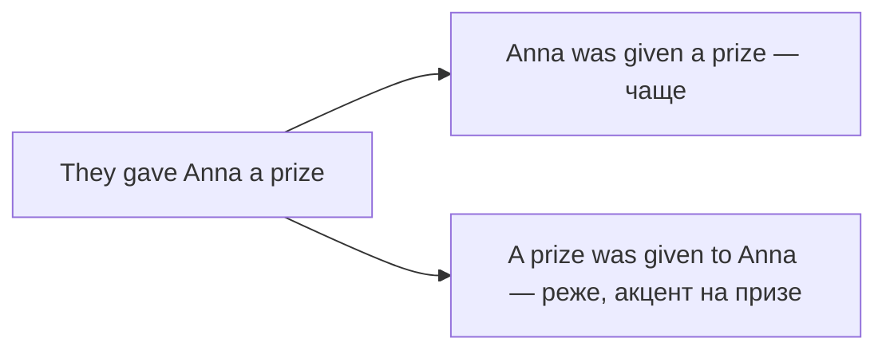

# Пассив — get, два дополнения и глаголы с предлогами

> [!abstract] Коротко
> - **Get-пассив** — разговорный, часто о неожиданном или неприятном: `He got fired`, `My car got stolen`.
> - **Два дополнения**: подлежащим обычно становится **человек** — `I was given a present`.
> - **Предлог остаётся** при глаголе: `The baby is being looked after`, `She was laughed at`.

<!-- beginner-intro:start -->
## Простыми словами

Основу пассива ты уже знаешь: `be + V3`. Здесь три особых случая, которые постоянно встречаются в живой речи и текстах.

Первый — **get вместо be**. `He was fired` и `He got fired` означают одно и то же — «его уволили», но вариант с `get` разговорный и подчёркивает событие, перемену, часто неприятную или неожиданную. Второй — глаголы вроде `give, send, offer, show`, у которых **два дополнения**: что и кому. В пассиве удобнее начать с человека: «Мне дали…» → `I was given…`. Третий — глаголы с **предлогом** (`look after, laugh at, talk about`). Предлог от глагола не отрывается и остаётся сразу после V3, даже если в конце предложения.

### Наглядная схема

Глагол с двумя дополнениями даёт два пассива; обычно выбирают первый:

## Правило и схема
<!-- beginner-intro:end -->

| Модель | Схема | Пример |
| --- | --- | --- |
| Get-пассив | get (в нужном времени) + V3 | I **got stuck** in traffic. |
| Человек — подлежащее | S(кому) + be + V3 + что | She **was offered** a job. |
| Вещь — подлежащее | S(что) + be + V3 + to + кому | A job **was offered to** her. |
| Глагол с предлогом | S + be + V3 + предлог | The problem **was dealt with**. |
| Пассив с инфинитивом | be + V3 + to V | He **was asked to wait**. |
| Пассив после модального | modal + be + V3 | It **can't be done**. |

**Get-пассив** типичен с `get married/divorced/dressed/lost/hurt/fired/paid/stuck/caught/invited`. В официальном письме лучше `be`. Вопрос и отрицание get-пассива — с `do/did`: `Did you get paid?`

**Два дополнения**: так работают `give, send, show, offer, tell, teach, lend, promise, pay, ask`. Глаголы `explain, describe, suggest, say` не дают пассива с человеком в начале: не *I was explained*, а `It was explained to me`.

<!-- beginner-examples:start -->
## Примеры с разбором

1. **My bike got stolen last night.** — Вчера ночью у меня украли велосипед.  
   **Разбор:** разговорный get-пассив подчёркивает неприятное событие; в нейтральном стиле — `was stolen`.
2. **We were shown the new office.** — Нам показали новый офис.  
   **Разбор:** из `They showed us the new office` подлежащим стал человек — `we`. Вещь осталась после глагола.
3. **The children are well looked after.** — За детьми хорошо присматривают.  
   **Разбор:** `look after` — неделимое сочетание, поэтому `after` стоит сразу за `looked`.
4. **The rules were explained to the new staff.** — Правила объяснили новым сотрудникам.  
   **Разбор:** у `explain` нельзя сказать *The staff were explained the rules*; подлежащим становится вещь, адресат идёт с `to`.
<!-- beginner-examples:end -->

## Дополнительные примеры

- **They got married in June.** — Они поженились в июне.
- **I was told to wait outside.** — Мне велели подождать снаружи.
- **This issue needs to be talked about.** — Этот вопрос нужно обсудить.

> [!warning] Частая ошибка
> Не теряй предлог: **She hates being laughed at**, а не *being laughed*. И не говори *I was explained the rule* — только **The rule was explained to me**.

## Проверь себя

Сначала ответь сам, потом открой ответы: нажми на заголовок блока.

1. Перестрой в пассив, начав с человека: *Someone sent me a strange email.*
2. Перестрой в пассив: *Nobody has paid the workers.* (начни с The workers)
3. Перестрой в пассив: *People often laugh at his jokes.*
4. Перестрой разговорно с get: *He was hurt in the accident.*
5. Перестрой в пассив: *They explained the situation to us.*
6. Исправь ошибку: *The dog was taken care by our neighbours.*

> [!success]- Ответы и пояснения
> 1. **I was sent a strange email.** — человек в начале, вещь после глагола.
> 2. **The workers haven't been paid.** — Present Perfect пассив: `have been + V3`.
> 3. **His jokes are often laughed at.** — предлог `at` остаётся после V3.
> 4. **He got hurt in the accident.** — `get + V3` — разговорный пассив события.
> 5. **The situation was explained to us.** — у `explain` подлежащим становится вещь.
> 6. **The dog was taken care of by our neighbours.** — `take care of`: предлог `of` не выпадает.

## Источники

- [Cambridge Dictionary — Get passive](https://dictionary.cambridge.org/grammar/british-grammar/get-passive)
- [Cambridge Dictionary — Passive: other forms](https://dictionary.cambridge.org/grammar/british-grammar/passive-other-forms)
- [British Council — Passives](https://learnenglish.britishcouncil.org/free-resources/grammar/b1-b2/passives)

---

[[070 - Have и get something done — услуга или воздействие|← Предыдущая тема]] · [[000 - Оглавление|Оглавление]] · [[072 - Reported Speech — передача утверждений|Следующая тема →]]
