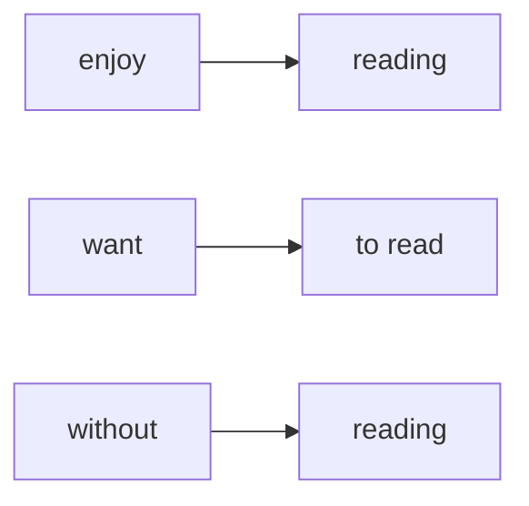

# Герундий и инфинитив после глаголов

> [!abstract] Коротко
> - Второй глагол меняет форму в зависимости от **первого**: `enjoy cooking`, но `want to cook`.
> - `+ V-ing`: enjoy, avoid, finish, mind, keep, give up, consider, practise. `+ to V`: want, decide, hope, plan, agree, refuse, manage, afford.
> - После **предлога** — всегда `-ing`: `without asking`, `good at drawing`.

<!-- beginner-intro:start -->
## Простыми словами

В «Я хочу уйти» два глагола: хочу и уйти. Английский обычно меняет **второй**: `want to leave`, но `enjoy reading`. `To leave` называют инфинитивом, а `reading` в такой роли — герундием. Пока важнее узнать шаблон, чем запомнить термин.

Первый глагол выбирает продолжение: запоминай `enjoy doing`, `decide to do`, а не отдельные слова. После предлога действие обычно получает `-ing`: `before leaving`. Единого правила «всё приятное с -ing» нет; таблица и словарь надёжнее.

### Наглядная схема

Выбор формы зависит от первого слова или от предлога.

## Правило и схема
<!-- beginner-intro:end -->

Когда после одного глагола идёт другой, второй часто принимает форму `V-ing` или `to + V`. Выбор определяется первым глаголом, а не русским переводом.

| Форма | Частые слова |
| --- | --- |
| + V-ing | enjoy, avoid, finish, mind, consider, practise, keep, give up |
| + to V | want, hope, decide, plan, agree, promise, refuse, manage, afford |
| Обе формы часто возможны | like, love, hate, prefer, begin, start, continue |

После предлога обычно нужен `V-ing`: `without asking`, `interested in learning`. Герундий может быть подлежащим: `Swimming is good exercise`. Отрицание: `not doing`, `not to do`.

<!-- beginner-examples:start -->
## Примеры с разбором

1. **I enjoy cooking.** — Мне нравится готовить.  
   **Разбор:** `enjoy` требует форму `-ing`, хотя по-русски стоит «готовить».
2. **I want to cook.** — Я хочу готовить.  
   **Разбор:** `want` выбирает другой шаблон — `to + V`.
3. **She left without eating.** — Она ушла, не поев.  
   **Разбор:** `without` — предлог; после него действие получает `-ing`.
4. **Swimming helps me relax.** — Плавание помогает мне расслабиться.  
   **Разбор:** `swimming` называет занятие и занимает место подлежащего; это не Continuous без `be`.
<!-- beginner-examples:end -->

## Дополнительные примеры

- **I enjoy learning languages.** — Мне нравится изучать языки.
- **We managed to finish on time.** — Нам удалось закончить вовремя.
- **Thank you for helping me.** — Спасибо, что помог мне.

> [!warning] Частая ошибка
> **Enjoy reading**, а не *enjoy to read*. **Would like to read**, а не *would like reading* для обычного пожелания. Смена смысла: [[079 - Инфинитив или -ing со сменой смысла|Инфинитив или -ing со сменой смысла]].

> [!tip] Дальше по теме
> [[141 - Инфинитив и герундий C1 — to have done, his coming, it's no use|Инфинитив и герундий C1 — to have done, his coming, it's no use]]

## Проверь себя

Сначала ответь сам, потом открой ответы: нажми на заголовок блока.

1. Вставь форму: I enjoy ___ (read) detective stories.
2. Вставь форму: We decided ___ (stay) at home.
3. Вставь форму: She finally gave up ___ (smoke).
4. Вставь форму: I can't afford ___ (buy) a new car.
5. Вставь форму: He left without ___ (say) goodbye.
6. Исправь ошибку: *Would you mind to help me?*

> [!success]- Ответы и пояснения
> 1. **reading** — `enjoy + V-ing`.
> 2. **to stay** — `decide + to V`.
> 3. **smoking** — `give up + V-ing`.
> 4. **to buy** — `afford + to V`.
> 5. **saying** — после предлога `without` — `-ing`.
> 6. **Would you mind helping me?** — `mind + V-ing`.

## Источники

- [British Council — Verbs followed by '-ing' or infinitive](https://learnenglish.britishcouncil.org/free-resources/grammar/a1-a2/verbs-followed-ing-or-infinitive)
- [Cambridge Dictionary — Infinitives with and without to](https://dictionary.cambridge.org/grammar/british-grammar/infinitives)

---

[[075 - Reporting Verbs — promise, suggest, deny|← Предыдущая тема]] · [[000 - Оглавление|Оглавление]] · [[077 - Глагол плюс дополнение плюс инфинитив|Следующая тема →]]
