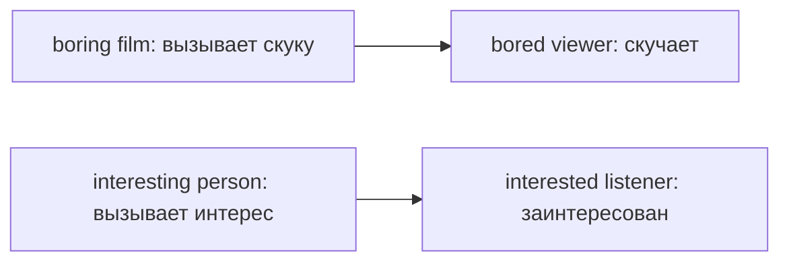

# Прилагательные на -ed и -ing

> [!abstract] Коротко
> - `-ed` — **что чувствую я**: `I'm bored, interested, tired`.
> - `-ing` — **что вызывает чувство**: `The film is boring, interesting, tiring`.
> - `I'm boring` = «со мной скучно» — частая и смешная ошибка.

<!-- beginner-intro:start -->
## Простыми словами

В таких парах спроси: **кто чувствует? что вызывает чувство?** `Bored` — испытывающий скуку, `boring` — вызывающий скуку. Это различие направления чувства, а не правило «человек или вещь».

Человек может быть `interesting`, если с ним интересно другим. Животное может быть `frightened`, если оно испугалось. Окончания помогают именно в соответствующих парах; не надо переносить эту формулу на любое слово, оканчивающееся на `-ed/-ing`.

### Наглядная схема

Стрелка идёт от причины чувства к тому, кто его испытывает.

## Правило и схема
<!-- beginner-intro:end -->

В парах вроде `interested/interesting` окончание помогает различить **испытываемое чувство** и **то, что его вызывает**.

| Чувство, -ed | Причина чувства, -ing |
| --- | --- |
| bored — скучающий | boring — скучный |
| interested — заинтересованный | interesting — интересный |
| excited — взволнованный | exciting — захватывающий |
| confused — растерянный | confusing — запутанный |
| tired — уставший | tiring — утомительный |

Правило не сводится к «люди/предметы»: человек может быть `interesting`, а животное — `frightened`. Эта закономерность касается соответствующих пар прилагательных, а не любого слова с `-ed/-ing`.

<!-- beginner-examples:start -->
## Примеры с разбором

1. **The film is boring.** — Фильм скучный.  
   **Разбор:** фильм вызывает скуку у зрителей, поэтому `-ing`.
2. **I'm bored.** — Мне скучно.  
   **Разбор:** чувство испытываю я, поэтому `-ed`. `I'm boring` означало бы «со мной скучно».
3. **She's an interesting speaker.** — Она интересный оратор.  
   **Разбор:** человек тоже может вызывать интерес, поэтому `interesting`.
4. **The instructions are confusing, and I'm confused.** — Инструкции запутанные, и я растерян.  
   **Разбор:** инструкции вызывают растерянность; я её испытываю. Обе формы описывают одну ситуацию с разных сторон.
<!-- beginner-examples:end -->

## Дополнительные примеры

- **The lesson was boring, so I felt bored.** — Урок был скучным, поэтому мне было скучно.
- **We were amazed by the view.** — Нас поразил вид.
- **The dog was frightened by the noise.** — Собака испугалась шума.

> [!warning] Частая ошибка
> **I'm bored** — мне скучно. **I'm boring** — я скучный, со мной скучно.

## Проверь себя

Сначала ответь сам, потом открой ответы: нажми на заголовок блока.

1. Выбери: The lecture was so (bored / boring) that I fell asleep.
2. Выбери: I'm (exciting / excited) about the trip.
3. Выбери: These instructions are very (confusing / confused).
4. Выбери: She felt (embarrassing / embarrassed) when she fell.
5. Выбери: It was a (tiring / tired) journey.
6. Исправь ошибку: *I'm very interesting in history.*

> [!success]- Ответы и пояснения
> 1. **boring** — лекция вызывает скуку.
> 2. **excited** — чувство испытываю я.
> 3. **confusing** — инструкции вызывают растерянность.
> 4. **embarrassed** — чувство испытывает она.
> 5. **tiring** — поездка утомляет.
> 6. **I'm very interested in history.** — интерес испытываю я → `-ed`.

## Источники

- [British Council — Adjectives ending in '-ed' and '-ing'](https://learnenglish.britishcouncil.org/free-resources/grammar/a1-a2/adjectives-ending-ed-ing)

---

[[089 - Прилагательные — позиция и порядок|← Предыдущая тема]] · [[000 - Оглавление|Оглавление]] · [[091 - Сравнительная степень — bigger и more useful|Следующая тема →]]
