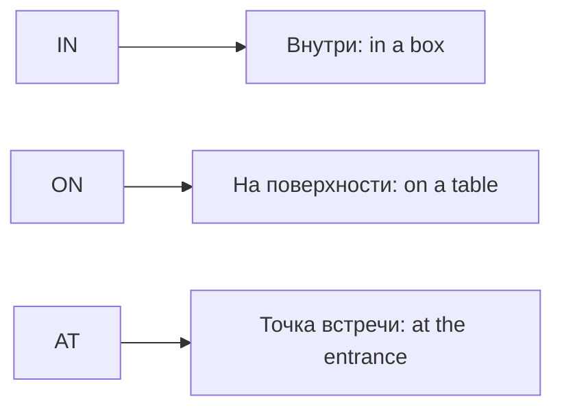

# Предлоги места — in, on, at

> [!abstract] Коротко
> - `in` — **внутри** (пространство): `in a box, in London, in a car`.
> - `on` — **на поверхности/линии**: `on the table, on the wall, on the second floor, on a bus`.
> - `at` — **точка/место деятельности**: `at the door, at the station, at work, at home`.

<!-- beginner-intro:start -->
## Простыми словами

Для начала представь три картинки: предмет **внутри коробки** — `in`, **на поверхности** — `on`, **в точке встречи** — `at`. Это помогает понять основные значения, но не заменяет устойчивые выражения вроде `at home`.

Один объект можно описать по-разному: `at the station` — на станции как месте встречи; `in the station` — именно внутри здания. Для транспорта запоминай обычные пары: `in a car/taxi`, но `on a bus/train`. Русский предлог «в» не всегда превращается в `in`.

### Наглядная схема

Это смысловые опоры; устойчивые сочетания проверяем отдельно.

## Правило и схема
<!-- beginner-intro:end -->

`In` обычно представляет место как пространство, `on` — как поверхность или линию, `at` — как точку или место деятельности. Это полезная схема, но многие сочетания устойчивые.

| Предлог | Примеры |
| --- | --- |
| in | in a room, in London, in a car |
| on | on the table, on the wall, on the third floor, on a bus |
| at | at the door, at the station, at work, at 10 Green Street |
| under / above | под / выше |
| behind / in front of | за / перед |
| next to / opposite | рядом с / напротив |
| between / among | между отдельными объектами / среди группы |

`Between` возможно и для более чем двух объектов, если важны отдельные отношения. `At the station` подчёркивает место; `in the station` — внутри здания.

<!-- beginner-examples:start -->
## Примеры с разбором

1. **The money is in my pocket.** — Деньги у меня в кармане.  
   **Разбор:** карман рассматривается как внутреннее пространство → `in`.
2. **The picture is on the wall.** — Картина на стене.  
   **Разбор:** поверхность может быть вертикальной; связь с поверхностью передаёт `on`.
3. **Let's meet at the entrance.** — Давай встретимся у входа.  
   **Разбор:** вход — точка встречи, а не пространство, внутри которого мы находимся.
4. **She's in a taxi. He's on a bus.** — Она в такси. Он в автобусе.  
   **Разбор:** для этих видов транспорта стандартные сочетания различаются; учим их целиком.
<!-- beginner-examples:end -->

## Дополнительные примеры

- **The keys are on the shelf.** — Ключи на полке.
- **There are a lot of people at the concert.** — На концерте много людей.
- **She sat between Anna and Leo.** — Она села между Анной и Лео.

> [!tip] Запомни
> **In a taxi**, но **on a train**; **at home**, без `the`.

## Проверь себя

Сначала ответь сам, потом открой ответы: нажми на заголовок блока.

1. Вставь предлог: The keys are ___ the table.
2. Вставь предлог: She lives ___ Paris.
3. Вставь предлог: I'll wait for you ___ the bus stop.
4. Вставь предлог: There's a picture ___ the wall.
5. Вставь предлоги: He's ___ a taxi, and she's ___ a train.
6. Исправь ошибку: *My office is in the third floor.*

> [!success]- Ответы и пояснения
> 1. **on** — поверхность.
> 2. **in** — город — пространство.
> 3. **at** — точка встречи.
> 4. **on** — вертикальная поверхность — тоже `on`.
> 5. **in, on** — устойчивые сочетания с транспортом.
> 6. **My office is on the third floor.** — этажи — `on`.

## Источники

- [British Council — Prepositions of place: 'in', 'on', 'at'](https://learnenglish.britishcouncil.org/free-resources/grammar/a1-a2/prepositions-place)

---

[[099 - Предлоги времени — at, on, in и другие|← Предыдущая тема]] · [[000 - Оглавление|Оглавление]] · [[101 - Предлоги движения — to, into, across|Следующая тема →]]
