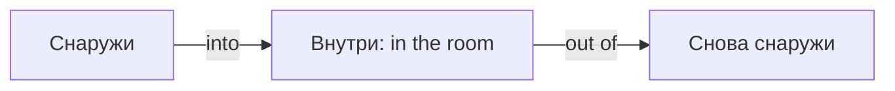

# Предлоги движения — to, into, across

> [!abstract] Коротко
> - `in` — где находится, `into` — **движение внутрь**: `go into the room`. `out of` — наружу.
> - `across` — поперёк (с одной стороны на другую), `through` — сквозь (внутри пространства), `along` — вдоль, `past` — мимо.
> - `to` — до пункта назначения, `towards` — в направлении. `go home` и `arrive at/in` — без `to`.

<!-- beginner-intro:start -->
## Простыми словами

Предлог движения рисует маршрут: куда, откуда, через что, вдоль чего. `In` описывает положение внутри, а `into` — **переход снаружи внутрь**. Это различие между фотографией места и стрелкой движения.

Сравни траектории: `across` — с одной стороны на другую; `through` — через внутреннее пространство; `along` — вдоль. `To` называет пункт назначения, `towards` — только направление и не гарантирует прибытия.

### Наглядная схема

Сравни положение и движение через границу.

## Правило и схема
<!-- beginner-intro:end -->

Предлоги движения описывают направление и траекторию. Отличай положение от перехода в новое место: `in` — внутри, `into` — внутрь.

| Предлог | Значение |
| --- | --- |
| to / towards | к пункту назначения / в направлении |
| into / out of | внутрь / наружу из |
| onto / off | на поверхность / с поверхности |
| across | через пространство с одной стороны на другую |
| through | сквозь, через внутреннее пространство |
| along / past | вдоль / мимо |
| over / under | над, через верх / под |

После `go/come/get` слово `home` обычно без `to`: `go home`. После `arrive` — `at` для места-точки, `in` для города/страны, а не `to`.

<!-- beginner-examples:start -->
## Примеры с разбором

1. **She is in the room. She walks into the room.** — Она в комнате. Она входит в комнату.  
   **Разбор:** сначала положение, затем пересечение границы внутрь.
2. **We walked across the road.** — Мы перешли дорогу.  
   **Разбор:** движение от одной стороны дороги к другой → `across`.
3. **We walked through the forest.** — Мы прошли через лес.  
   **Разбор:** маршрут проходит внутри пространства леса → `through`.
4. **He walked towards the station, then turned left.** — Он пошёл в сторону станции, затем свернул налево.  
   **Разбор:** `towards` сообщает направление; он необязательно дошёл до станции.
<!-- beginner-examples:end -->

## Дополнительные примеры

- **She walked into the kitchen.** — Она вошла в кухню.
- **We drove through a tunnel.** — Мы проехали через туннель.
- **Turn left and walk past the bank.** — Поверни налево и пройди мимо банка.

> [!warning] Частая ошибка
> **Across the road**, но **through the forest**. **Arrive in Paris**, не *arrive to Paris*.

## Проверь себя

Сначала ответь сам, потом открой ответы: нажми на заголовок блока.

1. Вставь предлог: She jumped ___ the pool.
2. Вставь предлог: We swam ___ the river to the other side.
3. Вставь предлог: The train went ___ a long tunnel.
4. Вставь предлог: We walked ___ the beach for an hour.
5. Исправь ошибку: *We arrived to London at night.*
6. Исправь ошибку: *Let's go to home.*

> [!success]- Ответы и пояснения
> 1. **into** — движение внутрь.
> 2. **across** — с одного берега на другой.
> 3. **through** — внутри пространства туннеля.
> 4. **along** — вдоль линии берега.
> 5. **We arrived in London at night.** — `arrive in` + город.
> 6. **Let's go home.** — с `home` после `go` предлог не нужен.

## Источники

- [British Council — Adverbials of direction](https://learnenglish.britishcouncil.org/free-resources/grammar/english-grammar-reference/adverbials-direction)
- [Cambridge Dictionary — Across, over or through ?](https://dictionary.cambridge.org/us/grammar/british-grammar/across)
- [Cambridge Dictionary — In, into](https://dictionary.cambridge.org/us/grammar/british-grammar/in-into)

---

[[100 - Предлоги места — in, on, at|← Предыдущая тема]] · [[000 - Оглавление|Оглавление]] · [[102 - Управление — глаголы, прилагательные и предлоги|Следующая тема →]]
