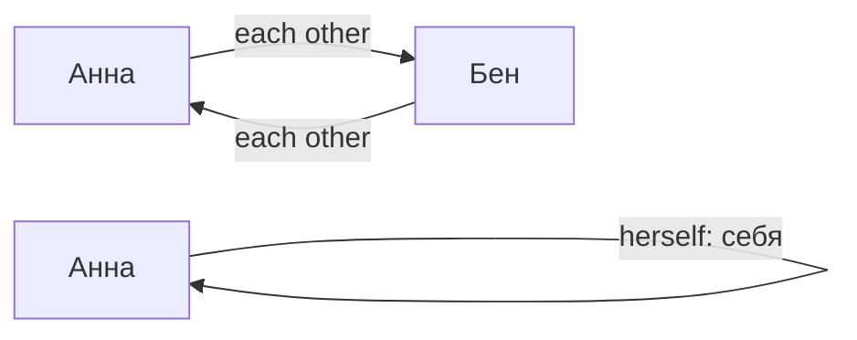

# Возвратные местоимения и each other

> [!abstract] Коротко
> - Возвратные: `myself, yourself, himself, herself, itself, ourselves, yourselves, themselves` — действие **на себя**.
> - Те же слова подчёркивают «сам»: `I did it myself`. `by myself` — один, самостоятельно.
> - `each other` — **друг друга**. Обычно без возвратного: `wash, dress, relax, feel` (`I relaxed`).

<!-- beginner-intro:start -->
## Простыми словами

Возвратное местоимение означает: действие вернулось к самому исполнителю. «Я увидел себя» — `I saw myself`. `Each other` означает другое: двое смотрят **друг на друга**, а не каждый на себя.

Сначала нарисуй мысленные стрелки: один человек → он же (`myself/herself`); один → другой и обратно (`each other`). Та же возвратная форма может подчёркивать «лично сам», а с `by` — «один/самостоятельно». Русское окончание «-ся» не всегда переводится возвратным местоимением.

### Наглядная схема

У возвратного действия стрелка возвращается к тому же человеку; у взаимного связывает разных людей.

## Правило и схема
<!-- beginner-intro:end -->

Возвратная форма нужна, когда субъект и объект действия совпадают: человек делает что-то **себе/с собой**. Она также выделяет, кто сделал действие лично.

| Личное | Возвратное |
| --- | --- |
| I / you, один | myself / yourself |
| he / she / it | himself / herself / itself |
| we / you, несколько / they | ourselves / yourselves / themselves |

`By myself` = один, самостоятельно. `Each other/one another` = друг друга, взаимное действие. В английском обычно не добавляют возвратное с обычными `wash`, `dress`, `relax`, если контекст не требует акцента.

<!-- beginner-examples:start -->
## Примеры с разбором

1. **She looked at herself in the mirror.** — Она посмотрела на себя в зеркало.  
   **Разбор:** смотрит и видит себя один человек → `herself`.
2. **They write to each other every week.** — Они пишут друг другу каждую неделю.  
   **Разбор:** каждый пишет другому, а не самому себе; действие взаимное.
3. **I made this cake myself.** — Я сам приготовил этот торт.  
   **Разбор:** `myself` подчёркивает исполнителя: лично я, не кто-то другой.
4. **I live by myself.** — Я живу один.  
   **Разбор:** `by myself` означает отсутствие других людей рядом; это не действие над собой.
<!-- beginner-examples:end -->

## Дополнительные примеры

- **I cut myself while cooking.** — Я порезался во время готовки.
- **She repaired it herself.** — Она починила это сама.
- **They looked at each other.** — Они посмотрели друг на друга.

> [!warning] Частая ошибка
> **They looked at themselves** — посмотрели на себя, например в зеркало. **At each other** — друг на друга. Не заменяй обычное **me** словом **myself** без причины.

## Проверь себя

Сначала ответь сам, потом открой ответы: нажми на заголовок блока.

1. Вставь: Be careful! Don't cut ___.
2. Вставь: We painted the room ___. (сами)
3. Вставь: Anna and Tom love ___. (друг друга)
4. Вставь: She lives by ___.
5. Исправь ошибку: *I felt myself tired.*
6. Исправь ошибку: *They looked at themselves and smiled.* (друг на друга)

> [!success]- Ответы и пояснения
> 1. **yourself** — действие направлено на себя.
> 2. **ourselves** — подчёркиваем «сами».
> 3. **each other** — взаимное действие.
> 4. **herself** — `by herself` — одна.
> 5. **I felt tired.** — с `feel` возвратное не нужно.
> 6. **They looked at each other and smiled.** — взаимное действие → `each other`.

## Источники

- [British Council — Reflexive pronouns](https://learnenglish.britishcouncil.org/free-resources/grammar/b1-b2/reflexive-pronouns)

---

[[109 - Other, another и the other|← Предыдущая тема]] · [[000 - Оглавление|Оглавление]] · [[111 - One и ones — замена существительного|Следующая тема →]]
