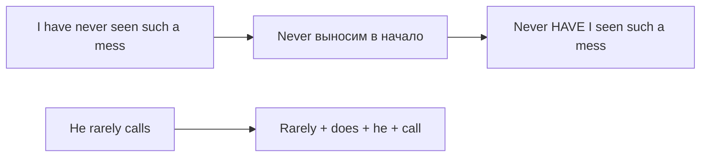

# Инверсия после отрицательных слов — Never have I

> [!abstract] Коротко
> - Если предложение начинается с отрицательного или ограничительного слова (`never, rarely, not only, hardly, no sooner, only then, under no circumstances`), дальше идёт **вопросительный порядок**: `Never have I seen…`
> - Обычный глагол в Simple получает `do/does/did`: `Rarely does he call`, `Little did I know`.
> - Это книжный, эмоциональный или ораторский стиль. В обычной речи — нейтральный порядок: `I've never seen…`

<!-- beginner-intro:start -->
## Простыми словами

Сравни: «Я никогда не видел такого» и «Никогда ещё я не видел такого!». Вторая фраза звучит сильнее, торжественнее. В английском для такого эффекта отрицательное слово выносят в начало, а после него переставляют подлежащее и помощник — **как в вопросе**, хотя это не вопрос: `Never have I seen such a mess!`

Механика та же, что в вопросах: найди первый помощник (`have, is, can, will…`) и поставь его перед подлежащим. Если помощника нет (Present/Past Simple), добавь `do/does/did`. Это приём «для эффекта», поэтому чаще встречается в письменной речи, выступлениях, литературе. В повседневном разговоре звучит пафосно.

### Наглядная схема

## Правило и схема
<!-- beginner-intro:end -->

**Схема:** `отрицательное/ограничительное слово + помощник + S + основной глагол…`

| Начало | Значение | Пример |
| --- | --- | --- |
| Never (before) / Rarely / Seldom | никогда / редко | **Seldom do we** see such talent. |
| Not only … but (also) | не только…, но и | **Not only did she** win, **but** she **also** broke the record. |
| Hardly / Scarcely … when | едва…, как | **Hardly had I** sat down **when** the phone rang. |
| No sooner … than | не успел…, как | **No sooner had we** arrived **than** it started to rain. |
| Only then / Only when / Only after / Only by | только тогда / только когда | **Only when** I got home **did I** realise. |
| Not until | лишь когда, не раньше чем | **Not until** the end **did** he speak. |
| Under no circumstances / On no account / In no way | ни при каких условиях | **Under no circumstances should you** open it. |
| Little | совсем не (понимал, знал) | **Little did I know** what was coming. |
| Nowhere | нигде | **Nowhere else can you** find such views. |
| So + adj / Such + be | настолько | **So tired was he that** he fell asleep. |

**Важно:**
- С `only when / not until / only after` инверсия происходит **во второй, главной части**: `Only when I saw her did I understand`.
- `Hardly/Scarcely … when` и `No sooner … than` почти всегда с Past Perfect в первой части.
- С `be` помощник не нужен: `Rarely is he late`.

<!-- beginner-examples:start -->
## Примеры с разбором

1. **Never have I felt so happy.** — Никогда ещё я не был так счастлив.  
   **Разбор:** нейтрально `I have never felt…`; после вынесенного `never` переставляем `have` и `I`.
2. **Not only does he speak French, but he also writes poetry in it.** — Он не только говорит по-французски, но и пишет на нём стихи.  
   **Разбор:** в Present Simple нет помощника, поэтому появляется `does`, а глагол — `speak` без `-s`. Вторая часть с `but` идёт в обычном порядке.
3. **No sooner had she left than he called.** — Не успела она уйти, как он позвонил.  
   **Разбор:** `had she left` — Past Perfect с инверсией; вторая часть после `than` — обычная, Past Simple.
4. **Only later did I understand what she meant.** — Лишь позже я понял, что она имела в виду.  
   **Разбор:** `only + время` вызывает инверсию; Past Simple → `did I understand`.
<!-- beginner-examples:end -->

## Дополнительные примеры

- **Little did they know that the police were watching.** — Они и не подозревали, что за ними следит полиция.
- **Under no circumstances must this door be left open.** — Ни при каких условиях нельзя оставлять эту дверь открытой.
- **So difficult was the exam that nobody finished it.** — Экзамен был настолько трудным, что никто его не закончил.

> [!warning] Частая ошибка
> **Not only did he lie**, а не *Not only he lied*. Но если `not only` стоит не в начале, инверсии нет: **He not only lied but also…** И не путай: в `Hardly anyone came` нет инверсии — `hardly` относится к `anyone`, а не ко всему предложению.

## Проверь себя

Сначала ответь сам, потом открой ответы: нажми на заголовок блока.

1. Перефразируй с Never: *I have never been so insulted.*
2. Перефразируй с Rarely: *We rarely go out these days.*
3. Перефразируй с Hardly: *I had just closed my eyes when the alarm went off.*
4. Перефразируй с Not only: *She sings and she also plays the violin.*
5. Перефразируй с Only when: *I realised my mistake only when I read the email again.*
6. Исправь ошибку: *Little I knew that he was lying.*

> [!success]- Ответы и пояснения
> 1. **Never have I been so insulted.** — помощник `have` перед `I`.
> 2. **Rarely do we go out these days.** — Present Simple → `do` + `go`.
> 3. **Hardly had I closed my eyes when the alarm went off.** — `hardly had + S + V3 … when + Past Simple`.
> 4. **Not only does she sing, but she also plays the violin.** — инверсия только в первой части.
> 5. **Only when I read the email again did I realise my mistake.** — инверсия в главной части после придаточного с `only when`.
> 6. **Little did I know that he was lying.** — после `little` в начале нужна инверсия с `did`.

## Источники

- [Cambridge Dictionary — Inversion](https://dictionary.cambridge.org/grammar/british-grammar/inversion)
- [Cambridge Dictionary — No sooner](https://dictionary.cambridge.org/grammar/british-grammar/no-sooner)
- [Cambridge Dictionary — Not only … but also](https://dictionary.cambridge.org/grammar/british-grammar/not-only-but-also)

---

[[125 - Британская и американская грамматика|← Предыдущая тема]] · [[000 - Оглавление|Оглавление]] · [[127 - Фронтинг и обособление — Much as I like it, Strange as it seems|Следующая тема →]]
