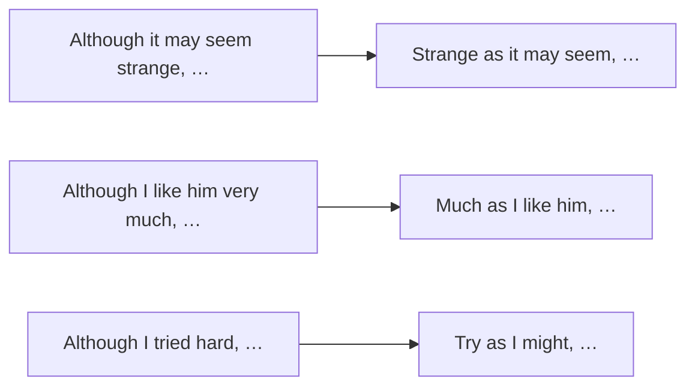

# Фронтинг и обособление — Much as I like it, Strange as it seems

> [!abstract] Коротко
> - **Фронтинг** — вынос части предложения в начало ради акцента или связи с предыдущим: `This I cannot accept.` `Into the room walked a tall man.`
> - Уступка: `adj/adv/N + as/though + S + V` — `Strange as it may seem…` (как ни странно), `Much as I like him…` (как бы он мне ни нравился), `Try as I might…` (как я ни старался).
> - Разговорные «хедеры» и «хвосты»: `That new café — have you been there?` · `He's a nice guy, your brother.`

<!-- beginner-intro:start -->
## Простыми словами

В английском порядок слов строгий, но иногда его специально нарушают, чтобы выделить важное. Это называется **фронтинг** (от `front` — «перед»). Например, обычно `I can't accept this`. Если сказать `This I cannot accept`, слово `this` оказывается в фокусе: «Вот это я принять не могу». Так говорят в эмоциональной речи и выразительных текстах.

Особенно полезна уступительная модель с `as`. Она заменяет `although`, но звучит элегантнее: `Although it may seem strange…` → `Strange as it may seem…` — «Как ни странно…». Обрати внимание: прилагательное идёт **первым**, без `so` и `although`. В литературе встречается и вынос места с инверсией: `Here comes the bus`, `On the hill stood a castle`.

### Наглядная схема

## Правило и схема
<!-- beginner-intro:end -->

| Модель | Пример | Перевод |
| --- | --- | --- |
| Вынос дополнения | **That** I don't believe. | Вот этому я не верю. |
| adj + as/though + S + V | **Tired as she was**, she kept going. | Хоть она и устала, продолжала. |
| adv + as + S + V | **Hard as he tried**, he failed. | Как он ни старался, не вышло. |
| Much as + S + V | **Much as I'd like to**, I can't. | Как бы мне ни хотелось, не могу. |
| V + as + S + might/may | **Try as I might**, I couldn't open it. | Как я ни пытался, не смог открыть. |
| N (без артикля) + as/though | **Child though she was**, she understood. | Хоть она и была ребёнком, поняла. |
| Место/направление + V + S | **Here comes** the bus. **Down came** the rain. | Вот идёт автобус. Хлынул дождь. |
| Such/So + be + S | **Such was** the noise that… | Шум был таким, что… |
| Хедер (разговорное) | **That friend of yours**, what's his name? | Этот твой друг, как его зовут? |
| Хвост (разговорное) | It's lovely, **this place**. | Классное оно, это место. |

**Инверсия после места:** только с непереходными глаголами движения/нахождения (`come, go, stand, lie, sit, walk`) и **не с местоимением**: `Here comes the bus`, но `Here it comes`.

<!-- beginner-examples:start -->
## Примеры с разбором

1. **Strange as it may sound, I enjoy doing housework.** — Как ни странно, я люблю заниматься домашними делами.  
   **Разбор:** `strange` вынесено вперёд; модель = `Although it may sound strange`.
2. **Much as I admire his talent, I can't work with him.** — Как бы я ни восхищался его талантом, работать с ним я не могу.  
   **Разбор:** `much as` — сильная уступка: «хотя очень».
3. **Try as she might, she couldn't remember his name.** — Как она ни старалась, не могла вспомнить его имя.  
   **Разбор:** начальная форма `try` + `as` + подлежащее + `might`.
4. **On the table lay a letter.** — На столе лежало письмо.  
   **Разбор:** место вынесено вперёд, глагол перед подлежащим — литературный приём.
<!-- beginner-examples:end -->

## Дополнительные примеры

- **What he did next I'll never forget.** — Того, что он сделал потом, я никогда не забуду.
- **Talented though he is, he's very lazy.** — Хоть он и талантлив, но очень ленив.
- **There goes our last chance.** — Вот и уплыл наш последний шанс.

> [!warning] Частая ошибка
> В уступке с `as` нет `so` и артикля: **Tired as I was**, а не *So tired as I was*; **Child though she was**, а не *A child though…*. После местоимения инверсии нет: **Here she comes**, а не *Here comes she*.

## Проверь себя

Сначала ответь сам, потом открой ответы: нажми на заголовок блока.

1. Перефразируй с as: *Although it may seem incredible, it's true.*
2. Перефразируй с much as: *Although I love you very much, I can't marry you.*
3. Перефразируй с try as: *Although we tried hard, we couldn't find the key.*
4. Перефразируй с though: *Although he was rich, he lived simply.*
5. Перестрой с инверсией: *The bus comes here.*
6. Исправь ошибку: *Here comes he!*

> [!success]- Ответы и пояснения
> 1. **Incredible as it may seem, it's true.** — прилагательное вперёд + `as`.
> 2. **Much as I love you, I can't marry you.** — `much as` = «как бы ни».
> 3. **Try as we might, we couldn't find the key.** — `V + as + S + might`.
> 4. **Rich though he was, he lived simply.** — `adj + though + S + V`.
> 5. **Here comes the bus.** — место вперёд, глагол перед существительным.
> 6. **Here he comes!** — с местоимением порядок обычный.

## Источники

- [Cambridge Dictionary — Fronting](https://dictionary.cambridge.org/grammar/british-grammar/fronting)
- [Cambridge Dictionary — Headers and tails](https://dictionary.cambridge.org/grammar/british-grammar/headers-and-tails)
- [Cambridge Dictionary — Word order and focus](https://dictionary.cambridge.org/grammar/british-grammar/word-order-and-focus_1)

---

[[126 - Инверсия после отрицательных слов — Never have I|← Предыдущая тема]] · [[000 - Оглавление|Оглавление]] · [[128 - Продвинутое выделение — All I want, The reason why, What happened was|Следующая тема →]]
