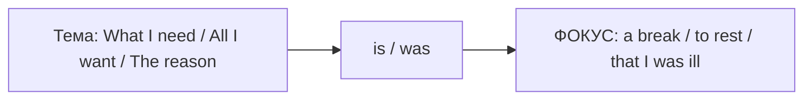

# Продвинутое выделение — All I want, The reason why, What happened was

> [!abstract] Коротко
> - Расширенные cleft-рамки: `All I want is…` (единственное, что), `The thing is…`, `The reason (why)… is that…`, `The place where…`, `The person who…`, `The last thing I need is…`
> - Выделение действия: `What + S + do/did + is/was + (to) V` — `What I did was (to) call the police`. События: `What happened was (that)…`
> - Обратный порядок: `A holiday is what I need`. Акцент на времени/причине: `It wasn't until 2010 that…`, `It's because… that…`

<!-- beginner-intro:start -->
## Простыми словами

На уровне B2 ты освоил базовые рамки `It was Tom who…` и `What I need is…`. Они позволяют разделить предложение на две части: подготовку («что мне нужно…») и главный ответ («…так это отдых»). На C1 таких рамок становится больше, и они звучат очень естественно в разговоре, презентациях и эссе.

Например, `All I want is some peace` — «Всё, чего я хочу, — это немного покоя» (подчёркивает «только это»). `The reason I called is that…` — «Звоню я вот почему…». `What happened was…` — удобный способ начать рассказ о проблеме. Главное правило: первая часть вводит тему, после `is/was` идёт новая, важная информация.

### Наглядная схема

## Правило и схема
<!-- beginner-intro:end -->

| Рамка | Смысл | Пример |
| --- | --- | --- |
| What + S + V + is/was + N | вот что | **What I love is** the silence. |
| What + S + do/did + is/was + (to) V | вот что сделал | **What we did was (to) call** a taxi. |
| What happened was (that) + предложение | дело было так | **What happened was** the car broke down. |
| All (that) + S + V + is/was | всё, что; только | **All I need is** a bed. |
| The thing (that) / The problem is (that) | дело в том, что | **The thing is**, I'm broke. |
| The reason (why) + S + V + is that | причина в том, что | **The reason I'm late is that** I overslept. |
| The place where / The time when / The person who | место, время, человек | **The person who helped me was** Anna. |
| The last thing + S + V + is | меньше всего | **The last thing I want is** an argument. |
| N + is what / where / why | обратный порядок | **That's why** I left. **This is where** we met. |
| It + be + not until … that | лишь тогда | **It wasn't until** midnight **that** he arrived. |
| It + be + because … that | именно потому | **It's because** he's honest **that** I trust him. |

Глагол `be` после рамки обычно в единственном числе даже перед множественным: `What we need **is** more volunteers` (разговорно встречается и `are`).

<!-- beginner-examples:start -->
## Примеры с разбором

1. **All I want is a cup of tea and some peace.** — Всё, чего я хочу, — это чашку чая и немного покоя.  
   **Разбор:** `all` подчёркивает «ничего больше»; после `is` — фокус.
2. **What I did was ring the manager.** — Я сделал вот что: позвонил менеджеру.  
   **Разбор:** выделяем действие; после `was` — `ring` или `to ring`, оба варианта верны.
3. **The reason why I'm calling is that we've changed the date.** — Звоню потому, что мы перенесли дату.  
   **Разбор:** после `the reason… is` нейтрально и правильно — `that`, а не *because*.
4. **It wasn't until I moved abroad that I understood my parents.** — Лишь переехав за границу, я понял своих родителей.  
   **Разбор:** `not until … that` выделяет момент, когда наконец произошло событие.
<!-- beginner-examples:end -->

## Дополнительные примеры

- **The last thing I need right now is another meeting.** — Ещё одного совещания мне сейчас нужно меньше всего.
- **Patience is what you need.** — Тебе нужно именно терпение.
- **What happened was that nobody had booked the room.** — Произошло вот что: никто не забронировал зал.

> [!warning] Частая ошибка
> **The reason is that…**, а не *The reason is because…* в нейтральном письме. После `What I did was` не ставь прошедшее ещё раз: **was call / was to call**, а не *was called*.

## Проверь себя

Сначала ответь сам, потом открой ответы: нажми на заголовок блока.

1. Выдели с What: *I need a long holiday.*
2. Выдели действие: *We sold the car.* (What we did…)
3. Выдели с All: *I want you to be happy.*
4. Выдели причину: *I left early because I felt ill.* (The reason…)
5. Выдели с not until: *I realised the truth only when I read her letter.*
6. Исправь ошибку: *The reason I'm late is because the bus broke down.*

> [!success]- Ответы и пояснения
> 1. **What I need is a long holiday.** — тема → фокус.
> 2. **What we did was (to) sell the car.** — после `was` — начальная форма или `to V`.
> 3. **All I want is for you to be happy.** / **All I want is you to be happy** (разговорно). — после `All I want is` естественно `for + кого + to V`.
> 4. **The reason (why) I left early was that I felt ill.** — `the reason… is/was that`.
> 5. **It wasn't until I read her letter that I realised the truth.** — `not until … that`.
> 6. **The reason I'm late is that the bus broke down.** — после `reason` — `that`.

## Источники

- [Cambridge Dictionary — Cleft sentences](https://dictionary.cambridge.org/grammar/british-grammar/cleft-sentences-it-was-in-june-we-got-married)
- [Cambridge Dictionary — Word order and focus](https://dictionary.cambridge.org/grammar/british-grammar/word-order-and-focus_1)
- [Cambridge Dictionary — Reason](https://dictionary.cambridge.org/grammar/british-grammar/reason)

---

[[127 - Фронтинг и обособление — Much as I like it, Strange as it seems|← Предыдущая тема]] · [[000 - Оглавление|Оглавление]] · [[129 - Условия без if — Had I known, but for, supposing|Следующая тема →]]
