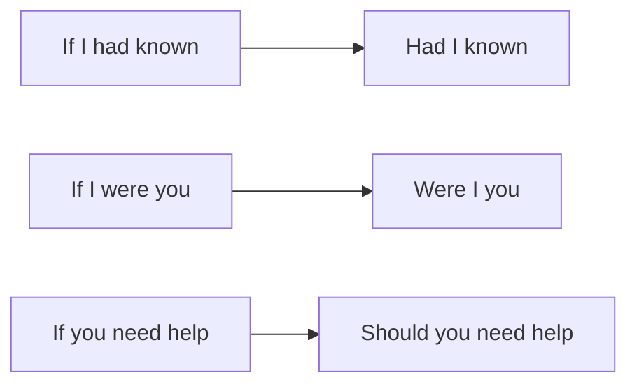

# Условия без if — Had I known, but for, supposing

> [!abstract] Коротко
> - В формальной речи `if` можно убрать и переставить помощник: `Had I known` = `If I had known`, `Were I you` = `If I were you`, `Should you need` = `If you (should) need`.
> - `If … were to + V` — гипотеза о маловероятном будущем: `If the plan were to fail…`
> - Другие способы выразить условие: `but for / if it weren't for / if it hadn't been for`, `otherwise`, `supposing / suppose`, `assuming (that)`, `on condition that`, `given that`, `in the event of`.

<!-- beginner-intro:start -->
## Простыми словами

Ты знаешь условные предложения с `if`. На уровне C1 важно узнавать и использовать их «элегантные» варианты. Первый — **инверсия**: убираем `if` и ставим помощник перед подлежащим. Так строятся только три типа: с `had` (нереальное прошлое), `were` (нереальное настоящее) и `should` (маловероятное будущее). Смысл не меняется, но фраза становится официальнее.

Второй — **другие слова вместо if**. `But for` = «если бы не»: `But for your help, I would have failed` — если бы не твоя помощь. `Otherwise` = «иначе, а то»: условие спрятано в предыдущем предложении. `Supposing` = «а что если, предположим». Их полезно знать, чтобы понимать тексты и разнообразить свою речь.

### Наглядная схема

## Правило и схема
<!-- beginner-intro:end -->

| Обычная форма | Инверсия (формально) | Тип |
| --- | --- | --- |
| If I had known, I would have come. | **Had I known**, I would have come. | 3-й / смешанный |
| If I were in your position… | **Were I** in your position… | 2-й |
| If it were to rain, … | **Were it to** rain, … | 2-й, маловероятно |
| If you need anything, call me. | **Should you need** anything, call me. | 1-й, «вдруг понадобится» |

Отрицание при инверсии — без сокращения: **Had I not seen** it…, а не *Hadn't I seen*.

| Выражение | Значение | Пример |
| --- | --- | --- |
| but for + N | если бы не | **But for** the rain, we'd have won. |
| if it weren't for / if it hadn't been for + N | если бы не (сейчас / тогда) | **If it weren't for** you, I'd be lost. |
| otherwise | иначе, в противном случае | Hurry, **otherwise** we'll miss it. |
| supposing / suppose (that) | предположим, а если | **Supposing** you lost your job, what would you do? |
| assuming (that) / given that | исходя из того, что | **Assuming** the train is on time, we'll be there by six. |
| on condition (that) / provided (that) | при условии, что | You can go **on condition that** you're back by ten. |
| in the event of + N / in case of + N | в случае | **In the event of** fire, leave the building. |
| if so / if not | если да / если нет | Are you free? **If so**, let's meet. |
| what if…? | а что, если…? | **What if** he doesn't come? |

<!-- beginner-examples:start -->
## Примеры с разбором

1. **Had we left earlier, we wouldn't have missed the flight.** — Выйди мы раньше, мы бы не опоздали на рейс.  
   **Разбор:** `Had we left` = `If we had left`; третий тип с инверсией.
2. **Should you have any questions, please contact us.** — Если у вас возникнут вопросы, пожалуйста, свяжитесь с нами.  
   **Разбор:** типичная фраза деловых писем; `should` подчёркивает «если вдруг».
3. **But for his quick thinking, the child would have drowned.** — Если бы не его сообразительность, ребёнок утонул бы.  
   **Разбор:** `but for + существительное` заменяет целое условие `If he hadn't thought quickly`.
4. **I wrote down the address; otherwise I'd have forgotten it.** — Я записал адрес, иначе забыл бы его.  
   **Разбор:** `otherwise` = «если бы я не записал» — условие выводится из первой части.
<!-- beginner-examples:end -->

## Дополнительные примеры

- **Were the government to raise taxes, there would be protests.** — Если бы правительство повысило налоги, начались бы протесты.
- **If it hadn't been for the map, we'd have got lost.** — Если бы не карта, мы бы заблудились.
- **Supposing it rains, where will we have the party?** — А если пойдёт дождь, где мы устроим праздник?

> [!warning] Частая ошибка
> Инверсия возможна только с `had`, `were`, `should`: не *Did I know…*, не *Knew I…*. Отрицание: **Had he not called**, а не *Hadn't he called*.

## Проверь себя

Сначала ответь сам, потом открой ответы: нажми на заголовок блока.

1. Перефразируй без if: *If I had known about the problem, I would have helped.*
2. Перефразируй без if: *If you need more information, please call.*
3. Перефразируй без if: *If I were the manager, I would change everything.*
4. Перефразируй с but for: *If the doctor hadn't helped, she would have died.*
5. Вставь подходящее слово: Take a coat, ___ you'll be cold.
6. Исправь ошибку: *Hadn't she warned us, we would have been in trouble.*

> [!success]- Ответы и пояснения
> 1. **Had I known about the problem, I would have helped.** — инверсия с `had`.
> 2. **Should you need more information, please call.** — инверсия с `should`.
> 3. **Were I the manager, I would change everything.** — инверсия с `were`.
> 4. **But for the doctor('s help), she would have died.** — после `but for` — существительное.
> 5. **otherwise** — «иначе, а то»: условие выводится из совета.
> 6. **Had she not warned us, we would have been in trouble.** — при инверсии отрицание без сокращения.

## Источники

- [Cambridge Dictionary — Conditionals: other expressions](https://dictionary.cambridge.org/grammar/british-grammar/conditionals-other-expressions-unless-should-as-long-as)
- [Cambridge Dictionary — Suppose, supposing and what if](https://dictionary.cambridge.org/grammar/british-grammar/suppose-supposing-and-what-if)
- [Cambridge Dictionary — Inversion](https://dictionary.cambridge.org/grammar/british-grammar/inversion)

---

[[128 - Продвинутое выделение — All I want, The reason why, What happened was|← Предыдущая тема]] · [[000 - Оглавление|Оглавление]] · [[130 - Сослагательное наклонение — I suggest that he be|Следующая тема →]]
