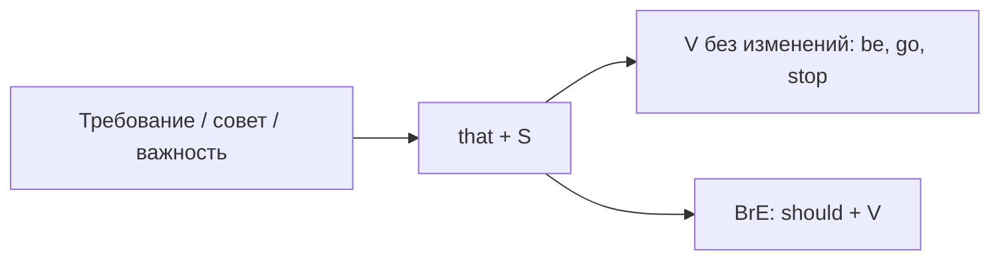

# Сослагательное наклонение — I suggest that he be

> [!abstract] Коротко
> - После слов требования и важности (`suggest, recommend, insist, demand, propose, request`; `It's essential/vital/important that…`) в придаточном ставят **начальную форму глагола для всех лиц**: `I suggest that he **go**`, `It's vital that she **be** there`.
> - Британский вариант: `should + V` — `I suggest that he should go`. Отрицание: `that he **not** go`.
> - Остатки сослагательного в устойчивых фразах: `if I were you`, `God save the King`, `be that as it may`, `so be it`, `come what may`, `as it were`.

<!-- beginner-intro:start -->
## Простыми словами

В русском есть «чтобы»: «Врач настаивает, **чтобы он бросил** курить». Английский в таких случаях может использовать особую форму — **сослагательное наклонение** (subjunctive). Выглядит оно просто: глагол стоит в самой начальной форме, без `-s` и без прошедшего времени, **даже с he/she/it**: `The doctor insists that he stop smoking`.

Это звучит необычно: кажется, что пропущено `-s`. Но это не ошибка, а особая форма для требований, рекомендаций и необходимости. В британском английском вместо неё часто говорят `should + V` (`that he should stop`), а в разговоре — обычное время (`that he stops`). Для письма на C1 полезно уверенно узнавать и использовать все три варианта.

### Наглядная схема

## Правило и схема
<!-- beginner-intro:end -->

**Схема:** `глагол/прилагательное требования + that + S + V (начальная форма)`

| Что вводит | Слова | Пример |
| --- | --- | --- |
| Глаголы | suggest, recommend, propose, insist, demand, request, ask, require, urge | They **demanded that** he **resign**. |
| Прилагательные | essential, vital, crucial, important, necessary, imperative | **It's essential that** every student **be** on time. |
| Существительные | suggestion, recommendation, demand, requirement | Her **suggestion that** we **meet** earlier was accepted. |

- Форма не меняется по лицам и времени: `He insisted that she **be** present` (прошлое — но всё равно `be`).
- Отрицание — `not` перед глаголом, без `do`: `We recommend that he **not** travel alone`.
- Пассив: `be + V3` — `The committee requested that the report **be published**`.

**Were-subjunctive** — нереальность: `If I were you`, `I wish it were true`, `as if he were the boss`.

**Устойчивые фразы:** `Long live the King!` (да здравствует), `God bless you`, `Be that as it may` (как бы то ни было), `Come what may` (будь что будет), `So be it` (да будет так), `as it were` (так сказать), `if need be` (если понадобится), `Suffice it to say` (достаточно сказать).

<!-- beginner-examples:start -->
## Примеры с разбором

1. **The doctor recommended that she rest for a week.** — Врач рекомендовал ей отдохнуть неделю.  
   **Разбор:** после `recommend that` — начальная форма `rest`, без `-s` и без прошедшего времени.
2. **It is vital that he be informed immediately.** — Крайне важно, чтобы ему сообщили немедленно.  
   **Разбор:** пассив в сослагательном: `be + V3`; не *is informed*.
3. **I suggest that you should apply now.** — Предлагаю тебе подать заявку сейчас.  
   **Разбор:** британский вариант со `should`; смысл тот же, что `I suggest that you apply`.
4. **They insisted that we not pay in advance.** — Они настояли, чтобы мы не платили заранее.  
   **Разбор:** отрицание сослагательного — просто `not` перед глаголом, без `don't`.
<!-- beginner-examples:end -->

## Дополнительные примеры

- **The law requires that every driver carry a licence.** — Закон требует, чтобы каждый водитель имел при себе права.
- **Be that as it may, we still need a decision.** — Как бы то ни было, решение нам всё равно нужно.
- **We'll work through the night if need be.** — Если понадобится, будем работать всю ночь.

> [!warning] Частая ошибка
> После `suggest/recommend` нельзя ставить объект + инфинитив: **I suggest that he go** / **I suggest he should go**, а не *I suggest him to go*. Не добавляй `-s`: **that she be**, **that he stay**.

## Проверь себя

Сначала ответь сам, потом открой ответы: нажми на заголовок блока.

1. Вставь глагол: The teacher insisted that every student ___ (hand) in the essay by Friday.
2. Вставь глагол: It's essential that the patient ___ (be) kept warm.
3. Вставь глагол (отрицание): I recommend that he ___ (not / drive) tonight.
4. Перефразируй по-британски с should: *They proposed that the meeting be postponed.*
5. Переведи: «Как бы то ни было, мы должны продолжать».
6. Исправь ошибку: *She suggested me to take a taxi.*

> [!success]- Ответы и пояснения
> 1. **hand** — начальная форма для всех лиц, даже после прошедшего `insisted`.
> 2. **be** — сослагательное от `be`; дальше пассив `be kept`.
> 3. **not drive** — отрицание без `do`: `that he not drive`.
> 4. **They proposed that the meeting should be postponed.** — британский вариант с `should`.
> 5. **Be that as it may, we must carry on.** — устойчивое выражение с сослагательным.
> 6. **She suggested (that) I (should) take a taxi.** / **She suggested taking a taxi.** — у `suggest` нет модели «кого + to V».

## Источники

- [Cambridge Dictionary — Suggest](https://dictionary.cambridge.org/grammar/british-grammar/suggest)
- [Cambridge Dictionary — Should](https://dictionary.cambridge.org/grammar/british-grammar/should)
- [Cambridge Dictionary — Formal and informal language](https://dictionary.cambridge.org/grammar/british-grammar/formal-and-informal-language)

---

[[129 - Условия без if — Had I known, but for, supposing|← Предыдущая тема]] · [[000 - Оглавление|Оглавление]] · [[131 - Модальные глаголы C1 — will для догадок, may well, be bound to|Следующая тема →]]
