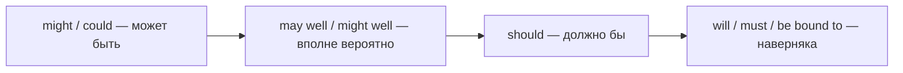

# Модальные глаголы C1 — will для догадок, may well, be bound to

> [!abstract] Коротко
> - `will / won't` — уверенная догадка о **настоящем**: `That'll be the postman` (наверняка почтальон). `will have done` — о прошлом: `You'll have heard the news`.
> - `will / would` — **характерное поведение**, часто раздражающее (с ударением): `He WILL leave his socks everywhere`; `She would say that`.
> - Оттенки вероятности: `may/might well` (вполне вероятно), `could easily`, `be bound to / be sure to` (наверняка), `might as well` (можно и, раз уж так), `can't possibly`, `needn't have`, `dare`.

<!-- beginner-intro:start -->
## Простыми словами

На уровне B2 модальные глаголы — это «могу, должен, следует». На C1 открывается второй слой: те же слова передают **тонкие оттенки уверенности, характера и отношения**. Звонят в дверь в 10 утра. Носитель скажет `That'll be the postman` — «это, наверняка, почтальон». Здесь `will` не про будущее, а про уверенное предположение о том, что происходит сейчас.

Или про привычки: `My grandad would sit by the window for hours` — «бывало, сидел» (тёплое воспоминание). `He will keep interrupting!` с ударением на `will` — «вечно он перебивает!» (раздражение). Эти значения делают речь живой и естественной. Учи их на примерах-ситуациях, а не как список.

### Наглядная схема

Шкала уверенности в положительном предположении:

## Правило и схема
<!-- beginner-intro:end -->

| Форма | Значение | Пример |
| --- | --- | --- |
| will + V | уверенная догадка о настоящем | Don't call now — she'**ll be** asleep. |
| will have + V3 | уверенная догадка о прошлом | They'**ll have arrived** by now. |
| will + V (ударное) | раздражающая привычка | He **WILL** leave the door open! |
| won't + V | упорный отказ (о людях и вещах) | The car **won't start**. |
| would + V | привычка в прошлом / типично для него | **She would say** that — she always defends him. |
| may / might well + V | вполне вероятно | Prices **may well** rise again. |
| could easily / might easily | легко может | It **could easily** take a week. |
| be bound to / be sure to + V | наверняка, неизбежно | He's **bound to** find out. |
| should / ought to + V | ожидаемо, логично | The parcel **should** arrive today. |
| might / may as well + V | можно и (раз лучшего варианта нет) | The bus has gone — we **might as well** walk. |
| can't possibly / couldn't possibly | никак не может / не мог бы (вежливый отказ) | I **couldn't possibly** accept this. |
| could have + V3 (упрёк) | мог бы и… | You **could have told** me! |
| dare (not) / How dare you | (не) сметь | I **daren't** tell him. **How dare you!** |
| needn't have + V3 | сделал зря | You **needn't have** waited. |
| can't help + V-ing | не могу не, не удержаться | I **can't help** laughing. |

<!-- beginner-examples:start -->
## Примеры с разбором

1. **There's someone at the door. — That'll be Anna; she said she'd come round.** — Кто-то у двери. — Это, наверняка, Анна, она обещала зайти.  
   **Разбор:** `will` выражает уверенную догадку о том, что происходит сейчас, а не будущее.
2. **You'll have heard that Tom is leaving.** — Ты, наверное, уже слышал, что Том уходит.  
   **Разбор:** `will have + V3` — уверенное предположение о прошлом: «ты наверняка уже слышал».
3. **It's late and there's nothing on TV. We might as well go to bed.** — Уже поздно, по телевизору ничего нет. Можно и лечь спать.  
   **Разбор:** `might as well` — «раз уж лучшего варианта нет, почему бы и нет».
4. **Don't worry, she's bound to call — she always does.** — Не волнуйся, она обязательно позвонит, она всегда звонит.  
   **Разбор:** `be bound to` — сильная уверенность в будущем, основанная на опыте.
<!-- beginner-examples:end -->

## Дополнительные примеры

- **Accidents will happen.** — Всякое бывает (несчастные случаи неизбежны).
- **The window won't close.** — Окно никак не закрывается.
- **You could at least have said thank you!** — Мог бы хоть спасибо сказать!

> [!warning] Частая ошибка
> **Might as well** — не «может, так же хорошо», а «раз уж так, можно и». **Be bound to** — не «быть связанным», а «наверняка». **She'll be at work now** — не будущее, а догадка о сейчас.

## Проверь себя

Сначала ответь сам, потом открой ответы: нажми на заголовок блока.

1. Переведи: «Не звони ему сейчас — он, наверняка, спит».
2. Переведи: «Посылка должна прийти завтра» (ожидаемо).
3. Вставь: The shop is closed. We ___ ___ ___ go home. (можно и)
4. Перефразируй: *It's very likely that the price will go up.* (may well)
5. Вставь глагол: My printer ___ (отказывается) work again!
6. Перефразируй: *I'm sure they have already left.* (will have)

> [!success]- Ответы и пояснения
> 1. **Don't call him now — he'll be asleep.** — `will` для догадки о настоящем.
> 2. **The parcel should arrive tomorrow.** — `should` для ожидаемого результата.
> 3. **might as well** — раз лучшего варианта нет.
> 4. **The price may well go up.** — «вполне вероятно».
> 5. **won't** — упорный отказ: `My printer won't work again!`
> 6. **They'll have left already.** / **They will have already left.** — догадка о прошлом.

## Источники

- [Cambridge Dictionary — Will](https://dictionary.cambridge.org/grammar/british-grammar/will)
- [Cambridge Dictionary — Would](https://dictionary.cambridge.org/grammar/british-grammar/would)
- [Cambridge Dictionary — May as well and might as well](https://dictionary.cambridge.org/grammar/british-grammar/may-as-well-and-might-as-well)
- [Cambridge Dictionary — Modality: other modal words and expressions](https://dictionary.cambridge.org/grammar/british-grammar/modality-other-modal-words-and-expressions)

---

[[130 - Сослагательное наклонение — I suggest that he be|← Предыдущая тема]] · [[000 - Оглавление|Оглавление]] · [[132 - Be to и формальные способы о будущем — be due to, be set to|Следующая тема →]]
