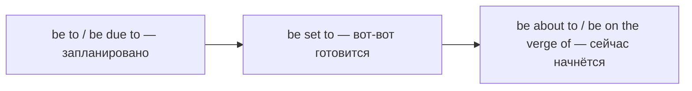

# Be to и формальные способы о будущем — be due to, be set to

> [!abstract] Коротко
> - `be to + V` — официальный план, распоряжение или судьба: `The President is to visit Spain` (визит запланирован), `You are to stay here` (приказ), `He was never to see her again` (судьба).
> - `be due to` — по графику; `be set to` — готовится, ожидается; `be about to` / `be on the verge of + V-ing` — вот-вот.
> - `be likely to`, `be bound to`, `be expected to` — оценки вероятности; в новостях очень часты.

<!-- beginner-intro:start -->
## Простыми словами

`Will` и `going to` — основа разговорного будущего. Но в новостях, официальных письмах, инструкциях и литературе используются другие, более точные конструкции. Например, `The Prime Minister is to meet the King tomorrow` — так в новостях сообщают о запланированном официальном событии. По-русски: «Премьер-министр встретится с королём».

`Be to` умеет больше. В инструкции `Students are to wear uniforms` — это обязанность: «должны носить». В рассказе `She was to become a famous writer` — взгляд из будущего на судьбу: «ей суждено было стать». Все эти конструкции строятся одинаково — через `be` в нужном времени плюс устойчивое продолжение.

### Наглядная схема

Насколько близко событие:

## Правило и схема
<!-- beginner-intro:end -->

| Конструкция | Значение | Пример |
| --- | --- | --- |
| be to + V | официальный план | The new bridge **is to open** in May. |
| be to + V | распоряжение, обязанность | You **are not to leave** this room. |
| was/were to + V | судьба (будущее в прошлом) | It **was to be** their last meeting. |
| was to have + V3 | план не осуществился | She **was to have started** in June, but fell ill. |
| if + be to + V | «если хотим, чтобы…» (необходимое условие) | **If we are to succeed**, we need more money. |
| be due to + V / be due + время | по расписанию, ожидается | The train **is due to arrive** at 6. The baby **is due** in March. |
| be set to + V | всё указывает, что произойдёт (СМИ) | Prices **are set to rise**. |
| be about to + V | вот-вот | Hurry, the film **is about to start**. |
| be on the verge / brink / point of + V-ing | на грани, вот-вот | The company **is on the verge of collapsing**. |
| be expected to / be likely to + V | ожидается / вероятно | Inflation **is expected to fall**. |
| be bound to + V | неизбежно, наверняка | It**'s bound to** cause problems. |

`Be to` — книжная форма, в разговорной речи её заменяют `will`, `have to`, `be going to`.

<!-- beginner-examples:start -->
## Примеры с разбором

1. **The Queen is to open the new hospital next week.** — На следующей неделе королева откроет новую больницу.  
   **Разбор:** типичный новостной стиль: официальное запланированное событие.
2. **All visitors are to report to reception.** — Все посетители должны обращаться на ресепшен.  
   **Разбор:** `are to` = «обязаны», формальная инструкция.
3. **He left his village in 1920. He was never to return.** — В 1920 году он покинул родную деревню. Ему не суждено было вернуться.  
   **Разбор:** `was to` — взгляд рассказчика на дальнейшую судьбу героя.
4. **If you are to pass this exam, you'll have to work harder.** — Если ты хочешь сдать этот экзамен, придётся работать усерднее.  
   **Разбор:** `if + be to` вводит цель как необходимое условие, а не простое будущее.
<!-- beginner-examples:end -->

## Дополнительные примеры

- **Our flight is due to land at 9.40.** — Наш рейс должен приземлиться в 9:40.
- **The talks are set to continue tomorrow.** — Переговоры, как ожидается, продолжатся завтра.
- **I was just about to call you!** — Я как раз собирался тебе звонить!

> [!warning] Частая ошибка
> После `be on the verge of` — `-ing`: **on the verge of tears / of crying**, а не *of cry*. `Be due to` о расписании ≠ `due to` «из-за»: **The delay was due to fog**.

## Проверь себя

Сначала ответь сам, потом открой ответы: нажми на заголовок блока.

1. Перефразируй в стиле новостей: *The Prime Minister will visit Japan next month.* (be to)
2. Перефразируй как приказ: *You must not open this box.* (be to)
3. Вставь: Hurry up! The concert is ___ ___ start.
4. Вставь: The plane is ___ to land in ten minutes. (по расписанию)
5. Переведи: «Ей не суждено было увидеть сына снова».
6. Исправь ошибку: *The company is on the verge of close.*

> [!success]- Ответы и пояснения
> 1. **The Prime Minister is to visit Japan next month.** — официальный план.
> 2. **You are not to open this box.** — `be not to` = запрет.
> 3. **about to** — «вот-вот».
> 4. **due** — по расписанию.
> 5. **She was never to see her son again.** — `was to` о судьбе.
> 6. **The company is on the verge of closing.** — после предлога `of` — `-ing`.

## Источники

- [Cambridge Dictionary — Be expressions (be able to, be due to)](https://dictionary.cambridge.org/grammar/british-grammar/be-expressions-be-able-to-be-due-to)
- [Cambridge Dictionary — Future: other expressions](https://dictionary.cambridge.org/grammar/british-grammar/future-other-expressions-to-talk-about-the-future)
- [Cambridge Dictionary — Future in the past](https://dictionary.cambridge.org/grammar/british-grammar/future-in-the-past)

---

[[131 - Модальные глаголы C1 — will для догадок, may well, be bound to|← Предыдущая тема]] · [[000 - Оглавление|Оглавление]] · [[133 - Времена для вежливости и дистанции — I was wondering|Следующая тема →]]
