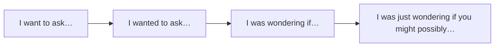

# Времена для вежливости и дистанции — I was wondering

> [!abstract] Коротко
> - Прошедшая форма и Continuous **смягчают** просьбу: `I want…` → `I wanted to ask…` → `I was wondering if…` — чем «дальше» форма, тем вежливее.
> - Время здесь не показывает прошлое: `I was hoping you could help` — просьба **сейчас**.
> - Ещё приёмы дистанции: `would/could`, `I'd like/I'd appreciate`, `just`, `possibly`, отрицательный вопрос (`Couldn't we…?`), `I don't suppose you could…?`

<!-- beginner-intro:start -->
## Простыми словами

Англичане очень ценят вежливую дистанцию. Прямое `I want you to help me` в просьбе к коллеге звучит резко. Один из главных способов смягчения — **отодвинуть глагол во времени**. `I wanted to ask you something` — формально прошедшее время, но речь о сейчас. Прошлое создаёт ощущение «я не давлю, просто когда-то подумал…».

Ещё мягче — Continuous: `I was wondering if you could help me` — «я тут подумал, не могли бы вы…». Это одна из самых частых вежливых фраз в британском английском. Её стоит выучить целиком, как и несколько соседних моделей. Они полезны в письмах, на работе и в общении с незнакомыми людьми.

### Наглядная схема

Лестница вежливости — от прямой просьбы к очень мягкой:

## Правило и схема
<!-- beginner-intro:end -->

| Прямо | Мягче | Ещё мягче |
| --- | --- | --- |
| I want to ask you… | I wanted to ask you… | I was wondering if I could ask you… |
| Do you want…? | Did you want…? | Were you wanting…? (в магазине, сервисе) |
| I hope you can help. | I hoped you could help. | I was hoping you could help. |
| Can you…? | Could you…? | Would you mind + V-ing / I'd appreciate it if you could… |
| I think we should… | I thought we could… | I was thinking we might… |

**Другие средства смягчения:**
- модальные `would, could, might`: `It might be better to wait`;
- маленькие слова: `just, possibly, perhaps, a bit, slightly`: `Could I just ask…?`;
- отрицательный вопрос-предложение: `Wouldn't it be better to…?`;
- `I don't suppose you could…? / I wonder whether…`;
- безличное: `It seems that…`, `There may have been a misunderstanding`.

Эти формы относятся к настоящему; ответ строится как на обычную просьбу: `Of course. What do you need?`

<!-- beginner-examples:start -->
## Примеры с разбором

1. **I was wondering if you could give me a lift.** — Не могли бы вы меня подвезти?  
   **Разбор:** Past Continuous + `could` создаёт двойную дистанцию; просьба относится к настоящему.
2. **I was hoping to speak to the manager.** — Я хотел бы поговорить с менеджером.  
   **Разбор:** прошедшая форма смягчает желание; говорящий хочет этого сейчас.
3. **Did you want a receipt?** — Вам нужен чек?  
   **Разбор:** продавец спрашивает о настоящем, но прошедшая форма звучит деликатнее, чем `Do you want…?`.
4. **I don't suppose you could lend me your car?** — Ты ведь, наверное, не мог бы одолжить мне машину?  
   **Разбор:** отрицательная рамка заранее допускает отказ и поэтому звучит очень вежливо.
<!-- beginner-examples:end -->

## Дополнительные примеры

- **I'd appreciate it if you could reply by Friday.** — Буду признателен, если вы ответите до пятницы.
- **I thought we could meet on Monday.** — Я подумал, может, встретимся в понедельник?
- **Could I just interrupt for a second?** — Можно, я на секунду перебью?

> [!warning] Частая ошибка
> Не принимай вежливое прошедшее за реальное прошлое: **I was wondering if you were free tonight** — вопрос о сегодняшнем вечере. После `I'd appreciate it` не забывай `it`: **I'd appreciate it if…**

## Проверь себя

Сначала ответь сам, потом открой ответы: нажми на заголовок блока.

1. Сделай вежливее с wondering: *Can you help me with my CV?*
2. Сделай вежливее с hoping: *I want to talk to you about my salary.*
3. Сделай вежливее: *Send me the file today.* (I'd appreciate it…)
4. Сделай вежливее с отрицательным вопросом: *It's better to wait.*
5. О каком времени фраза? *I was wondering if you were busy this evening.*
6. Исправь ошибку: *I'd appreciate if you could call me back.*

> [!success]- Ответы и пояснения
> 1. **I was wondering if you could help me with my CV.** — Past Continuous + `could`.
> 2. **I was hoping to talk to you about my salary.** — смягчённое желание.
> 3. **I'd appreciate it if you could send me the file today.** — вежливая просьба в письме.
> 4. **Wouldn't it be better to wait?** — отрицательный вопрос звучит как мягкое предложение.
> 5. **О настоящем: этот вечер.** — прошедшая форма только смягчает.
> 6. **I'd appreciate it if you could call me back.** — нужно `it`.

## Источники

- [Cambridge Dictionary — Past verb forms referring to the present](https://dictionary.cambridge.org/grammar/british-grammar/past-verb-forms-referring-to-the-present)
- [Cambridge Dictionary — Politeness](https://dictionary.cambridge.org/grammar/british-grammar/politeness)
- [Cambridge Dictionary — Requests](https://dictionary.cambridge.org/grammar/british-grammar/requests)

---

[[132 - Be to и формальные способы о будущем — be due to, be set to|← Предыдущая тема]] · [[000 - Оглавление|Оглавление]] · [[134 - Сложные причастные обороты — Having been told, weather permitting|Следующая тема →]]
