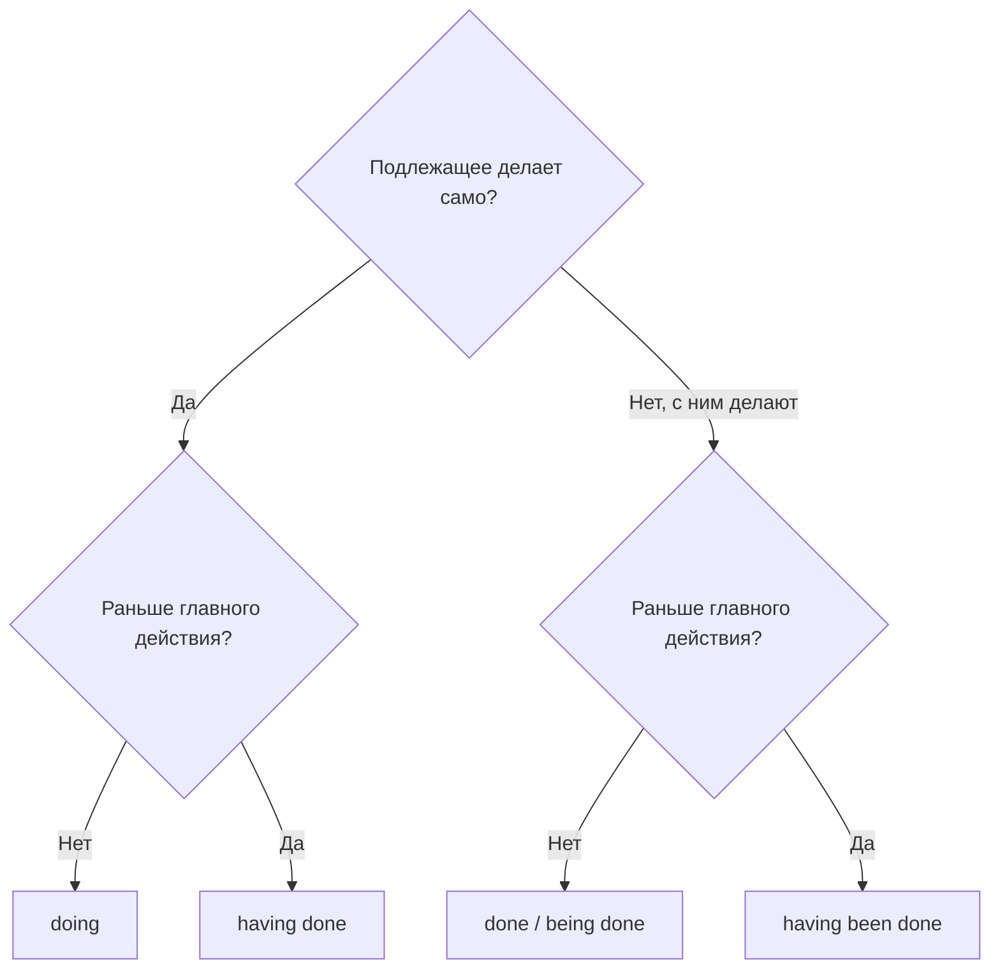

# Сложные причастные обороты — Having been told, weather permitting

> [!abstract] Коротко
> - Формы причастия: `doing` (одновременно, актив) · `done` / `being done` (пассив) · `having done` (раньше, актив) · `having been done` (раньше, пассив).
> - **Независимый оборот** имеет своё подлежащее: `The work finished, we went home`; `Weather permitting, we'll eat outside`.
> - `with + N + V-ing/V3` — «при том что, с»: `With prices rising, people spend less`. Связки перед причастием: `when, while, after, before, since, once, if, unless, though`.

<!-- beginner-intro:start -->
## Простыми словами

На B2 ты научился сокращать придаточные: `Feeling tired, I went to bed`. На C1 обороты становятся плотнее и разнообразнее. Например, можно показать, что одно действие было раньше другого и при этом совершено над подлежащим: `Having been warned, we took umbrellas` — «Поскольку нас предупредили, мы взяли зонты».

Вторая новинка — **независимый оборот**. Обычно подлежащее оборота совпадает с подлежащим главной части. Но в книжном стиле у оборота может быть своё подлежащее: `The meeting over, everyone left` — «Когда собрание закончилось, все ушли». Такие обороты часто встречаются в литературе, новостях и академических текстах. Их важно уметь читать, а в письме использовать умеренно.

### Наглядная схема

Выбор формы причастия по двум вопросам:

## Правило и схема
<!-- beginner-intro:end -->

| Форма | Смысл | Пример |
| --- | --- | --- |
| V-ing | одновременно, актив | **Walking** home, I met Tom. |
| V3 | пассив, состояние | **Built** in 1890, the house needs repairs. |
| being + V3 | пассив, процесс/причина | **Being watched**, he felt nervous. |
| having + V3 | раньше, актив | **Having read** the report, she called him. |
| having been + V3 | раньше, пассив | **Having been rejected** twice, he gave up. |
| not + причастие | отрицание | **Not knowing** what to do, I waited. |
| связка + причастие | уточняет связь | **After talking** to her, I felt better. **Once opened**, keep in the fridge. |
| N + причастие (независимый) | у оборота своё подлежащее | **The rain having stopped**, we went out. |
| with + N + V-ing/V3 | сопровождающее обстоятельство | **With** his eyes **closed**, he listened. |

**Устойчивые независимые обороты:** `weather permitting` (если позволит погода), `all things considered` (с учётом всего), `generally speaking`, `strictly speaking`, `judging by/from…`, `considering…`, `given…`, `that said` (при этом).

**Висячее причастие** (dangling participle) — ошибка, когда подлежащие не совпадают: *Driving to work, the sun blinded me* (солнце не ехало). Правильно: `Driving to work, I was blinded by the sun`.

<!-- beginner-examples:start -->
## Примеры с разбором

1. **Having finished the project, the team celebrated.** — Закончив проект, команда отпраздновала это.  
   **Разбор:** `having finished` — сначала закончили, потом праздновали; исполнитель один — команда.
2. **Having been told the news, she burst into tears.** — Когда ей сообщили новость, она расплакалась.  
   **Разбор:** новость сообщили ей (пассив) и раньше, чем она заплакала → `having been told`.
3. **Weather permitting, the concert will take place outdoors.** — Если позволит погода, концерт пройдёт на открытом воздухе.  
   **Разбор:** устойчивый независимый оборот с собственным подлежащим `weather`.
4. **With so many people watching, I felt nervous.** — Когда на меня смотрело столько людей, я нервничал.  
   **Разбор:** `with + N + V-ing` описывает обстоятельство, на фоне которого происходит главное.
<!-- beginner-examples:end -->

## Дополнительные примеры

- **Not wanting to wake the baby, she whispered.** — Не желая будить ребёнка, она шептала.
- **All things considered, the trip was a success.** — В целом поездка удалась.
- **Once installed, the app updates automatically.** — После установки приложение обновляется автоматически.

> [!warning] Частая ошибка
> Висячий оборот: *Having eaten lunch, the bus left* — получается, что обедал автобус. Правильно: **Having eaten lunch, we caught the bus**.

## Проверь себя

Сначала ответь сам, потом открой ответы: нажми на заголовок блока.

1. Сократи: *After she had checked the figures, she sent the report.*
2. Сократи: *Because he had been injured, he couldn't play.*
3. Сократи: *As I didn't know the way, I asked a policeman.*
4. Сократи с независимым оборотом: *When the work was done, we went home.*
5. Перефразируй с with: *The door was open, so we could hear everything.*
6. Исправь висячий оборот: *Walking into the room, the smell of coffee hit me.*

> [!success]- Ответы и пояснения
> 1. **Having checked the figures, she sent the report.** — раньше, актив.
> 2. **Having been injured, he couldn't play.** — раньше, пассив.
> 3. **Not knowing the way, I asked a policeman.** — отрицание перед причастием.
> 4. **The work done, we went home.** — у оборота своё подлежащее `the work`.
> 5. **With the door open, we could hear everything.** — `with + N + прилагательное/причастие`.
> 6. **Walking into the room, I was hit by the smell of coffee.** / **When I walked into the room, the smell of coffee hit me.** — подлежащие должны совпадать, иначе «шёл запах».

## Источники

- [Cambridge Dictionary — Clauses: finite and non-finite](https://dictionary.cambridge.org/grammar/british-grammar/clauses-finite-and-non-finite)
- [Cambridge Dictionary — Detached impersonal style](https://dictionary.cambridge.org/grammar/british-grammar/detached-impersonal-style)
- [Cambridge Dictionary — Finite and non-finite verbs](https://dictionary.cambridge.org/grammar/british-grammar/finite-and-non-finite-verbs)

---

[[133 - Времена для вежливости и дистанции — I was wondering|← Предыдущая тема]] · [[000 - Оглавление|Оглавление]] · [[135 - Эллипсис и замещение — so, not, do so, to|Следующая тема →]]
