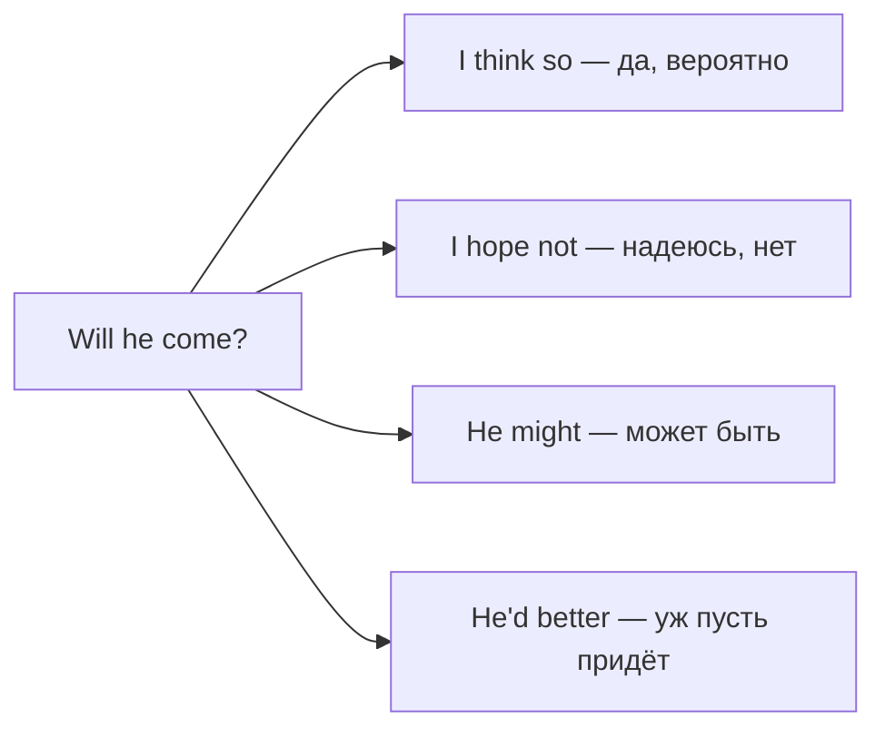

# Эллипсис и замещение — so, not, do so, to

> [!abstract] Коротко
> - **Замещение** — заменить повтор коротким словом: `I think so / I hope not`, `one/ones`, `do so`, `do it/that`.
> - **Эллипсис** — просто опустить повтор, оставив помощник или `to`: `She can swim, but I can't.` `I'd love to.`
> - Носители почти никогда не повторяют целый глагол: `Will it rain? — It might.` `Have you finished? — Not yet.`

<!-- beginner-intro:start -->
## Простыми словами

Представь разговор, где каждый ответ повторяет вопрос полностью: «Ты придёшь? — Да, я приду на вечеринку». Звучит странно. В английском эта «экономия» — обязательная часть естественной речи. Правило: **сохрани помощник или частицу `to`, а остальное убери**. `Are you coming? — I might.` `Do you want to come? — I'd love to.`

Второй приём — короткие слова-заместители. `So` заменяет целое положительное утверждение после `think, hope, expect, suppose, be afraid`: «Он придёт?» — `I think so`. Для отрицания — `not`: `I hope not`. `Do so` в официальном стиле заменяет целое действие: `Please submit the form. Those who fail to do so…` Эти приёмы делают речь связной и «английской».

### Наглядная схема

## Правило и схема
<!-- beginner-intro:end -->

**Эллипсис — что остаётся:**

| Что опускаем | Что оставляем | Пример |
| --- | --- | --- |
| глагол после помощника | помощник / модальный | I haven't finished, but Tom **has**. |
| глагол после `to` | `to` | I didn't want to go, but I **had to**. |
| повтор в однородных частях | первое упоминание | She plays the piano and (she) sings. |
| начало фразы в разговоре | ключевые слова | (Do you) Want a coffee? (It) Sounds good. |
| после сравнения | помощник | He runs faster than I **do**. |

**Замещение — чем заменяем:**

| Слово | Что заменяет | Пример |
| --- | --- | --- |
| so | положительное придаточное (после think, hope, expect, suppose, guess, be afraid, imagine) | Is it true? — I'm afraid **so**. |
| not | отрицательное придаточное | Will it rain? — I hope **not**. |
| I don't think so | нейтральное «думаю, нет» (чаще, чем *I think not*) | Is he coming? — I **don't think so**. |
| do so / do it / do that | действие (do so — официально) | He promised to call, but didn't **do so**. |
| one / ones | исчисляемое существительное | a red one, the new ones |
| so / neither + помощник + S | «тоже / тоже нет» | **So did** I. **Neither has** she. |
| if so / if not | условие | Are you free? **If so**, call me. |

<!-- beginner-examples:start -->
## Примеры с разбором

1. **Is she coming to the party? — I expect so.** — Она придёт на вечеринку? — Думаю, да.  
   **Разбор:** `so` заменяет всё `she is coming to the party`.
2. **Will we be late? — I hope not.** — Мы опоздаем? — Надеюсь, нет.  
   **Разбор:** отрицательный ответ через `not`, а не *I don't hope so*.
3. **You don't have to come, but I'd like you to.** — Ты не обязан приходить, но мне бы хотелось.  
   **Разбор:** после `to` опущено `come`; частицу `to` оставляем обязательно.
4. **The company was asked to reduce costs and has done so.** — Компанию попросили сократить расходы, и она это сделала.  
   **Разбор:** `done so` заменяет `reduced costs`; формальный стиль.
<!-- beginner-examples:end -->

## Дополнительные примеры

- **I'd help you if I could.** — Я бы помог, если бы мог.
- **She speaks English better than she did a year ago.** — Она говорит по-английски лучше, чем год назад.
- **Did you lock the door? — I think so.** — Ты запер дверь? — Вроде да.

> [!warning] Частая ошибка
> **I hope so / I hope not**, а не *I hope it* или *I don't hope so*. **I'd love to**, а не *I'd love* без `to`. **I think so**, а не *I think it*.

## Проверь себя

Сначала ответь сам, потом открой ответы: нажми на заголовок блока.

1. Ответь «Боюсь, что да»: *Is the shop closed?*
2. Ответь «Надеюсь, нет»: *Is it going to snow?*
3. Сократи повтор: *I can't come tonight, but my sister can come tonight.*
4. Сократи повтор: *I didn't want to apologise, but I had to apologise.*
5. Ответь на приглашение «С удовольствием»: *Would you like to join us?*
6. Исправь ошибку: *Will he pass the exam? — I think it.*

> [!success]- Ответы и пояснения
> 1. **I'm afraid so.** — `so` заменяет положительное утверждение.
> 2. **I hope not.** — отрицательное замещение.
> 3. **I can't come tonight, but my sister can.** — оставляем модальный глагол.
> 4. **I didn't want to apologise, but I had to.** — оставляем `to`.
> 5. **I'd love to.** — `to` обязателен.
> 6. **I think so.** — после `think` заместитель `so`.

## Источники

- [Cambridge Dictionary — Ellipsis](https://dictionary.cambridge.org/grammar/british-grammar/ellipsis)
- [Cambridge Dictionary — Substitution](https://dictionary.cambridge.org/grammar/british-grammar/substitution)
- [Cambridge Dictionary — So and not with expect, hope, think, etc.](https://dictionary.cambridge.org/grammar/british-grammar/so-and-not-with-expect-hope-think-etc)

---

[[134 - Сложные причастные обороты — Having been told, weather permitting|← Предыдущая тема]] · [[000 - Оглавление|Оглавление]] · [[136 - Сложные относительные конструкции — whereby, all of which, the first to|Следующая тема →]]
