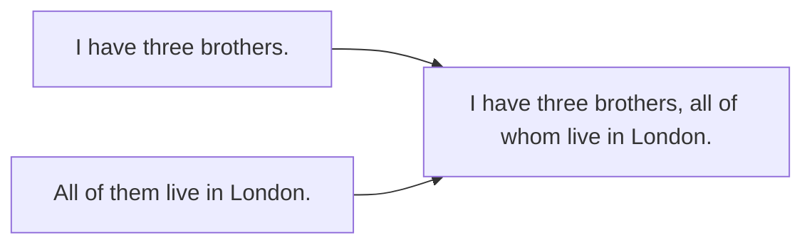

# Сложные относительные конструкции — whereby, all of which, the first to

> [!abstract] Коротко
> - Количество + `of whom / of which`: `two sisters, both of whom are doctors`; `many books, most of which…`
> - `whereby` — посредством которого (о системе, соглашении); `the extent to which`, `the way in which`, `the reason for which`.
> - Инфинитив вместо придаточного: `the first/last/only/next + to V` — `She was the first to arrive`; `a place to stay`, `something to eat`.

<!-- beginner-intro:start -->
## Простыми словами

Определительные придаточные ты уже знаешь: `the man who…`, `the book which…`. В официальных и академических текстах встречаются более сложные варианты. Например, вместо двух предложений «У меня три брата. Все они живут в Лондоне» пишут одно: `I have three brothers, all of whom live in London`. Конструкция `количество + of whom/which` очень частая и экономная.

Второе полезное упрощение — **инфинитив вместо целого придаточного**. «Она пришла первой» = `She was the first to arrive` (вместо `the first who arrived`). «Нам нужно место, где остановиться» = `We need a place to stay`. Это короче и естественнее, особенно после `the first, the last, the only, the next`.

### Наглядная схема

## Правило и схема
<!-- beginner-intro:end -->

| Модель | Пример |
| --- | --- |
| количество + of whom (люди) | 20 students, **most of whom** passed |
| количество + of which (вещи) | three cars, **none of which** works |
| N + of which (принадлежность, официально) | a house, **the roof of which** leaked (= whose roof) |
| preposition + which/whom | the company **for which** she works |
| whereby | a system **whereby** users pay monthly |
| the extent / degree to which | **the extent to which** stress affects health |
| the way (in which) / how | **the way (in which)** he spoke (не *the way how*) |
| the first / last / only / next + to V | He was **the only one to notice**. |
| N + to V (назначение) | **a place to live**, **nothing to lose**, **a decision to make** |
| N + preposition + whom/which + to V | **a friend with whom to share** it (книжно) |
| whoever / whichever / whatever (= anyone who…) | **Whoever** wins gets a prize. |

`Some, any, none, all, both, each, many, most, several, half, neither, one, two…` + `of whom/which`. Это всегда **неопределительное** придаточное, с запятой.

<!-- beginner-examples:start -->
## Примеры с разбором

1. **She has two sons, both of whom are engineers.** — У неё два сына, оба инженеры.  
   **Разбор:** `both of whom` = `and both of them`; после предлога для людей — `whom`.
2. **We tried three restaurants, none of which was open.** — Мы попробовали три ресторана, но ни один не был открыт.  
   **Разбор:** о вещах — `of which`; запятая обязательна.
3. **They introduced a scheme whereby employees can work from home.** — Ввели схему, по которой сотрудники могут работать из дома.  
   **Разбор:** `whereby` = `by which / according to which` — официальный стиль.
4. **Neil Armstrong was the first person to walk on the Moon.** — Нил Армстронг первым прошёл по Луне.  
   **Разбор:** `the first + to V` заменяет `the first person who walked`.
<!-- beginner-examples:end -->

## Дополнительные примеры

- **The report examines the extent to which prices have risen.** — В отчёте рассматривается, насколько выросли цены.
- **I've got nothing to wear!** — Мне нечего надеть!
- **He gave several reasons, the most important of which was cost.** — Он привёл несколько причин, главной из которых была стоимость.

> [!warning] Частая ошибка
> **Most of whom**, а не *most of them* внутри одного предложения: *I have friends, most of them…* без союза — ошибка соединения. **The way he spoke** или **the way in which**, но не *the way how*.

## Проверь себя

Сначала ответь сам, потом открой ответы: нажми на заголовок блока.

1. Соедини: *I have four cousins. Two of them live abroad.*
2. Соедини: *He wrote many novels. Most of them were bestsellers.*
3. Перефразируй с to V: *She was the last person who left the office.*
4. Вставь: This is the hotel at ___ we stayed. (официально)
5. Переведи: «Ему не с кем поговорить».
6. Исправь ошибку: *I bought ten eggs, half of them were broken.*

> [!success]- Ответы и пояснения
> 1. **I have four cousins, two of whom live abroad.** — люди → `of whom`.
> 2. **He wrote many novels, most of which were bestsellers.** — вещи → `of which`.
> 3. **She was the last (person) to leave the office.** — `the last + to V`.
> 4. **which** — после предлога о предмете.
> 5. **He has nobody to talk to.** — `N + to V + предлог`.
> 6. **I bought ten eggs, half of which were broken.** — нужна относительная связка, а не `them`.

## Источники

- [Cambridge Dictionary — Relative clauses: defining and non-defining](https://dictionary.cambridge.org/grammar/british-grammar/relative-clauses-defining-and-non-defining)
- [Cambridge Dictionary — Relative pronouns](https://dictionary.cambridge.org/grammar/british-grammar/relative-pronouns)
- [British Council — Relative clauses: non-defining relative clauses](https://learnenglish.britishcouncil.org/free-resources/grammar/b1-b2/relative-clauses-non-defining-relative-clauses)

---

[[135 - Эллипсис и замещение — so, not, do so, to|← Предыдущая тема]] · [[000 - Оглавление|Оглавление]] · [[137 - Whatever, however, no matter — что бы ни|Следующая тема →]]
