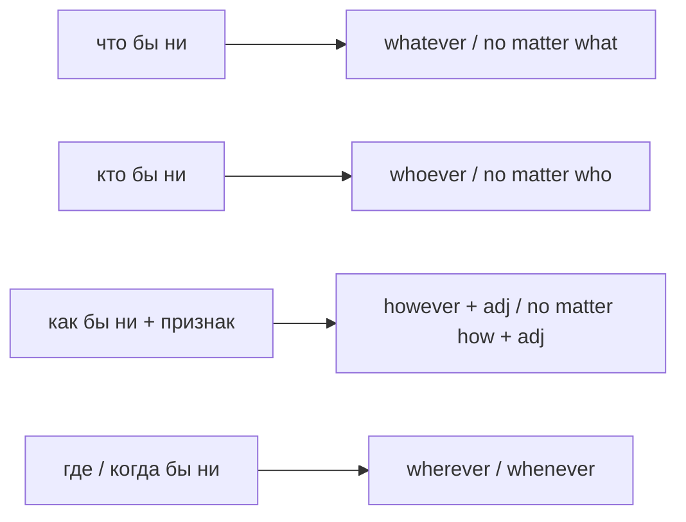

# Whatever, however, no matter — что бы ни

> [!abstract] Коротко
> - `whatever, whoever, wherever, whenever, whichever, however` = «что бы ни, кто бы ни, где бы ни…»: `Whatever you do, don't panic`.
> - `however + adj/adv` = «каким бы … ни»: `However hard I try, I fail`.
> - То же через `no matter what/who/where/how`: `No matter how tired you are, call me`. О будущем внутри — настоящее время.

<!-- beginner-intro:start -->
## Простыми словами

Русское «что бы ты ни делал», «где бы он ни был», «как бы я ни старался» передаётся словами с окончанием `-ever`. Они значат «неважно что/кто/где — результат тот же». `Wherever you go, I'll follow you` — «Куда бы ты ни пошёл, я пойду за тобой».

Есть синоним — `no matter`: `No matter where you go…`. Он чуть разговорнее и эмоциональнее. Особенно внимательно отнесись к `however`: кроме знакомого «однако», в начале с прилагательным оно значит «каким бы ни»: `However expensive it is, I'll buy it` — «Сколько бы это ни стоило, я это куплю».

### Наглядная схема

## Правило и схема
<!-- beginner-intro:end -->

| Слово | Значение | Пример |
| --- | --- | --- |
| whatever | что бы ни; любой | **Whatever** happens, stay calm. |
| whoever | кто бы ни; тот, кто | **Whoever** called, I'm not here. |
| whichever | какой бы ни (из выбора) | Take **whichever** you like. |
| wherever | где/куда бы ни | Sit **wherever** you want. |
| whenever | когда бы ни; каждый раз когда | Call me **whenever** you need. |
| however + adj/adv | каким бы ни; как бы ни | **However** hard it is, don't give up. |
| however + S + V | как угодно | Do it **however** you like. |
| no matter + what/who/where/when/how | неважно, что/кто… | **No matter what** they say, I trust you. |

**Время:** о будущем в такой части — настоящее: `Whatever you decide, I'll support you` (не *will decide*). Часто добавляют `may/might` для оттенка допущения: `However hard it may seem…`

**Ещё роли:** `whatever` усиливает отрицание (`I have no idea whatever` = никакого понятия); в разговоре `Whatever!` — пренебрежительное «да как скажешь».

<!-- beginner-examples:start -->
## Примеры с разбором

1. **Whatever you do, don't tell Mum.** — Что бы ты ни делал, не говори маме.  
   **Разбор:** `whatever` — любое действие; главный совет от него не зависит.
2. **However much it costs, we need it.** — Сколько бы это ни стоило, нам это нужно.  
   **Разбор:** `however + much` = «как бы много ни»; порядок после — утвердительный.
3. **No matter how many times I explain, he doesn't understand.** — Сколько бы раз я ни объяснял, он не понимает.  
   **Разбор:** `no matter how many` — синоним `however many`.
4. **Whoever finishes first will get a prize.** — Тот, кто закончит первым, получит приз.  
   **Разбор:** `whoever` = `the person who`; о будущем — настоящее время `finishes`.
<!-- beginner-examples:end -->

## Дополнительные примеры

- **You can come whenever you like.** — Приходи когда захочешь.
- **Wherever she goes, she makes friends.** — Куда бы она ни поехала, у неё появляются друзья.
- **There are two routes; take whichever is quicker.** — Есть два маршрута, выбирай тот, что быстрее.

> [!warning] Частая ошибка
> **However hard I try**, а не *How hard I try* и не *However I try hard*. О будущем — **whatever happens**, а не *whatever will happen*.

## Проверь себя

Сначала ответь сам, потом открой ответы: нажми на заголовок блока.

1. Переведи: «Где бы ты ни был, позвони мне».
2. Переведи: «Каким бы трудным это ни было, я закончу».
3. Перефразируй с no matter: *Whatever she says, don't believe her.*
4. Вставь: ___ broke the window must pay for it. (тот, кто)
5. Вставь: You can choose ___ colour you prefer — red or blue.
6. Исправь ошибку: *Whatever will happen, I'll be there.*

> [!success]- Ответы и пояснения
> 1. **Wherever you are, call me.** — «где бы ни».
> 2. **However difficult it is, I'll finish.** — `however + adj`.
> 3. **No matter what she says, don't believe her.** — синоним.
> 4. **Whoever** — «тот, кто».
> 5. **whichever** — выбор из ограниченного набора.
> 6. **Whatever happens, I'll be there.** — о будущем в такой части — настоящее время.

## Источники

- [Cambridge Dictionary — However, whatever, whichever, whenever, wherever, whoever](https://dictionary.cambridge.org/grammar/british-grammar/however-whatever-whichever-whenever-wherever-whoever)
- [Cambridge Dictionary — Matter (no matter)](https://dictionary.cambridge.org/grammar/british-grammar/matter)

---

[[136 - Сложные относительные конструкции — whereby, all of which, the first to|← Предыдущая тема]] · [[000 - Оглавление|Оглавление]] · [[138 - Продвинутые артикли — the rich, a good knowledge of|Следующая тема →]]
