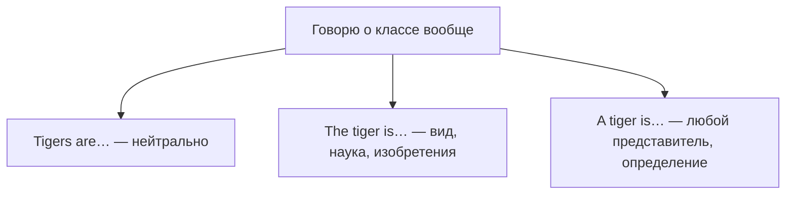

# Продвинутые артикли — the rich, a good knowledge of

> [!abstract] Коротко
> - **Обобщение** тремя способами: `Tigers are endangered` (нейтрально) · `The tiger is endangered` (вид как класс, научно) · `A tiger is a big cat` (любой представитель, определение).
> - `the + прилагательное` = группа людей: `the rich, the elderly, the unemployed` (глагол — во множественном).
> - Неисчисляемое с описанием может получить `a/an`: `a good knowledge of French`, `a strong desire`, `a wonderful time`; абстрактное с уточнением — `the`: `the history of Russia`.

<!-- beginner-intro:start -->
## Простыми словами

Базовые правила артиклей ты знаешь. На C1 нужно уверенно управлять тонкими случаями, которые встречаются в серьёзных текстах. Первый — **обобщение**. Сказать «тигры под угрозой» можно тремя способами, и у каждого свой оттенок. `The tiger` — о виде как о научном классе, поэтому так пишут в энциклопедиях и про изобретения: `The computer changed our lives`.

Второй — **`the` + прилагательное** для групп людей: `the poor` — бедные (как социальная группа). Третий — **неисчисляемые с `a/an`**: если описание выделяет «особый вид» явления, артикль появляется: `She has a good knowledge of history`, `We had a great time`. И наконец, абстрактное слово в общем смысле — без артикля (`History is interesting`), а с уточнением — с `the` (`the history of Rome`).

### Наглядная схема

## Правило и схема
<!-- beginner-intro:end -->

| Случай | Пример | Комментарий |
| --- | --- | --- |
| Обобщение, множественное | **Computers** have changed our lives. | самый частый вариант |
| Обобщение, the + единственное | **The computer** has changed our lives. | класс, вид, изобретение |
| Обобщение, a + единственное | **A computer** needs electricity. | любой экземпляр |
| the + adj (группа людей) | **The rich** are getting richer. | глагол во мн. ч. |
| the + национальность на -sh/-ch/-ese | **The French** love cheese. | народ целиком |
| a/an + adj + неисчисляемое | a **good knowledge** of, a **high level** of | «некий вид» |
| a + чувство/впечатление | **a fear** of spiders, **a love** of music | конкретный вид чувства |
| абстрактное вообще / уточнённое | **Life** is short. **The life** of a soldier is hard. | уточнение `of` → the |
| институты: функция / здание | in **prison**, at **university** / **the** prison | функция без артикля |
| уникальное с описанием | **a** new moon, **a** blue sky | разные «виды» уникального |
| устойчивые без артикля | by car, at night, in fact, on foot, at first sight | заучиваем |
| музыкальные инструменты | play **the** piano | но: She's a jazz pianist |

<!-- beginner-examples:start -->
## Примеры с разбором

1. **The smartphone has transformed communication.** — Смартфон изменил общение.  
   **Разбор:** говорим об изобретении как о классе, а не о конкретном телефоне.
2. **The government should do more for the homeless.** — Правительство должно больше делать для бездомных.  
   **Разбор:** `the homeless` = бездомные люди как группа; глагол бы стоял во множественном.
3. **She has an excellent command of English.** — Она отлично владеет английским.  
   **Разбор:** `command` здесь неисчисляемое, но с прилагательным получает `an` — «особый уровень владения».
4. **Crime is rising. The crime he committed was terrible.** — Преступность растёт. Преступление, которое он совершил, ужасно.  
   **Разбор:** в общем смысле без артикля, с уточнением — `the`.
<!-- beginner-examples:end -->

## Дополнительные примеры

- **A dog is a loyal animal.** — Собака — верное животное.
- **The elderly need more support.** — Пожилым нужно больше поддержки.
- **We had a wonderful time.** — Мы прекрасно провели время.

> [!warning] Частая ошибка
> **The rich are**, а не *the rich is* и не *the riches* (riches = богатства). Не ставь `the` перед общими абстрактными понятиями: **Nature is beautiful**, а не *The nature is beautiful*.

## Проверь себя

Сначала ответь сам, потом открой ответы: нажми на заголовок блока.

1. Вставь артикль или ничего: ___ wheel was invented thousands of years ago.
2. Вставь артикль или ничего: ___ unemployed often feel isolated.
3. Вставь артикль или ничего: She has ___ good understanding of economics.
4. Вставь артикль или ничего: ___ society has changed a lot. / ___ society we live in is complex.
5. Вставь артикль или ничего: He's in ___ hospital (пациент), so I went to ___ hospital to see him.
6. Исправь ошибку: *The poors need help.*

> [!success]- Ответы и пояснения
> 1. **The** — изобретение как класс.
> 2. **The** — группа людей; глагол `feel` во мн. ч.
> 3. **a** — неисчисляемое с прилагательным, «некий уровень».
> 4. **— (без артикля); The** — общее понятие без артикля, уточнённое — с `the`.
> 5. **— ; the** — функция учреждения / конкретное здание (BrE).
> 6. **The poor need help.** — `the + adj` без `-s`.

## Источники

- [Cambridge Dictionary — A/an and the](https://dictionary.cambridge.org/grammar/british-grammar/a-an-and-the)
- [Cambridge Dictionary — Determiners and types of noun](https://dictionary.cambridge.org/grammar/british-grammar/determiners-and-types-of-noun)
- [British Council — Articles: 'the' or no article](https://learnenglish.britishcouncil.org/free-resources/grammar/a1-a2-grammar/articles-the-or-no-article)

---

[[137 - Whatever, however, no matter — что бы ни|← Предыдущая тема]] · [[000 - Оглавление|Оглавление]] · [[139 - Количество и согласование C1 — a number of, the majority, plenty|Следующая тема →]]
