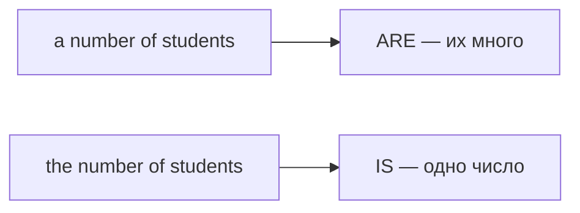

# Количество и согласование C1 — a number of, the majority, plenty

> [!abstract] Коротко
> - `a number of + N(мн.)` → глагол во **множественном** (много); `the number of + N(мн.)` → в **единственном** (само число).
> - Богатые выражения количества: `a great deal of` (неисч.), `a large number of` (исч.), `the vast majority of`, `plenty of`, `hardly any`, `quite a few`, `a handful of`, `countless`.
> - Согласование по смыслу: суммы, расстояния, время как одно целое — единственное: `Ten miles is a long way`; `One in three people is…`

<!-- beginner-intro:start -->
## Простыми словами

`Much, many, a lot of` хватает для повседневной речи, но на C1 нужны более точные и стилистически разнообразные выражения количества. Например, в эссе лучше `a considerable amount of time` или `the vast majority of people`, чем бесконечное `a lot of`.

Вторая тема — **хитрое согласование**. `A number of students are…` — «ряд студентов» (их много, глагол во множественном). `The number of students is…` — «количество студентов» (это одно число, глагол в единственном). Похожая логика у сумм и расстояний: `Two hours is enough` — два часа воспринимаются как один отрезок времени.

### Наглядная схема

## Правило и схема
<!-- beginner-intro:end -->

| Выражение | С чем | Пример |
| --- | --- | --- |
| a great/good deal of, a large amount of | неисчисляемые | **a great deal of** effort |
| a large/significant number of | исчисляемые мн. | **a large number of** complaints **have** been made |
| the majority of / the vast majority of | оба (глагол по существительному) | **The majority of** people **agree**. |
| a minority of | исчисляемые | **a minority of** students |
| plenty of | оба | We've got **plenty of** time / chairs. |
| quite a few / quite a lot of | много (разг.) | **Quite a few** people came. |
| hardly any / very few / very little | почти нет | There's **hardly any** milk left. |
| a handful of | горстка | **a handful of** volunteers |
| countless / numerous | бесчисленные / многочисленные | **numerous** studies |
| a couple of | пара, несколько | **a couple of** days |
| every / each + число + N | интервалы | **every three days** |

| Согласование | Пример |
| --- | --- |
| a number of + мн. → мн. | **A number of** problems **have** arisen. |
| the number of + мн. → ед. | **The number of** cars **is** growing. |
| сумма, расстояние, время как целое → ед. | **Five pounds is** too much. **Three years is** a long time. |
| one in / one out of + число → ед. (чаще) | **One in five** adults **smokes**. |
| two-thirds / half / per cent of + N → по N | **Half of** the money **is** gone. **Half of** the people **are** here. |
| collective (BrE) | The team **is/are** playing well. |
| either/neither of + мн. | **Neither of** them **is** (формально) / **are** (разг.) |
| more than one + ед. | **More than one** student **has** failed. |

<!-- beginner-examples:start -->
## Примеры с разбором

1. **A number of employees have complained.** — Ряд сотрудников пожаловался.  
   **Разбор:** `a number of` = «многие», глагол согласуется с `employees` → `have`.
2. **The number of employees has doubled.** — Число сотрудников удвоилось.  
   **Разбор:** подлежащее — `the number` (одно число) → `has`.
3. **The vast majority of students passed the exam.** — Подавляющее большинство студентов сдало экзамен.  
   **Разбор:** формальная замена `most`; в C1-эссе звучит естественно.
4. **Twenty kilometres is too far to walk.** — Двадцать километров — слишком далеко, чтобы идти пешком.  
   **Разбор:** расстояние воспринимается как одно целое → `is`.
<!-- beginner-examples:end -->

## Дополнительные примеры

- **It took a great deal of patience.** — Потребовалось очень много терпения.
- **There's hardly any time left.** — Времени почти не осталось.
- **More than one person has asked about it.** — Об этом спрашивал не один человек.

> [!warning] Частая ошибка
> **A great deal of money**, но не *a great deal of people* — для людей **a great many / a large number of people**. **The number of tourists is**, а не *are*.

## Проверь себя

Сначала ответь сам, потом открой ответы: нажми на заголовок блока.

1. Выбери: A number of questions (was / were) raised.
2. Выбери: The number of accidents (has / have) fallen.
3. Выбери: Ten dollars (is / are) not enough.
4. Вставь: There were only ___ ___ ___ people at the meeting. (горстка)
5. Замени a lot of формальным выражением: *A lot of research has been done.*
6. Исправь ошибку: *A great deal of people came to the concert.*

> [!success]- Ответы и пояснения
> 1. **were** — `a number of` = «многие».
> 2. **has** — подлежащее `the number`.
> 3. **is** — сумма как одно целое.
> 4. **a handful of** — «горстка».
> 5. **A great deal of research has been done.** / **A considerable amount of research…** — `research` неисчисляемое.
> 6. **A large number of / A great many people came to the concert.** — `a great deal of` только с неисчисляемыми.

## Источники

- [Cambridge Dictionary — Amount of, number of or quantity of?](https://dictionary.cambridge.org/grammar/british-grammar/amount-of-number-of-or-quantity-of)
- [Cambridge Dictionary — Subject–verb agreement](https://dictionary.cambridge.org/grammar/british-grammar/subject-verb-agreement)
- [Cambridge Dictionary — Plenty](https://dictionary.cambridge.org/grammar/british-grammar/plenty)
- [Cambridge Dictionary — Quantifiers](https://dictionary.cambridge.org/grammar/british-grammar/quantifiers)

---

[[138 - Продвинутые артикли — the rich, a good knowledge of|← Предыдущая тема]] · [[000 - Оглавление|Оглавление]] · [[140 - Продвинутые сравнения — twice as, nowhere near, by far|Следующая тема →]]
