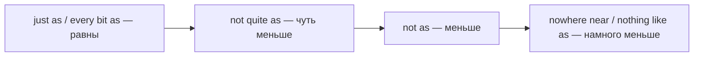

# Продвинутые сравнения — twice as, nowhere near, by far

> [!abstract] Коротко
> - Во сколько раз: `twice / three times as + adj + as` — `twice as expensive as`; `half as…as`.
> - Насколько далеко от равенства: `nowhere near / not nearly as…as` (далеко не), `nothing like as…as`, `just as`, `every bit as` (ничуть не менее).
> - Усиление превосходной: `by far the best`, `easily the biggest`, `the second largest`; а также `no + comparative + than`, `not so much X as Y`, `the + comparative of the two`.

<!-- beginner-intro:start -->
## Простыми словами

`Bigger`, `the biggest`, `as big as` — база. На C1 сравнения становятся **точнее и выразительнее**. Можно сказать не просто «дороже», а «вдвое дороже»: `twice as expensive as`. Не просто «не такой хороший», а «далеко не такой хороший»: `nowhere near as good as`. Не просто «лучший», а «безусловно лучший»: `by far the best`.

Есть и тонкие модели. `It's not so much a job as a hobby` — «Это не столько работа, сколько хобби». `He's no better than his brother` — «Он ничем не лучше брата». `She's the taller of the two` — «Она выше из двух» (с `the`, хотя это сравнительная степень). Такие модели часты в эссе, рецензиях и аргументации.

### Наглядная схема

Шкала «насколько не равны»:

## Правило и схема
<!-- beginner-intro:end -->

| Модель | Значение | Пример |
| --- | --- | --- |
| twice / three times as + adj + as | в два/три раза | The flat is **twice as big as** ours. |
| twice / three times + the + N + of | в … раз больше по | It's **three times the size of** London. |
| half as + adj + as | вдвое меньше | It's **half as expensive**. |
| just as / every bit as + adj + as | ничуть не менее | She's **every bit as talented as** him. |
| not quite as … as | чуть меньше | It's **not quite as good as** I expected. |
| nowhere near / not nearly / nothing like as … as | далеко не | It's **nowhere near as hard as** people say. |
| by far / easily / much + the + superlative | безусловно | **By far the best** option. |
| the second/third + superlative | второй по… | **the second largest** city |
| the + comparative + of the two | более … из двух | She's **the older of the two**. |
| no + comparative + than | ничуть не (так же) | He's **no better than** you. |
| not so much X as Y | не столько X, сколько Y | It was **not so much** a holiday **as** an adventure. |
| comparative + than + ever / expected / I thought | чем когда-либо / ожидалось | **better than ever** |
| as + adj + as possible / as can be | максимально | **as soon as possible** |
| more + adj + than + adj | скорее…, чем… | He was **more angry than upset**. |

<!-- beginner-examples:start -->
## Примеры с разбором

1. **Train tickets are three times as expensive as they were ten years ago.** — Билеты на поезд втрое дороже, чем десять лет назад.  
   **Разбор:** `число + times as … as` показывает кратность.
2. **The sequel is nowhere near as good as the original.** — Продолжение и близко не так хорошо, как оригинал.  
   **Разбор:** `nowhere near` сильно усиливает отрицательное сравнение.
3. **This is by far the most important decision of my life.** — Это безусловно самое важное решение в моей жизни.  
   **Разбор:** `by far` усиливает превосходную степень.
4. **It's not so much the money as the principle.** — Дело не столько в деньгах, сколько в принципе.  
   **Разбор:** `not so much X as Y` смещает акцент со второстепенного на главное.
<!-- beginner-examples:end -->

## Дополнительные примеры

- **Of the two candidates, she is the more experienced.** — Из двух кандидатов она более опытная.
- **The new model is every bit as reliable as the old one.** — Новая модель ничуть не менее надёжна, чем старая.
- **Birmingham is the second largest city in the UK.** — Бирмингем — второй по величине город Великобритании.

> [!warning] Частая ошибка
> **Twice as big as**, а не *two times bigger as* и не *twice bigger*. С `by far` нужно `the`: **by far the best**.

## Проверь себя

Сначала ответь сам, потом открой ответы: нажми на заголовок блока.

1. Переведи: «Этот дом вдвое больше нашего».
2. Переведи: «Экзамен был далеко не таким трудным, как я думал».
3. Перефразируй: *She is the best player in the team, and nobody is close.* (by far)
4. Вставь: Of the two brothers, Tom is ___ taller.
5. Перефразируй: *His car is not cheaper than mine at all.* (no)
6. Исправь ошибку: *This phone is two times more expensive as that one.*

> [!success]- Ответы и пояснения
> 1. **This house is twice as big as ours.** — `twice as … as`.
> 2. **The exam was nowhere near as difficult as I thought.** — или `not nearly as`.
> 3. **She is by far the best player in the team.** — `by far the + superlative`.
> 4. **the** — `the + comparative of the two`.
> 5. **His car is no cheaper than mine.** — `no + comparative`.
> 6. **This phone is twice as expensive as that one.** — `twice as … as`.

## Источники

- [Cambridge Dictionary — Comparison: comparisons of equality](https://dictionary.cambridge.org/grammar/british-grammar/comparison-comparisons-of-equality-as-tall-as-his-father)
- [Cambridge Dictionary — Comparison: clauses](https://dictionary.cambridge.org/grammar/british-grammar/comparison-clauses-bigger-than-we-had-imagined)
- [British Council — Modifying comparatives](https://learnenglish.britishcouncil.org/free-resources/grammar/b1-b2/modifying-comparatives)

---

[[139 - Количество и согласование C1 — a number of, the majority, plenty|← Предыдущая тема]] · [[000 - Оглавление|Оглавление]] · [[141 - Инфинитив и герундий C1 — to have done, his coming, it's no use|Следующая тема →]]
